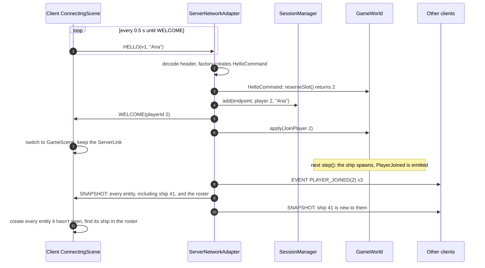
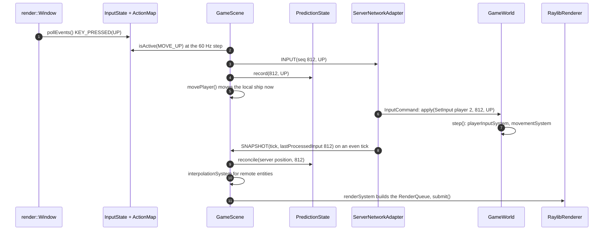
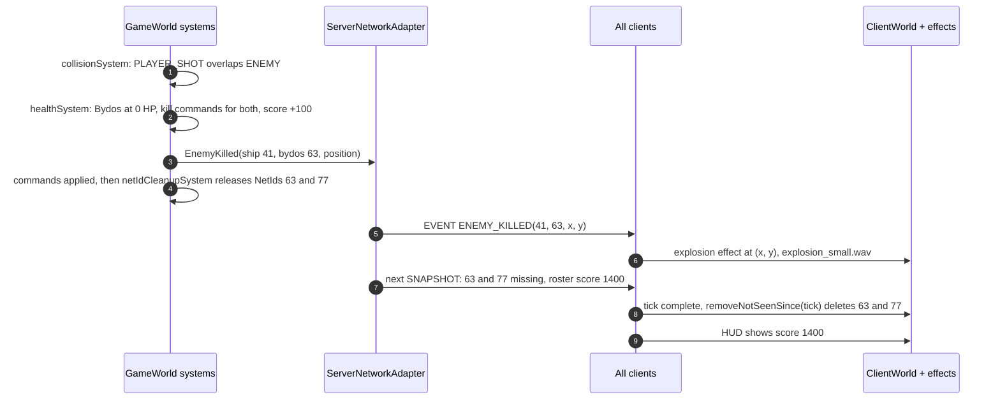
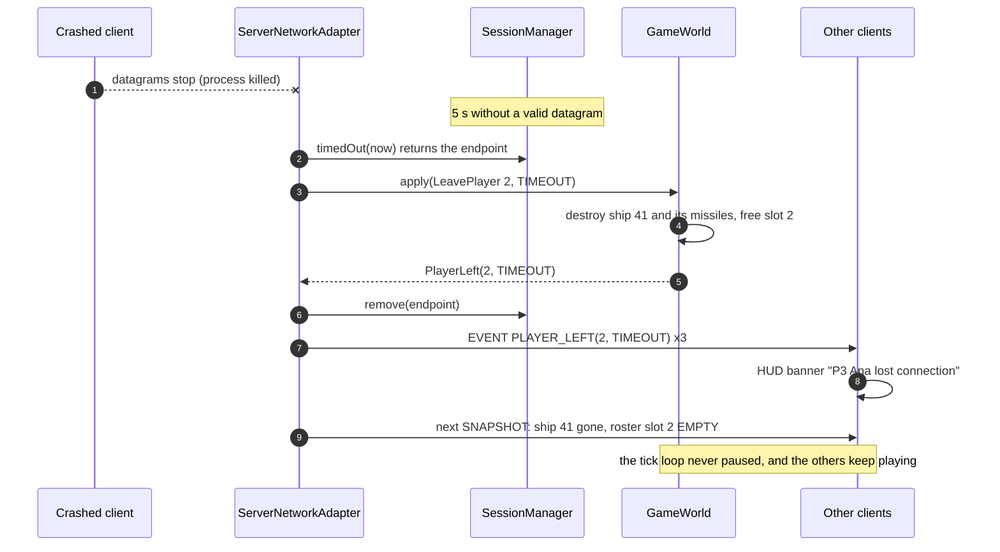

# How the modules work together

Four flows exercise every boundary in the architecture: joining a game, a key press reaching the screen, a Bydos being shot down, and a client crashing. In each diagram, "network" stands for `net::UdpSocket`, and only the adapters ever touch both protocol messages and game objects.

## Joining a game in progress

If WELCOME is lost, the client's next HELLO gets another one. If a snapshot is lost, the next one carries the same entities.

## From a key press to the screen

## A Bydos is shot down

If the EVENT is lost, the Bydos still disappears with the next complete snapshot, just without the explosion.

## A client crashes

## Who calls whom

| Caller | Callee | Through |
| --- | --- | --- |
| `ServerApp`, `ClientApp` | every module | Construction and wiring (composition roots) |
| `ServerNetworkAdapter` | `GameWorld` | `apply(PlayerCommand)`, `drainEvents()`, `collectReplicated()`, `roster()` |
| Both adapters | `rtype_protocol` | `Header` and message structs, read and written with `packet.read<T>()` and `packet << message` |
| Both adapters | `network` | `UdpSocket::sendTo`, `UdpSocket::receiveAll`, `net::Packet` |
| `GameWorld` systems | `engine_ecs` | `Registry` views, `commands()`, resources |
| Client `renderSystem` | `engine_render` | `RenderQueue::push`, `IRenderer::submit` |
| Client `GameScene` | `engine_input`, `engine_audio` | `ActionMap::isActive`, `IAudio::playSound` |
| Nothing | `GameWorld` → `network` or `render` | Forbidden by the [dependency rules](overview.md#dependency-rules) |
