# Kollection — Declarative UI Framework Architecture

**A Flutter-inspired, backend-agnostic UI framework in C++20**
**Target:** the UI of the project's second game, drawn through the shared `engine_render` (Raylib). Terminal and SDL backends stay in the design for later.
**Status:** Consolidated draft, revision 2. Fixes the bugs and inconsistencies of revision 1 (see [Appendix C](#appendix-c--changes-from-revision-1)) and marks the MVP scope.

> **Project name:** **Kollection**. Root namespace `kollection`, short alias `koll`.
> 
> **How to read this.** §1–§2 give the whole picture: the mental model, the four layers and the frame pipeline. §3–§6 describe the four layers in dependency order, each with one fully developed widget. §7 follows one running app through all four layers, frame by frame. §8–§10 cover cross-cutting concerns, decisions and the roadmap. Items marked **[MVP]** are the first deliverable. Items marked **[Later]** are designed but not built yet.

---

# 1. Overview and philosophy

## 1.1 Goal

Build UI the way Flutter does, with **declarative, composable, immutable descriptions**, and render it through a swappable backend. The same widget code can then drive a game window (through `engine_render`), and later a terminal (character cells) or a standalone SDL window. The core has no external dependencies. Only the backend leaves know about Raylib, SDL or the terminal.

## 1.2 The one-sentence mental model

> **You describe the UI as immutable widgets. The framework reconciles them into a persistent tree, lays it out, and paints it into abstract commands. A backend turns those commands into pixels or cells, and the host presents the result and feeds input back.**

Everything below elaborates on that sentence.

## 1.3 The four layers

| #   | Layer         | Namespace               | Responsibility                                                     | Depends on                 | Key output                |
| --- | ------------- | ----------------------- | ------------------------------------------------------------------ | -------------------------- | ------------------------- |
| 1   | **Widget**    | `kollection::widget`    | Describe *what* the UI is (immutable tree)                         | `core`                     | Widget tree               |
| 2   | **Framework** | `kollection::framework` | Reconcile → layout → paint → hit-test → focus                      | 1, `core`, `paint`         | Paint-command list        |
| 3   | **Platform**  | `kollection::platform`  | Own the window or terminal and the event loop, or adapt the host's | 2 (the `Surface` contract) | Size in, events in        |
| 4   | **Backend**   | `kollection::backend`   | Rasterize commands, then present                                   | `paint`, `core`            | Pixels or cells on screen |

In the game, layers 3 and 4 collapse into a single adapter, `backend::raylib::RaylibSurface`. The game owns the window and the loop already (§5.2).

## 1.4 The frame pipeline

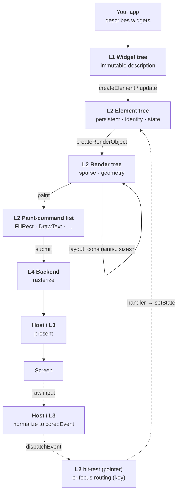

Solid arrows are the **display path**, run once per frame that has dirty work. Dotted arrows are the **event path**, run on each input. The loop closes when a handler calls `setState`: that marks an element dirty, and the next frame picks it up.

## 1.5 Core invariants (hold across all layers)

1. **Widgets are immutable and short-lived.** They hold configuration only and are rebuilt constantly. A widget never holds state that must survive a rebuild.
2. **Mutable state lives in the element tree**, in `State` objects the framework keeps alive across rebuilds, never on a widget.
3. **Three widget categories, no fourth:** *composition* (builds into other widgets, has no render node), *render* (owns a render node), *proxy* (passes one child through and injects ambient data or parent data; `InheritedWidget` is a proxy).
4. **One element per mounted widget. The render tree is sparse:** only render widgets contribute render nodes, and layout and paint traverse only those.
5. **Work is dirty-driven and batched.** Nothing rebuilds, re-lays-out or repaints unless it is marked dirty. One frame flushes each dirty set once, in dependency order.
6. **Phases don't interleave.** Build fully settles the trees, then layout runs, then paint. A node is never painted before it is laid out, and no element is destroyed while a phase still holds a pointer to it.
7. **The core names no backend.** Backend neutrality rests on three things: layout is *unit-agnostic* (1 unit = 1 cell or 1 logical pixel), paint is an *abstract command list* the backend replays, and text is measured through the `TextMeasurer` interface the backend provides.

---

# 2. Layer map and contracts

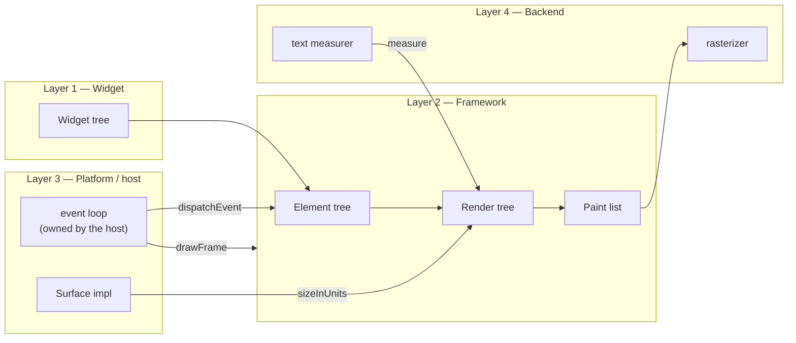

## 2.1 Namespace map

The root namespace is `kollection`, with one sub-namespace per layer plus two shared vocabularies that no single layer owns.

| Namespace                     | Layer          | Contents                                                                                                                                                                                                         |
| ----------------------------- | -------------- | ---------------------------------------------------------------------------------------------------------------------------------------------------------------------------------------------------------------- |
| `kollection::core`            | shared         | Value types every layer uses: `Size`, `Offset`, `Rect`, `EdgeInsets`, `Color`, `TextStyle`, `TextRun`, `WidgetKey`, `BoxConstraints`, `Alignment`, `KeyCode`, `KeyEvent`, `PointerEvent`, `ResizeEvent`, `Event` |
| `kollection::widget`          | L1             | `Widget`, `StatelessWidget`, `StatefulWidget`, `RenderWidget` (+ leaf/single/multi), `ProxyWidget`, `InheritedWidget`, `StateBase`, `State<W>`, and every concrete widget                                        |
| `kollection::framework`       | L2             | `Element` (+ families), `BuildContext`, `RenderObject` (+ subclasses), `ParentData`, `Pipeline`, `HitTestResult`, `FocusNode`, `FocusManager`, `Surface`, `TextMeasurer`                                         |
| `kollection::paint`           | L2↔L4 contract | The paint commands, `PaintCommand`, `PaintList`, `PaintContext`                                                                                                                                                  |
| `kollection::platform`        | L3             | `Platform` (standalone loop + `waitEvent`), `run()`                                                                                                                                                              |
| `kollection::platform::term`  | L3 [Later]     | `TerminalPlatform`, the raw-input parser                                                                                                                                                                         |
| `kollection::platform::sdl`   | L3 [Later]     | `SdlPlatform`                                                                                                                                                                                                    |
| `kollection::backend::raylib` | L3+L4 [MVP]    | `RaylibSurface` (adapter over `engine::render` and `engine::input`)                                                                                                                                              |
| `kollection::backend::term`   | L4 [Later]     | `TerminalBackend`, `Cell`, the ANSI differ                                                                                                                                                                       |
| `kollection::backend::sdl`    | L4 [Later]     | `SdlBackend`, `FontCache`                                                                                                                                                                                        |

Conventions:

- Use C++17 nested syntax (`namespace kollection::widget { … }`).
- Never write `using namespace` in a header. Inside `kollection`, headers write `core::Size` or bring single names in with `using core::Size;`.
- Application code opts in with a short alias:

```cpp
namespace koll = kollection;
using namespace kollection::widget;   // app code only: widget names read best unqualified
```

**Two shared vocabularies, deliberately not owned by a layer.**

- `core` holds the value types. If they lived in `widget`, then `framework`, `platform` and `backend` would all depend on L1 just to name a `Size`.
- `paint` holds the command list. It is the L2→L4 contract, so giving it its own namespace makes the dependency explicit: `backend` includes `paint`, never `framework`.

**No clash with the game engine.** The repo already has a top-level `::engine` namespace. That's why L2 is called `framework` (Flutter uses the same name for this layer). Only `backend::raylib` includes `engine/...` headers. From inside `kollection`, always refer to it as `::engine::render::…`.

**On the widget↔framework cycle.** `widget::Widget::createElement()` returns a `framework::Element`, and `framework::Element` holds a `widget::WidgetPtr`. That mutual reference is fine. Break it with forward declarations at namespace scope in the headers, and include the full definitions only in the `.cpp` files:

```cpp
namespace kollection::framework {
class Element;
class RenderObject;
class BuildContext;
}

namespace kollection::widget {
// … uses framework::Element by pointer / unique_ptr only
}
```

Namespaces don't create cycles. Headers do.

## 2.2 The seam that keeps L3/L4 small — `Surface` and `TextMeasurer`

Both are defined by the framework and implemented by a backend:

```cpp
namespace kollection::framework {

struct TextMeasurer {
    virtual core::Size measure(const core::TextRun& run) = 0;  // cells, or logical px
    virtual ~TextMeasurer() = default;
};

struct Surface {
    virtual core::Size sizeInUnits() = 0;                       // cells, or logical px
    virtual TextMeasurer& textMeasurer() = 0;
    virtual void submit(const paint::PaintList& commands) = 0;  // hand the frame to the backend
    virtual ~Surface() = default;
};

}
```

- **Down:** the pipeline asks the surface for its size (the root constraints), measures text through it during layout, and hands it a `PaintList` each frame.
- **Up:** the host's loop calls `pipeline.dispatchEvent(event)` and `pipeline.drawFrame()`.
- **Loop ownership:** the **host owns the loop** and calls into the pipeline, which never blocks. In standalone mode the host is a `Platform` (§5.3). Embedded in the game, the host is the game's own frame loop (§5.2).
- `submit` means "here is this frame's UI". Who presents is up to the host. A standalone platform presents right away. The Raylib adapter queues the commands and the game presents them together with the rest of its frame.

---

# 3. Layer 1 — Widget layer

## 3.1 Taxonomy

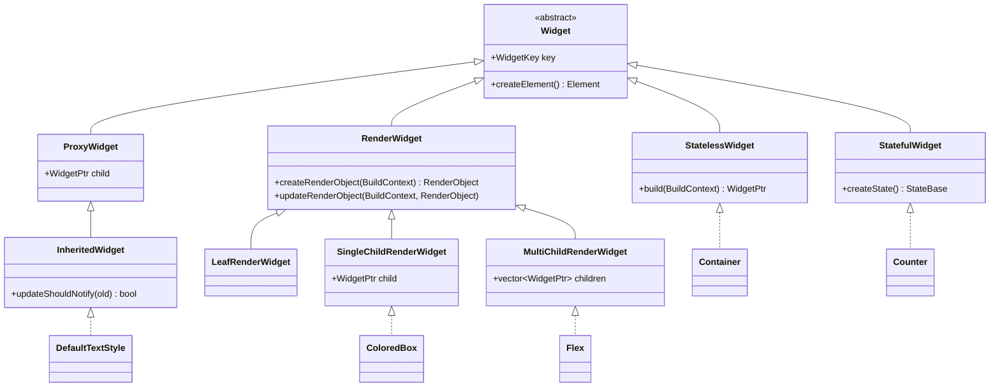

| Kind                      | Render node? | `build`?          | Example developed here              |
| ------------------------- | ------------ | ----------------- | ----------------------------------- |
| `StatelessWidget`         | no           | yes → subtree     | **Container** (§3.5)                |
| `StatefulWidget`          | no           | yes (via `State`) | **Counter** (§3.6), `Button` (§4.8) |
| `InheritedWidget`         | no (proxy)   | no                | `DefaultTextStyle` (§3.7)           |
| `SingleChildRenderWidget` | yes          | no                | **ColoredBox** (§4.6)               |
| `LeafRenderWidget`        | yes          | no                | `Paragraph` (§3.8)                  |
| `MultiChildRenderWidget`  | yes          | no                | `Row` / `Column` (§4.6.4)           |

## 3.2 Base classes

```cpp
namespace kollection::framework {
class Element;
class RenderObject;
class BuildContext;
}

namespace kollection::widget {

class Widget;
class StateBase;

// Widgets are shared, immutable and short-lived. An element keeps its current
// widget alive by holding this pointer. The old widget is freed when the
// element is updated with a new one (§8.2).
using WidgetPtr = std::shared_ptr<const Widget>;

class Widget {
public:
    explicit Widget(core::WidgetKey key = {}) : key_(std::move(key)) {}
    virtual ~Widget() = default;

    virtual std::unique_ptr<framework::Element> createElement(WidgetPtr self) const = 0;
    const core::WidgetKey& key() const { return key_; }

    // Reuse-vs-replace predicate driving reconciliation (§4.4).
    static bool canUpdate(const Widget& a, const Widget& b) {
        return typeid(a) == typeid(b) && a.key_ == b.key_;
    }

private:
    core::WidgetKey key_;
};

class StatelessWidget : public Widget {
public:
    using Widget::Widget;
    virtual WidgetPtr build(framework::BuildContext&) const = 0;
    std::unique_ptr<framework::Element> createElement(WidgetPtr self) const override;  // → StatelessElement
};

class StatefulWidget : public Widget {
public:
    using Widget::Widget;
    virtual std::unique_ptr<StateBase> createState() const = 0;
    std::unique_ptr<framework::Element> createElement(WidgetPtr self) const override;  // → StatefulElement
};

class RenderWidget : public Widget {
public:
    using Widget::Widget;
    virtual std::unique_ptr<framework::RenderObject> createRenderObject(framework::BuildContext&) const = 0;
    virtual void updateRenderObject(framework::BuildContext&, framework::RenderObject&) const = 0;
};

class LeafRenderWidget : public RenderWidget {
public:
    using RenderWidget::RenderWidget;
    std::unique_ptr<framework::Element> createElement(WidgetPtr self) const override;  // → LeafRenderElement
};

class SingleChildRenderWidget : public RenderWidget {
public:
    SingleChildRenderWidget(WidgetPtr child, core::WidgetKey key)
        : RenderWidget(std::move(key)), child_(std::move(child)) {}
    const WidgetPtr& child() const { return child_; }
    std::unique_ptr<framework::Element> createElement(WidgetPtr self) const override;  // → SingleChildRenderElement
private:
    WidgetPtr child_;
};

class MultiChildRenderWidget : public RenderWidget {
public:
    MultiChildRenderWidget(std::vector<WidgetPtr> children, core::WidgetKey key)
        : RenderWidget(std::move(key)), children_(std::move(children)) {}
    const std::vector<WidgetPtr>& children() const { return children_; }
    std::unique_ptr<framework::Element> createElement(WidgetPtr self) const override;  // → MultiChildRenderElement
private:
    std::vector<WidgetPtr> children_;
};

class ProxyWidget : public Widget {
public:
    ProxyWidget(WidgetPtr child, core::WidgetKey key)
        : Widget(std::move(key)), child_(std::move(child)) {}
    const WidgetPtr& child() const { return child_; }
private:
    WidgetPtr child_;
};

class InheritedWidget : public ProxyWidget {
public:
    using ProxyWidget::ProxyWidget;
    virtual bool updateShouldNotify(const InheritedWidget& old) const = 0;
    std::unique_ptr<framework::Element> createElement(WidgetPtr self) const override;  // → InheritedElement
};

// Builds a widget and returns it as a WidgetPtr: the only way widgets are created.
template <class T>
WidgetPtr make(typename T::Config config) {
    return std::make_shared<const T>(std::move(config));
}

}
```

`createElement` receives `self`, the `shared_ptr` that owns this widget, so the element can hold it. Children are stored privately and read through `child()` / `children()`, so a widget can't be changed after it is constructed (invariant #1).

## 3.3 Why a nested `Config` struct (construction DSL)

C++20 designated initializers (`{ .padding = … }`) need an **aggregate**: no user-declared constructors, no virtual functions, no virtual or non-public bases. Every widget is polymorphic, so a widget class can't be an aggregate, and `Container{ .padding = … }` won't compile.

The fix is a nested plain `Config` struct, an aggregate you *can* initialize that way. **Every concrete widget follows the same rule:**

- It declares `struct Config { …; core::WidgetKey key{}; }` with its child or children inside the `Config`.
- It has exactly one constructor, `explicit T(Config c)`, which passes `c.key` (and the child, for render and proxy widgets) to the base class, validates, and stores the rest as `cfg_`.
- It is built with `make<T>({ … })` and never constructed directly.

```cpp
make<Container>({ .padding = EdgeInsets::all(1), .color = Color::Blue, .child = text("Hi") })
```

Composition uses **free functions** so the tree reads as nested calls: `column({ text("a"), row({ text("b"), text("c") }) })`. A pipe operator for decoration (`text("x") | bold | pad(1)`) is a later, independent addition [Later].

## 3.4 Value types (`kollection::core`)

**Rule for optional fields:** a field that can be "not set" is a `std::optional`. Sentinel values like "alpha 0 means unset" are not used, because transparent is a real colour.

```cpp
namespace kollection::core {

inline constexpr double INF = std::numeric_limits<double>::infinity();

struct Size   { double w = 0, h = 0;  bool operator==(const Size&) const = default; };
struct Offset { double x = 0, y = 0;  bool operator==(const Offset&) const = default;
                Offset operator+(Offset o) const { return {x + o.x, y + o.y}; }
                Offset operator-(Offset o) const { return {x - o.x, y - o.y}; } };
struct Rect   { double x = 0, y = 0, w = 0, h = 0;
                bool contains(Offset p) const { return p.x >= x && p.y >= y && p.x < x + w && p.y < y + h; } };

struct EdgeInsets {
    double l = 0, t = 0, r = 0, b = 0;
    static EdgeInsets all(double v) { return {v, v, v, v}; }
    static EdgeInsets symmetric(double h, double v) { return {h, v, h, v}; }
    double hor() const { return l + r; }
    double ver() const { return t + b; }
    bool operator==(const EdgeInsets&) const = default;
};

struct Color {
    std::uint8_t r = 0, g = 0, b = 0, a = 255;
    bool operator==(const Color&) const = default;
    static const Color Black, White, Blue, Transparent;
};

// -1..1 on each axis: (-1,-1) is top-left, (0,0) is centre, (1,1) is bottom-right.
struct Alignment {
    double x = 0, y = 0;
    static constexpr Alignment center()  { return {0, 0}; }
    static constexpr Alignment topLeft() { return {-1, -1}; }
    Offset inscribe(Size child, Size parent) const {
        return { (parent.w - child.w) * (x + 1) / 2, (parent.h - child.h) * (y + 1) / 2 };
    }
    bool operator==(const Alignment&) const = default;
};

struct TextStyle {
    std::optional<Color>  fg, bg;
    std::optional<double> size;         // logical px; ignored by the terminal backend
    std::optional<bool>   bold, underline;
    std::optional<int>    font;         // backend font id; unset = default font
    bool operator==(const TextStyle&) const = default;
    TextStyle merge(const TextStyle& o) const;   // fields set in o win
};

struct TextRun { std::string text; TextStyle style;  bool operator==(const TextRun&) const = default; };

// Widget identity for reconciliation. Empty means "no key".
struct WidgetKey {
    std::variant<std::monostate, std::int64_t, std::string> value;
    bool operator==(const WidgetKey&) const = default;
};

}
```

`BoxConstraints` is in §4.6.1, and the event types are in §5.1. Both are in `core` too.

## 3.5 CONCRETE — `Container` (stateless)

`Container` owns no render node. All it does is wrap its child in render primitives, depending on which fields are set. It is the textbook proof of invariant #3.

```cpp
struct Container : StatelessWidget {
    struct Config {
        std::optional<core::Alignment>      alignment;
        std::optional<core::EdgeInsets>     padding;
        std::optional<core::Color>          color;
        std::optional<core::BoxConstraints> constraints;   // width/height fold in here
        std::optional<core::EdgeInsets>     margin;
        WidgetPtr                           child;
        core::WidgetKey                     key{};
        // reserved wrap positions, pixel-leaning [Later]: decoration, clip, transform
    };
    explicit Container(Config c) : StatelessWidget(c.key), cfg_(std::move(c)) {}

    WidgetPtr build(framework::BuildContext&) const override {
        WidgetPtr current = cfg_.child;

        const bool tight = cfg_.constraints && cfg_.constraints->isTight();
        if (!current && !tight)
            current = make<ConstrainedBox>({ .constraints = core::BoxConstraints::expand() });
        else if (current && cfg_.alignment)
            current = make<Align>({ .alignment = *cfg_.alignment, .child = current });

        if (cfg_.padding)
            current = make<Padding>({ .padding = *cfg_.padding, .child = current });
        if (cfg_.color)
            current = make<ColoredBox>({ .color = *cfg_.color, .child = current });
        if (cfg_.constraints)
            current = make<ConstrainedBox>({ .constraints = *cfg_.constraints, .child = current });
        if (cfg_.margin)
            current = make<Padding>({ .padding = *cfg_.margin, .child = current });

        return current;   // the outermost wrapper is applied last
    }

private:
    Config cfg_;
};
```

Expanding `Container({ .padding = all(1), .color = Blue, .child = text("Hi") })` gives:

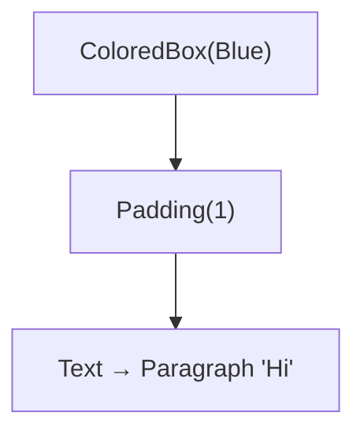

A bare `Container({ .color = Blue, .child })` collapses to just `ColoredBox → child`: a wrapper appears only when its field is set. A `Container` with no child fills the space its parent allows, in each axis where that space is finite (§4.6.3).

## 3.6 CONCRETE — `Counter` (stateful)

The state lives in `CounterState`, not in the widget. `setState` changes a field and marks the element dirty. The framework keeps the state object across rebuilds.

```cpp
struct Counter : StatefulWidget {
    struct Config { int start = 0; core::WidgetKey key{}; };
    explicit Counter(Config c) : StatefulWidget(c.key), cfg_(std::move(c)) {}
    const Config& config() const { return cfg_; }
    std::unique_ptr<StateBase> createState() const override;
private:
    Config cfg_;
};

class CounterState : public State<Counter> {
    int count_ = 0;
public:
    void initState() override { count_ = widget().config().start; }   // once, on mount

    WidgetPtr build(framework::BuildContext&) override {
        // Listener is a render widget that forwards hit-tested pointer events (§4.7).
        return make<Listener>({
            .onPointerDown = [this](const core::PointerEvent&) {
                setState([&] { count_++; });          // change + mark dirty
            },
            .child = make<Container>({
                .padding = core::EdgeInsets::all(1),
                .color   = core::Color::Blue,
                .child   = text("Count: " + std::to_string(count_)),
            }),
        });
    }
};

std::unique_ptr<StateBase> Counter::createState() const {
    return std::make_unique<CounterState>();
}
```

Capturing `this` in the callback is safe. The `RenderListener` that stores the callback is owned by an element *below* `CounterState`'s element, so it is always destroyed first (§4.4.4).

## 3.7 `DefaultTextStyle` (inherited) — ambient data

Ambient data (default text style, theme, surface size) must not be passed through every constructor, and must not be a global or a mutable field. It flows through **inherited widgets**, read with `T::of(context)`. That call finds the nearest ancestor of type `T` **and** subscribes the caller to its changes (§4.5).

```cpp
struct DefaultTextStyle : InheritedWidget {
    struct Config { core::TextStyle style; WidgetPtr child; core::WidgetKey key{}; };
    explicit DefaultTextStyle(Config c)
        : InheritedWidget(std::move(c.child), c.key), style_(std::move(c.style)) {}

    bool updateShouldNotify(const InheritedWidget& old) const override {
        return style_ != static_cast<const DefaultTextStyle&>(old).style_;
    }
    static core::TextStyle of(framework::BuildContext& ctx) {
        const auto* w = ctx.dependOnInheritedOfType<DefaultTextStyle>();
        return w ? w->style_ : core::TextStyle{};
    }
private:
    core::TextStyle style_;
};
```

## 3.8 `Text` / `Paragraph`

`Text` is a **composition** widget, not a leaf (as in Flutter, where `Text.build()` returns a `RichText`). It resolves the ambient style, then builds the render leaf `Paragraph`:

```cpp
struct Text : StatelessWidget {
    struct Config { std::string content; core::TextStyle style{}; core::WidgetKey key{}; };
    explicit Text(Config c) : StatelessWidget(c.key), cfg_(std::move(c)) {}

    WidgetPtr build(framework::BuildContext& ctx) const override {
        core::TextStyle effective = DefaultTextStyle::of(ctx).merge(cfg_.style);
        return make<Paragraph>({ .run = core::TextRun{cfg_.content, effective} });
    }
private:
    Config cfg_;
};

inline WidgetPtr text(std::string s) { return make<Text>({ .content = std::move(s) }); }
```

`Paragraph : LeafRenderWidget` creates a `RenderParagraph`. Its layout asks the pipeline's `TextMeasurer` for the run's size and constrains it. Its paint emits one `DrawText`. Line wrapping is [Later]: in the MVP a paragraph is a single line.

---

# 4. Layer 2 — Framework

## 4.1 The bridge: `createElement()`

Each widget kind creates its matching element. This is the only structural link between the two trees.

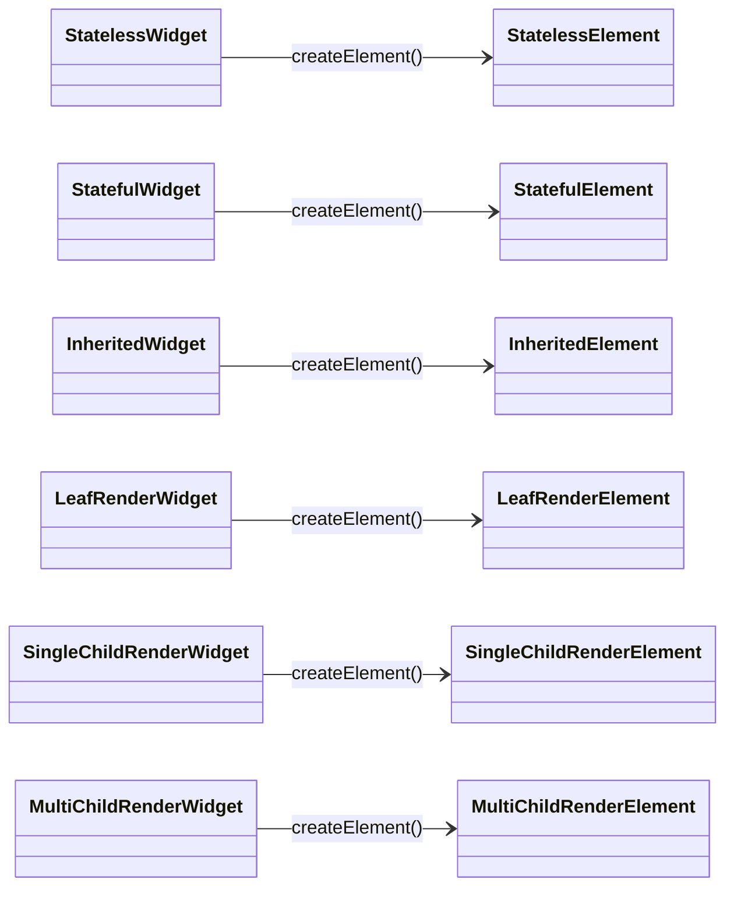

Families: `ComponentElement` (base of `StatelessElement`, `StatefulElement` and `ProxyElement`; one child, no render object), `InheritedElement : ProxyElement`, and `RenderObjectElement` (base of the three render-element kinds; owns one render object).

## 4.2 Element base

```cpp
namespace kollection::framework {

class BuildContext {
public:
    template <class T> const T* dependOnInheritedOfType();   // find + subscribe (§4.5)
    virtual ~BuildContext() = default;
};

class Element : public BuildContext {
public:
    enum class Life { Initial, Active, Inactive, Defunct };

    Element(widget::WidgetPtr w) : widget_(std::move(w)) {}

    virtual void mount(Element* parent);                // first insertion
    virtual void update(widget::WidgetPtr newWidget);    // canUpdate matched: swap + rebuild
    virtual void deactivate();                          // detached from the tree, not yet destroyed
    virtual void unmount();                             // permanent removal, just before destruction
    virtual void performRebuild() = 0;                  // family-specific

    void rebuild();                                     // runs performRebuild if Active and dirty
    void markNeedsBuild();                              // → pipeline dirty list

    int depth() const { return depth_; }
    bool mounted() const { return life_ == Life::Active; }
    const widget::Widget& widget() const { return *widget_; }

    // Nearest render object at or below this element (its own, or its child's).
    virtual RenderObject* renderObject() = 0;

protected:
    // The reconciliation primitive (§4.4).
    std::unique_ptr<Element> updateChild(std::unique_ptr<Element> child, widget::WidgetPtr newWidget);

    widget::WidgetPtr widget_;                // keeps the current config alive
    Element*  parent_ = nullptr;
    Pipeline* owner_  = nullptr;              // copied from the parent on mount
    int       depth_  = 0;                    // orders the build pass
    bool      dirty_  = true;
    bool      inDirtyList_ = false;
    Life      life_   = Life::Initial;

    std::unordered_set<InheritedElement*> deps_;   // inherited elements this one reads
};

}
```

**Ownership.** Each element owns its children (`std::unique_ptr<Element>`), and the pipeline owns the root. Raw `Element*` pointers (`parent_`, the dirty list, `deps_`) are only safe because destruction is deferred to the end of the build phase (§4.4.4).

## 4.3 Element lifecycle · an element *is* the `BuildContext`

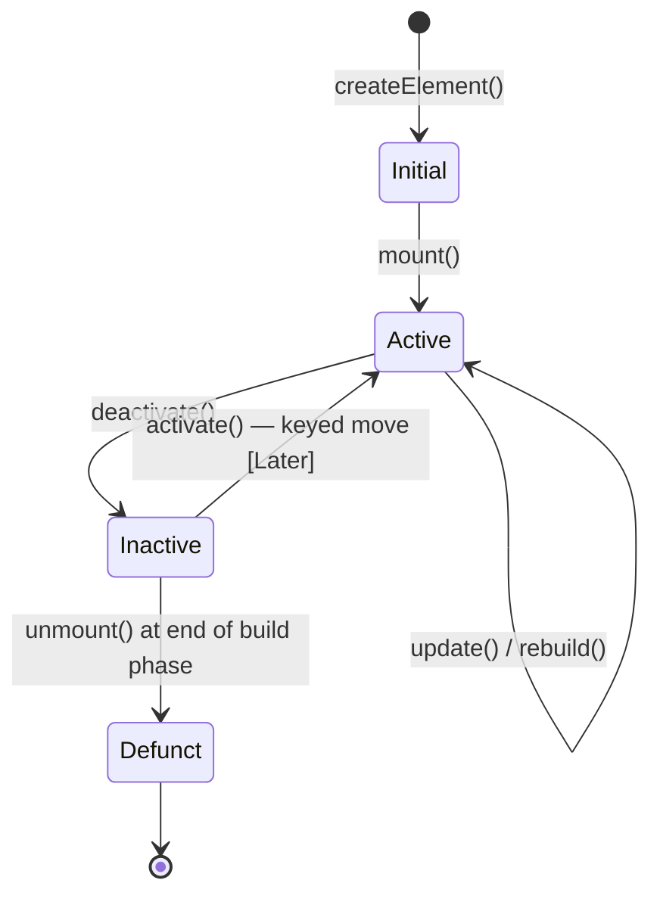

`build(context)` receives the element itself. That's why `DefaultTextStyle::of(context)` can find its position in the tree: the context is a live handle into the element tree.

## 4.4 Reconciliation

### 4.4.1 `updateChild`

Every parent–child link is maintained by one function:

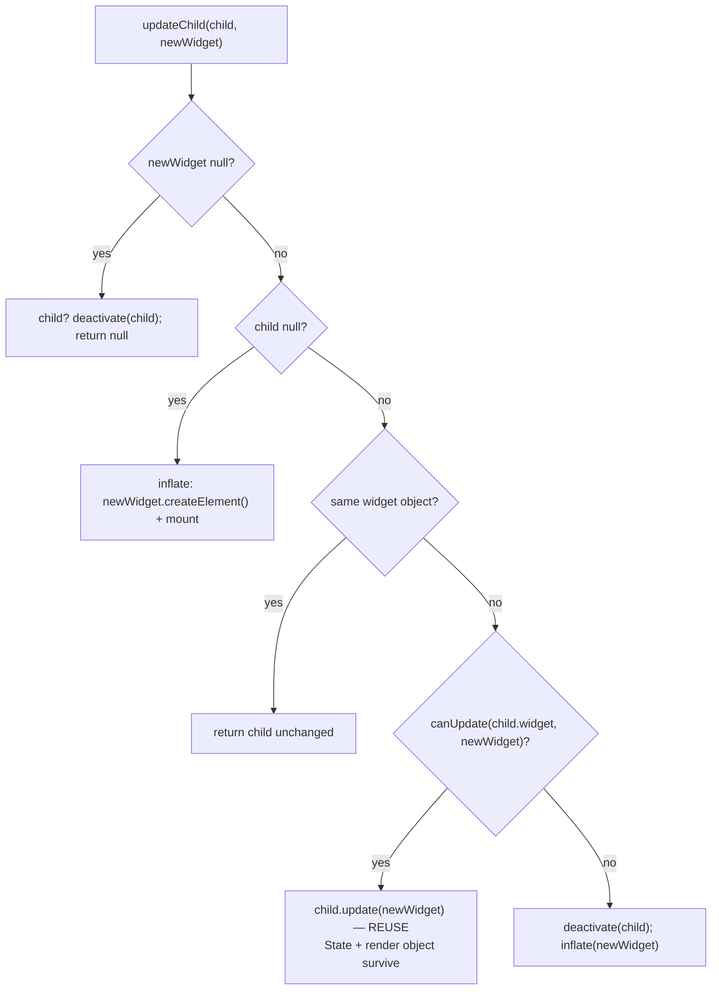

```cpp
std::unique_ptr<Element> Element::updateChild(std::unique_ptr<Element> child, widget::WidgetPtr w) {
    if (!w) {
        if (child) owner_->deactivate(std::move(child));
        return nullptr;
    }
    if (child) {
        if (child->widget_ == w) return child;
        if (widget::Widget::canUpdate(*child->widget_, *w)) {
            child->update(std::move(w));
            return child;
        }
        owner_->deactivate(std::move(child));
    }
    auto fresh = w->createElement(w);
    fresh->mount(this);
    return fresh;
}
```

`Pipeline::deactivate` calls `deactivate()` on the subtree (which detaches its render objects from the render tree) and parks the `unique_ptr` in the pipeline's inactive list. The element is unmounted and destroyed at the end of the build phase, not right away.

### 4.4.2 The dirty build pass

`markNeedsBuild()` adds the element to the pipeline's dirty list once (guarded by `inDirtyList_`). `flushBuild()` rebuilds dirty elements **shallowest first**, because a parent's rebuild may remove or rebuild a child. Rebuilding can dirty more elements (an inherited widget notifying its dependents), so the loop goes by index and re-sorts when the list grows:

```cpp
void Pipeline::flushBuild() {
    auto byDepth = [](Element* a, Element* b) { return a->depth() < b->depth(); };
    std::sort(dirty_.begin(), dirty_.end(), byDepth);
    for (std::size_t i = 0; i < dirty_.size(); ++i) {
        std::size_t before = dirty_.size();
        dirty_[i]->rebuild();
        if (dirty_.size() != before)
            std::sort(dirty_.begin() + i + 1, dirty_.end(), byDepth);
    }
    for (Element* e : dirty_) e->inDirtyList_ = false;
    dirty_.clear();
    finalizeTree();   // unmount + destroy everything deactivated during this pass
}
```

`rebuild()` skips elements that aren't `Active`. Because of the deferred destruction, a dirty element whose parent removed it during this pass is still a valid object, just `Inactive`.

### 4.4.3 `State<W>`

`State` lives on the `StatefulElement`. The framework keeps it across rebuilds and points it at the new widget on each update:

```cpp
namespace kollection::widget {

class StateBase {
public:
    virtual ~StateBase() = default;
    virtual void initState() {}
    virtual void didUpdateWidget(const Widget& oldWidget) {}
    virtual void didChangeDependencies() {}      // an inherited dependency changed
    virtual void dispose() {}                    // once, on unmount
    virtual WidgetPtr build(framework::BuildContext&) = 0;

    bool mounted() const;
    void setState(const std::function<void()>& fn);   // fn(); then markNeedsBuild if mounted

protected:
    const Widget& baseWidget() const { return *widget_; }

private:
    framework::StatefulElement* element_ = nullptr;
    WidgetPtr widget_;
    friend class framework::StatefulElement;
};

template <class W>
class State : public StateBase {
public:
    const W& widget() const { return static_cast<const W&>(baseWidget()); }
};

}
```

```cpp
namespace kollection::framework {

class StatefulElement : public ComponentElement {
public:
    using ComponentElement::ComponentElement;

    void mount(Element* parent) override {
        Element::mount(parent);
        state_ = static_cast<const widget::StatefulWidget&>(*widget_).createState();
        state_->element_ = this;
        state_->widget_  = widget_;
        state_->initState();
        state_->didChangeDependencies();
        rebuild();
    }
    void update(widget::WidgetPtr w) override {
        widget::WidgetPtr old = std::exchange(widget_, std::move(w));
        state_->widget_ = widget_;
        state_->didUpdateWidget(*old);
        dirty_ = true;
        rebuild();
    }
    void unmount() override {
        state_->dispose();
        state_->element_ = nullptr;
        Element::unmount();
    }
    void performRebuild() override {
        child_ = updateChild(std::move(child_), state_->build(*this));
    }

private:
    std::unique_ptr<widget::StateBase> state_;
};

}
```

That `update` is the core of stateful behaviour: the **widget** object is swapped, but `state_` (which holds `count_`) is untouched. So `count_` survives while the `Counter` widget around it is thrown away and rebuilt.

`setState` after `dispose()` is a no-op (`mounted()` is false). For example, a timer callback that fires after its screen closed does nothing.

### 4.4.4 Child lists (multi-child elements)

`MultiChildRenderElement::update` reconciles **by index** in the MVP: slot `i` of the old list is matched with slot `i` of the new list through `updateChild`. Extra old elements are deactivated, and extra new widgets are created. Afterwards the element sets its render object's child list again, in order. Keyed matching (so a moved child keeps its state) is [Later]. Until it lands, reordering a list rebuilds the moved children.

### 4.4.5 Destruction order

`finalizeTree()` unmounts each deactivated subtree **bottom-up**, calling `unmount()` on children before parents, and only then destroys it. So a `State`'s `dispose()` runs after every render object below it has been detached, and no callback registered by that state can be called later.

## 4.5 Inherited dependency propagation

`dependOnInheritedOfType<T>()` returns the nearest ancestor `T` **and** registers the caller as a dependent. When that inherited widget updates and `updateShouldNotify` returns true, every dependent is marked dirty and gets `didChangeDependencies()`.

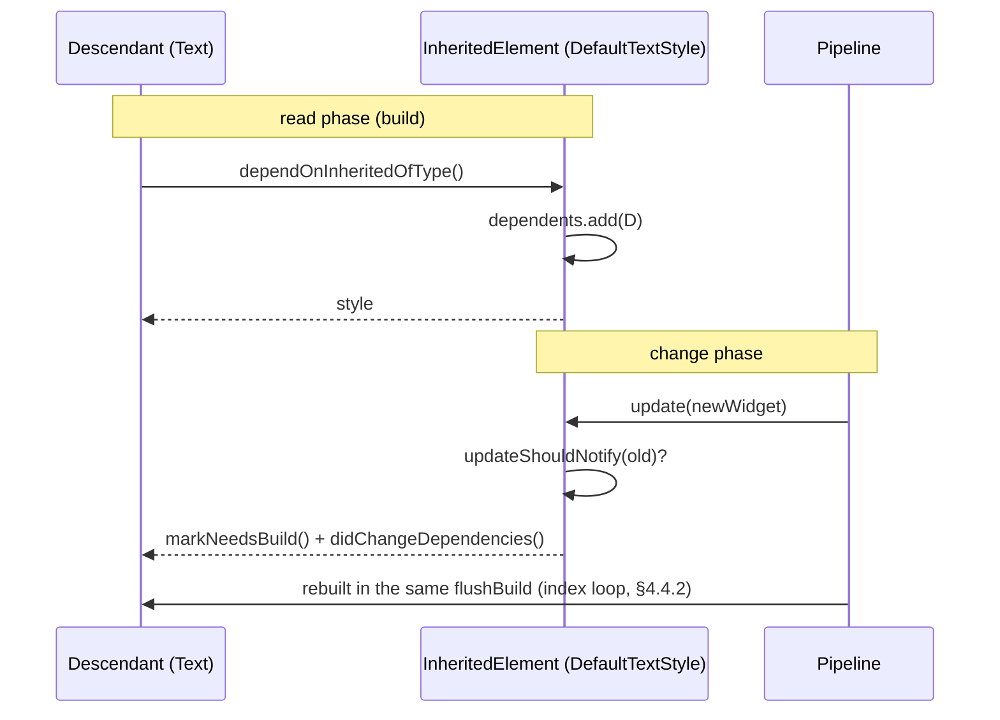

When a dependent is deactivated, it removes itself from each `InheritedElement` in its `deps_`.

**Lookup:** [MVP] walk up `parent_` until an `InheritedElement` whose widget's type is `T`. [Later] An O(1) map: each element shares its parent's `type → nearest InheritedElement` map by pointer, and each `InheritedElement` publishes a copy with itself added. Add it only if deep trees measure slow.

## 4.6 Render tree and layout

### 4.6.1 The protocol

**A parent gives a child `BoxConstraints`. The child returns a `Size` within them. The parent then positions the child** by writing an `Offset` into the child's `parentData`. Constraints flow down, sizes flow up, and positions are set by the parent.

```cpp
namespace kollection::core {

struct BoxConstraints {
    double minW = 0, maxW = INF, minH = 0, maxH = INF;

    static BoxConstraints tight(Size s)  { return {s.w, s.w, s.h, s.h}; }
    static BoxConstraints loose(Size s)  { return {0, s.w, 0, s.h}; }
    // "As big as the parent allows." Only meaningful once enforced against
    // the parent's constraints (ConstrainedBox does that, §4.6.3).
    static BoxConstraints expand()       { return {INF, INF, INF, INF}; }

    Size constrain(Size s) const {
        return { std::clamp(s.w, minW, maxW), std::clamp(s.h, minH, maxH) };
    }
    Size smallest() const { return constrain({0, 0}); }
    bool isTight() const { return minW == maxW && minH == maxH; }
    bool hasBoundedWidth() const  { return maxW < INF; }
    bool hasBoundedHeight() const { return maxH < INF; }

    BoxConstraints loosen() const { return {0, maxW, 0, maxH}; }
    BoxConstraints deflate(const EdgeInsets& e) const;    // subtract insets, never below 0
    // Clamp this into `parent`'s range: the result always satisfies `parent`.
    BoxConstraints enforce(const BoxConstraints& parent) const;

    bool operator==(const BoxConstraints&) const = default;
};

}
```

### 4.6.2 `RenderObject`

```cpp
namespace kollection::framework {

struct ParentData {                      // written by the parent
    core::Offset offset;
    virtual ~ParentData() = default;
};

class RenderObject {
public:
    virtual ~RenderObject() = default;

    void layout(const core::BoxConstraints& c);
    virtual void performLayout() = 0;                        // sets size_, lays out + positions children
    virtual void paint(paint::PaintContext& ctx, core::Offset origin) = 0;
    virtual bool hitTest(HitTestResult& result, core::Offset local);   // §4.7

    void markNeedsLayout();
    void markNeedsPaint();

    // Child management, called by render elements (§4.6.5).
    virtual void insertChild(RenderObject& child) = 0;
    virtual void removeChild(RenderObject& child) = 0;
    virtual void setupParentData(RenderObject& child);       // default: plain ParentData

    core::Size size() const { return size_; }
    ParentData& parentData() { return *parentData_; }

protected:
    void adoptChild(RenderObject& child);                    // sets parent_ + owner_ + parentData
    void dropChild(RenderObject& child);

    RenderObject*               parent_ = nullptr;
    Pipeline*                   owner_  = nullptr;
    std::unique_ptr<ParentData> parentData_;
    core::BoxConstraints        constraints_;
    core::Size                  size_;
    bool                        needsLayout_ = true;
    bool                        needsPaint_  = true;
};

void RenderObject::layout(const core::BoxConstraints& c) {
    if (!needsLayout_ && c == constraints_) return;
    constraints_ = c;
    performLayout();
    needsLayout_ = false;
    markNeedsPaint();
}

void RenderObject::markNeedsLayout() {
    if (needsLayout_) return;
    needsLayout_ = true;
    if (parent_) parent_->markNeedsLayout();            // no relayout boundaries yet (OQ-6)
    else if (owner_) owner_->requestLayout();
}

}
```

Without relayout boundaries, `markNeedsLayout` has to reach the root. Otherwise the root sees "clean, same constraints" and returns early, and the dirty child never lays out again. The memo in `layout()` is still useful: it skips the clean subtrees on the way back down.

`RenderObject` has two helper bases, so most render objects only override what makes them different:

- `RenderProxyBox`: one child. Passes constraints through, sizes to the child (or `constraints.smallest()` without one), paints and hit-tests the child at its own origin. `RenderColoredBox`, `RenderListener` and `RenderConstrainedBox` derive from it.
- `RenderBoxWithChildren`: holds a `std::vector<RenderObject*>` in order. `RenderFlex` derives from it.

Render objects are **owned by their element** (`std::unique_ptr<RenderObject>` in `RenderObjectElement`). The render tree links them with raw pointers only.

### 4.6.3 CONCRETE — `ColoredBox` and its render object

`ColoredBox` shows the whole render path: passing constraints through, sizing to its child, and emitting a paint command.

```cpp
struct ColoredBox : SingleChildRenderWidget {
    struct Config { core::Color color; WidgetPtr child; core::WidgetKey key{}; };
    explicit ColoredBox(Config c)
        : SingleChildRenderWidget(std::move(c.child), c.key), color_(c.color) {}

    std::unique_ptr<framework::RenderObject> createRenderObject(framework::BuildContext&) const override {
        return std::make_unique<framework::RenderColoredBox>(color_);
    }
    void updateRenderObject(framework::BuildContext&, framework::RenderObject& ro) const override {
        auto& r = static_cast<framework::RenderColoredBox&>(ro);
        if (r.color() != color_) r.setColor(color_);   // a colour change only needs a repaint
    }
private:
    core::Color color_;
};
```

```cpp
class RenderColoredBox : public RenderProxyBox {
public:
    explicit RenderColoredBox(core::Color c) : color_(c) {}
    core::Color color() const { return color_; }
    void setColor(core::Color c) { color_ = c; markNeedsPaint(); }

    void paint(paint::PaintContext& ctx, core::Offset origin) override {
        ctx.fillRect({origin.x, origin.y, size_.w, size_.h}, color_);
        RenderProxyBox::paint(ctx, origin);                 // child on top
    }
    // performLayout and hitTest come from RenderProxyBox.
private:
    core::Color color_;
};
```

`RenderProxyBox::performLayout` passes the constraints to the child unchanged, puts the child at `{0, 0}`, and takes the child's size. With no child it takes `constraints_.smallest()`. Taking "as big as allowed" instead would give an infinite size inside a `Row`/`Column`.

`RenderConstrainedBox` (behind `ConstrainedBox`, `SizedBox` and `Container`'s `constraints`) lays out its child with `additional.enforce(constraints_)`. When the result is still unbounded in an axis, as with `expand()` inside a `Column`, it uses the parent's minimum for that axis. So an empty `Container` fills whatever is finite and collapses to its minimum elsewhere, instead of becoming infinite.

**`RenderPadding`**, a render object with real geometry:

```cpp
void RenderPadding::performLayout() {
    if (!child_) {
        size_ = constraints_.constrain({insets_.hor(), insets_.ver()});
        return;
    }
    child_->layout(constraints_.deflate(insets_));
    child_->parentData().offset = {insets_.l, insets_.t};
    core::Size c = child_->size();
    size_ = constraints_.constrain({c.w + insets_.hor(), c.h + insets_.ver()});
}
```

`RenderAlign` lays out its child with `constraints_.loosen()`, sizes itself to the biggest bounded size (shrinking to the child in unbounded axes), and positions the child with `alignment.inscribe(child, size_)`.

### 4.6.4 Multi-child layout — `Row` / `Column` [MVP]

`Flex : MultiChildRenderWidget` has the fields `direction`, `mainAxisAlignment` (`start | center | end | spaceBetween`), `crossAxisAlignment` (`start | center | end | stretch`), `spacing`, `children` and `key`. `row({...})` and `column({...})` are free functions that build a `Flex` with `direction` set.

`RenderFlex::performLayout` (MVP, no flex factors):

1. Lay out each child with the cross axis bounded by the parent's maximum (tight when `stretch`) and the main axis unbounded.
2. Main size: the sum of the children's main sizes plus `spacing` between them, constrained. Cross size: the largest child, constrained.
3. Distribute the leftover main-axis space according to `mainAxisAlignment`. Place each child on the cross axis according to `crossAxisAlignment`. Write the offsets into each child's `ParentData`.

`FlexParentData : ParentData { int flex = 0; }` and the `Expanded` parent-data widget (a `ProxyWidget`) are [Next]. `RenderFlex::setupParentData` already installs `FlexParentData`, so adding them later won't change any interface.

### 4.6.5 Element ↔ render-object attachment

- **On mount**, a `RenderObjectElement` calls `createRenderObject`. It then finds its *ancestor render-object element* by walking `parent_` past component and proxy elements, which have none, and inserts its render object there with `insertChild`.
- **On update**, it calls `updateRenderObject`.
- **On deactivate**, it removes its render object from that ancestor with `removeChild`. The render object stays alive until the element is destroyed.
- A **component element's** `renderObject()` returns its child's. That's how a `RenderPadding` finds the `RenderParagraph` produced by a `Text` it never sees directly.

## 4.7 Hit-testing, `Listener`, and pointer dispatch

Hit-testing needs geometry, so it runs on the render tree. `Listener` is a render widget with no visuals that receives the pointer events found by hit-testing. This is how `Counter` gets clicks.

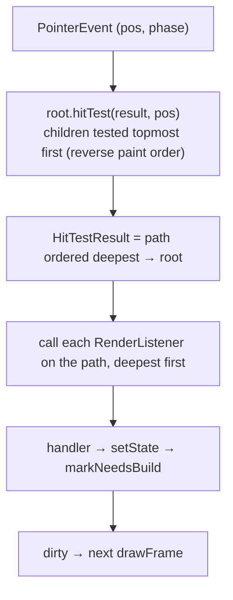

The default `RenderObject::hitTest`: if `local` is outside `{0, 0, size_}`, return false. Otherwise test the children in reverse order at `local - child.offset`, stop at the first one that returns true, then add `this` and return true. Because children add themselves before their parent, the result is ordered **deepest first**.

```cpp
struct Listener : SingleChildRenderWidget {
    struct Config {
        std::function<void(const core::PointerEvent&)> onPointerDown, onPointerUp, onPointerMove;
        WidgetPtr       child;
        core::WidgetKey key{};
    };
    explicit Listener(Config c);
    // createRenderObject → RenderListener (a RenderProxyBox) holding the callbacks.
    // updateRenderObject copies the callbacks again: they are new closures on every build.
};
```

Dispatch happens between frames, so nothing is built or destroyed while the `HitTestResult` holds raw pointers to render objects.

## 4.8 Focus and keyboard routing [MVP]

Game menus are driven by keyboard and gamepad first. The host maps gamepad buttons to `KeyCode`s (D-pad → arrows, A → `Enter`, B → `Escape`), so the framework only ever sees keys.

```cpp
namespace kollection::framework {

enum class KeyResult { Handled, Ignored };

class FocusNode {
public:
    bool hasFocus() const;
    void requestFocus();
    std::function<KeyResult(const core::KeyEvent&)> onKey;
    std::function<void(bool)>                       onFocusChange;
};

class FocusManager {                     // owned by Pipeline
public:
    FocusNode* focused() const;
    void focus(FocusNode* node);         // calls onFocusChange on the old and new node
    void next();                         // tree order, wraps around
    void previous();
    KeyResult dispatch(const core::KeyEvent& ev);
};

}
```

- `widget::Focus` is a `StatefulWidget` (`onKey`, `onFocusChange`, `autofocus`, `child`). Its state owns a `FocusNode`, registers it on `initState`, and unregisters it on `dispose`.
- **Traversal order** is the depth-first order of `Focus` elements in the element tree. It is computed when focus has to move, which is cheap for a menu. Spatial (2D) navigation is [Later].
- **Dispatch:** the key event goes to the focused node's `onKey`, then to each enclosing `Focus` until one returns `Handled`. If nobody handles it: `Down`/`Tab` → `next()`, `Up`/`Shift+Tab` → `previous()`.
- If the focused node is unregistered, focus moves to the next node in traversal order, or to none.

**`Button`** [MVP] is a `StatefulWidget` (`onPressed`, `child`, `autofocus`) built from `Focus` + `Listener` + `Container`:

- Its state keeps `focused_` (set from `onFocusChange` with `setState`) and draws a different colour or outline when focused.
- `Enter` on the focused button, or pointer down then up inside it, calls `onPressed`.
- A pointer down also requests focus.

## 4.9 Painting and the paint-command vocabulary (the L4 contract)

`flushPaint()` walks the render tree. Each node paints itself and then its children at `origin + child.offset`, building an ordered `PaintList`. There are no repaint boundaries yet, so any `needsPaint_` repaints the whole tree. When nothing is dirty, the pipeline keeps the last `PaintList` (§5.2).

```cpp
namespace kollection::paint {

struct FillRect   { core::Rect rect; core::Color color; };
struct StrokeRect { core::Rect rect; core::Color color; double width; };
struct DrawText   { core::Offset at; core::TextRun run; };
struct DrawLine   { core::Offset a, b; core::Color color; double width; };   // [Later]
struct PushClip   { core::Rect rect; };                                      // [Later]
struct PopClip    {};                                                        // [Later]
struct PushTranslate { core::Offset by; };                                   // [Later]
struct PopTranslate  {};                                                     // [Later]

using PaintCommand = std::variant<FillRect, StrokeRect, DrawText,
                                  DrawLine, PushClip, PopClip, PushTranslate, PopTranslate>;
using PaintList = std::vector<PaintCommand>;

class PaintContext {
public:
    explicit PaintContext(PaintList& list) : list_(list) {}
    void fillRect(core::Rect r, core::Color c)                { list_.push_back(FillRect{r, c}); }
    void strokeRect(core::Rect r, core::Color c, double w)    { list_.push_back(StrokeRect{r, c, w}); }
    void drawText(core::Offset at, const core::TextRun& run)  { list_.push_back(DrawText{at, run}); }
    // drawLine, pushClip/popClip, pushTranslate/popTranslate [Later]
private:
    PaintList& list_;
};

}
```

The variant matches the game engine's `DrawCommand`, and it lets each command carry only its own fields. Full affine transforms are replaced by translation only. No planned widget needs rotation or scale, and the terminal can't do them anyway.

| Command                      | Raylib adapter [MVP]                     | Terminal [Later]               | SDL [Later]             |
| ---------------------------- | ---------------------------------------- | ------------------------------ | ----------------------- |
| `FillRect`                   | `RectCmd` with fill                      | cell background over region    | filled rect             |
| `StrokeRect`                 | `RectCmd` with outline only              | box-drawing border             | 4 lines                 |
| `DrawText`                   | `TextCmd`                                | glyphs into cells + attributes | SDL_ttf texture         |
| `DrawLine`                   | —                                        | box-drawing chars (H/V only)   | `SDL_RenderLine`        |
| `PushClip/PopClip`           | needs scissor support in `engine_render` | rectangular cell clip          | `SDL_SetRenderClipRect` |
| `PushTranslate/PopTranslate` | offset stack in the adapter              | integer offset stack           | offset stack            |

## 4.10 The frame pipeline

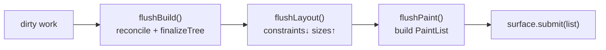

```cpp
class Pipeline {
public:
    Pipeline(Surface& surface, widget::WidgetPtr rootWidget);

    void dispatchEvent(const core::Event& ev);   // pointer → hit-test, key → focus, resize → relayout
    bool hasDirtyWork() const;                   // dirty elements, layout or paint pending
    void drawFrame();
    const paint::PaintList& lastFrame() const { return lastFrame_; }

    // called by elements / render objects / focus
    void scheduleBuild(Element& e);
    void requestLayout();
    void requestPaint();
    void deactivate(std::unique_ptr<Element> subtree);
    FocusManager& focus();
    TextMeasurer& textMeasurer() { return surface_.textMeasurer(); }

private:
    void flushBuild();
    void finalizeTree();

    Surface&                  surface_;
    std::unique_ptr<Element>  root_;
    std::vector<Element*>     dirty_;
    std::vector<std::unique_ptr<Element>> inactive_;
    FocusManager              focus_;
    paint::PaintList          lastFrame_;
};

void Pipeline::drawFrame() {
    flushBuild();                                                    // trees settle
    RenderObject* root = root_->renderObject();
    root->layout(core::BoxConstraints::loose(surface_.sizeInUnits()));
    lastFrame_.clear();
    paint::PaintContext ctx{lastFrame_};
    root->paint(ctx, {0, 0});
    surface_.submit(lastFrame_);
}
```

The order is strict (invariant #6): build before layout, because building changes the render tree, and layout before paint, because paint reads sizes and offsets. The three dirty sets (elements for build, render objects for layout and for paint) are flushed in that order, so N `setState` calls in one turn coalesce into one frame.

The root constraints are **loose**: the UI takes the size it needs, up to the surface. A full-screen UI wraps its root in a `SizedBox` or `Container` with tight constraints.

---

# 5. Layer 3 — Platform and host integration

## 5.1 The unified event type (`kollection::core`)

```cpp
namespace kollection::core {

enum class KeyCode { Up, Down, Left, Right, Enter, Escape, Tab, Backspace, Char /* + codepoint */ };

struct KeyEvent {
    enum class Phase { Down, Up, Repeat };
    KeyCode  key;
    Phase    phase = Phase::Down;
    char32_t codepoint = 0;              // valid when key == KeyCode::Char
    bool     ctrl = false, alt = false, shift = false;
};

struct PointerEvent {
    enum class Phase { Down, Up, Move };
    Offset pos;
    Phase  phase;
    int    button = 0;
};

struct ResizeEvent { Size newSize; };

using Event = std::variant<KeyEvent, PointerEvent, ResizeEvent>;

}
```

Resize is handled the same way everywhere: the game window's resize event, terminal `SIGWINCH` and SDL window resize all become `ResizeEvent` → root constraints change → relayout.

## 5.2 Embedded in the game [MVP]

The game owns the window, the loop and presentation. `backend::raylib::RaylibSurface` implements `Surface` and `TextMeasurer` on top of the shared engine:

- `sizeInUnits()` returns the game's logical size, so the UI is letterboxed with the rest of the game.
- `textMeasurer()` measures with the same fonts `engine::render::FontCache` uses.
- `submit(list)` converts each command to a `::engine::render::DrawCommand` (table in §4.9) on a UI layer above gameplay and stores the result.
- `appendTo(RenderQueue&)` adds the stored commands to the frame's queue. Raylib redraws every frame, so the UI is resubmitted every frame, even when nothing changed.
- `toEvent(const ::engine::input::InputEvent&)` turns an engine input event into a `core::Event`.

```cpp
void UiScene::update() {
    for (const auto& raw : input.events())
        if (auto ev = surface.toEvent(raw)) pipeline.dispatchEvent(*ev);
    if (pipeline.hasDirtyWork()) pipeline.drawFrame();     // rebuild only when something changed
    surface.appendTo(renderQueue);                         // redraw the cached frame every frame
}
```

**What `engine_input` needs first:** mouse position, mouse buttons and gamepad buttons, which `InputEvent` doesn't have yet. Text input (characters) is only needed once a text field exists [Later].

## 5.3 Standalone loop [Later]

For the terminal and SDL platforms, the platform owns the loop and blocks between events:

```cpp
void run(framework::Pipeline& pipeline, Platform& plat) {
    pipeline.drawFrame();
    while (plat.running()) {
        std::optional<core::Event> ev = plat.waitEvent(std::nullopt);   // blocking; a timeout enables animation later
        if (ev) pipeline.dispatchEvent(*ev);
        if (pipeline.hasDirtyWork()) pipeline.drawFrame();
    }
}
```

## 5.4 Terminal platform [Later]

Most of the work here is **parsing raw input yourself**. That's the price of not using ncurses, and also what gives full control.

```cpp
class TerminalPlatform : public Platform, public framework::Surface, public framework::TextMeasurer {
    termios saved_{};
public:
    void enterRawMode() {
        tcgetattr(STDIN_FILENO, &saved_);
        termios raw = saved_;
        raw.c_lflag &= ~(ICANON | ECHO | ISIG);
        raw.c_iflag &= ~(IXON | ICRNL);
        tcsetattr(STDIN_FILENO, TCSANOW, &raw);
        static constexpr std::string_view enter = "\x1b[?1049h\x1b[?25l\x1b[?1000;1006h";  // alt screen, hide cursor, SGR mouse
        write(STDOUT_FILENO, enter.data(), enter.size());
    }
    void leaveRawMode();       // restore saved_, main screen, show cursor, mouse off

    core::Size sizeInUnits() override {
        winsize ws{};
        ioctl(STDOUT_FILENO, TIOCGWINSZ, &ws);
        return { double(ws.ws_col), double(ws.ws_row) };
    }
    core::Size measure(const core::TextRun& run) override;   // display width in cells (wcwidth), height 1
    framework::TextMeasurer& textMeasurer() override { return *this; }
    void submit(const paint::PaintList& list) override;      // → TerminalBackend (§6.1)
    std::optional<core::Event> waitEvent(std::optional<Duration> timeout) override;
};
```

**Input parser (state machine).** Raw mode delivers bytes, and you decode them:

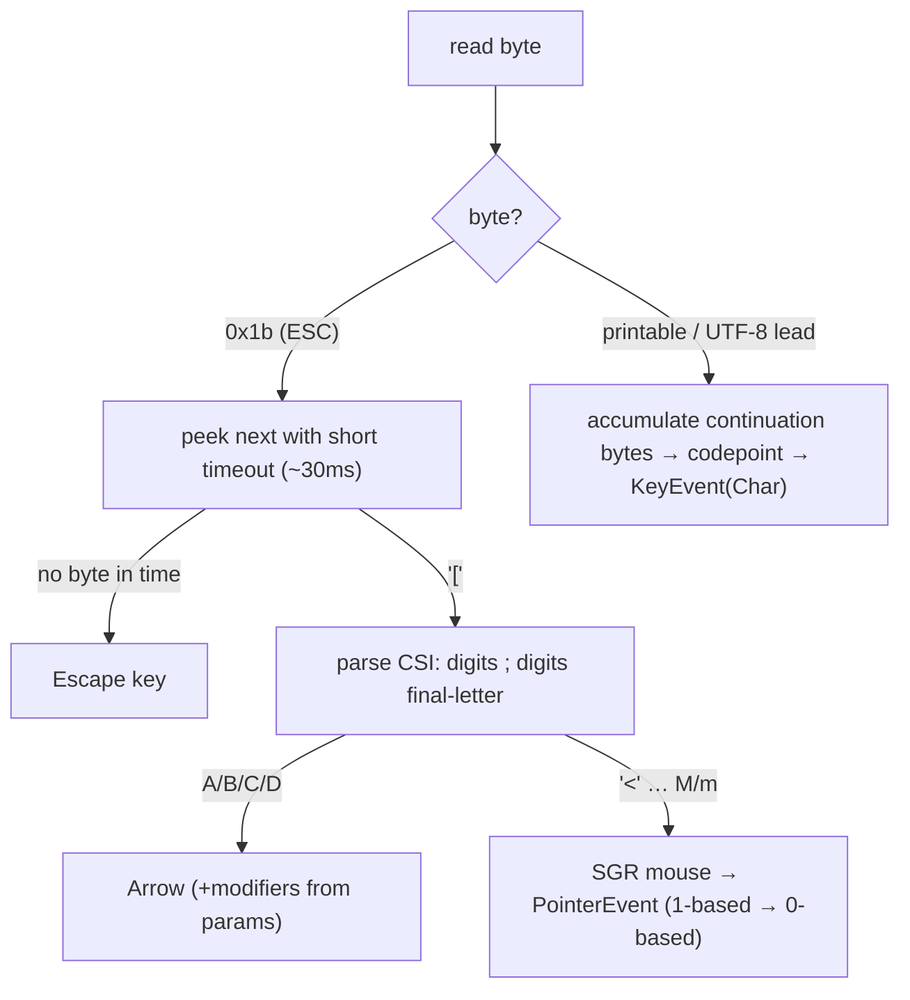

A ~30 ms read timeout resolves the lone-`ESC` ambiguity (Escape key, or the start of a sequence?). `SIGWINCH` sets a flag that the loop checks, and it emits a `ResizeEvent`. SGR mouse coordinates are 1-based, so the parser subtracts 1.

## 5.5 SDL platform [Later]

```cpp
class SdlPlatform : public Platform, public framework::Surface {
    SDL_Window* win_ = nullptr;
    SDL_Renderer* ren_ = nullptr;
public:
    void init();                                             // SDL_Init, resizable window, renderer, TTF_Init
    core::Size sizeInUnits() override;                       // SDL_GetWindowSize (logical px)
    framework::TextMeasurer& textMeasurer() override;        // FontCache (TTF_GetStringSize)
    std::optional<core::Event> waitEvent(std::optional<Duration> timeout) override;
    void submit(const paint::PaintList& list) override;      // → SdlBackend::replay + present (§6.2)
};
```

SDL already hides X11/Win32/Cocoa, so this layer has **no per-OS windowing code**.

---

# 6. Layer 4 — Backends [Later, except the Raylib adapter in §5.2]

A backend takes a `PaintList` and puts it on screen. It is the *only* place that knows about cells, SDL or Raylib.

## 6.1 Terminal backend — cell grid + ANSI diff

Rasterize the commands into a **cell grid**, then present by diffing against the previous frame and writing as little ANSI as possible. A `setState` that changes one word then rewrites only those cells.

```cpp
struct Cell {
    char32_t ch = U' ';
    std::optional<core::Color> fg, bg;   // unset = terminal default
    bool bold = false, underline = false;
    bool operator==(const Cell&) const = default;
};

class TerminalBackend {
    std::vector<Cell> front_, back_;
    int cols_ = 0, rows_ = 0;
public:
    void resize(int cols, int rows);     // reallocates both buffers; front_ is filled with a
                                         // cell no frame can produce, so the next present redraws everything
    void rasterize(const paint::PaintList& list) {
        std::fill(back_.begin(), back_.end(), Cell{});
        for (const auto& cmd : list)
            std::visit(overloaded{
                [&](const paint::FillRect& c)   { fillCells(c.rect, c.color); },
                [&](const paint::StrokeRect& c) { boxBorder(c.rect, c.color); },
                [&](const paint::DrawText& c)   { writeGlyphs(c.at, c.run); },
                [&](const auto&)                { /* clip / translate stacks */ },
            }, cmd);
    }
    void present() {
        std::string out;
        for (int y = 0; y < rows_; ++y)
            for (int x = 0; x < cols_; ++x) {
                const Cell& n = back_[y * cols_ + x];
                if (n != front_[y * cols_ + x]) { moveCursor(out, x, y); emitStyle(out, n); appendUtf8(out, n.ch); }
            }
        write(STDOUT_FILENO, out.data(), out.size());
        std::swap(front_, back_);
    }
};
```

Coordinates are rounded to whole cells during rasterization (OQ-3). `emitStyle` converts the internal truecolor `Color` to the terminal's palette: truecolor `\x1b[38;2;r;g;bm`, with a 256- or 16-colour fallback (OQ-2).

## 6.2 SDL backend — replay

```cpp
class SdlBackend {
    SDL_Renderer* ren_;
    FontCache fonts_;
public:
    void replay(const paint::PaintList& list) {
        for (const auto& cmd : list)
            std::visit(overloaded{
                [&](const paint::FillRect& c) { setColor(c.color); SDL_RenderFillRect(ren_, sdlRect(c.rect)); },
                [&](const paint::DrawText& c) { SDL_Texture* t = fonts_.render(c.run, ren_);
                                                SDL_RenderTexture(ren_, t, nullptr, sdlDst(c.at, t)); },
                [&](const paint::PushClip& c) { pushClip(c.rect); },     // intersect with the current clip
                [&](const paint::PopClip&)    { popClip(); },
                [&](const auto&)              { /* stroke, line, translate */ },
            }, cmd);
    }
    void present() { SDL_RenderPresent(ren_); }
};
```

Every backend sits behind the same `Surface::submit(list)`.

---

# 7. End-to-end worked example

App: root `Counter({ .start = 0 })` on a surface of 20×5 units. To keep the numbers small, text is measured as one unit per character and one unit high, which is exactly what the terminal measurer returns. With the Raylib adapter the units are logical pixels and the numbers get bigger, but every step is the same.

## 7.1 First frame — mount, build, layout, paint

**Build** produces this element tree (render elements in bold):

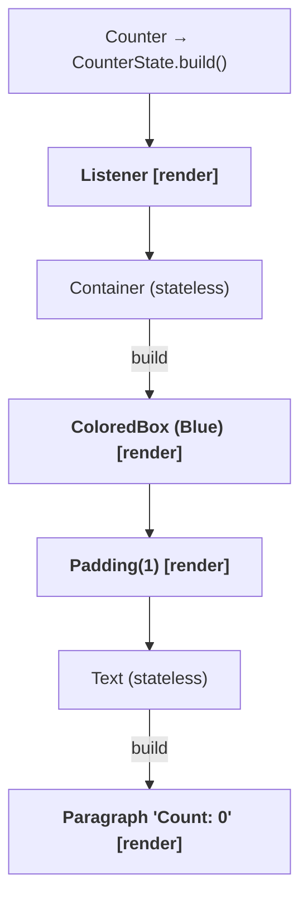

The render tree is `RenderListener → RenderColoredBox → RenderPadding → RenderParagraph`. `Counter`, `Container` and `Text` are composition elements and contribute no render nodes.

**Layout** against the loose root constraints `(0..20) × (0..5)`:

```text
Listener       passes constraints through ................. (0..20)×(0..5) ↓
 ColoredBox    passes through ............................. (0..20)×(0..5) ↓
  Padding      deflate by 1 on all sides .................. (0..18)×(0..3) ↓
   Paragraph   measures "Count: 0" = 8×1, constrained ..... Size 8×1 ↑
  Padding      size = 8+2 × 1+2 = 10×3; child offset (1,1)   10×3 ↑
 ColoredBox    size = child = 10×3 ......................... 10×3 ↑
Listener       10×3 ↑
```

**Paint** walks the render tree and produces this `PaintList`:

```text
FillRect { (0,0, 10,3), Blue }                ← ColoredBox
DrawText { (1,1), "Count: 0", style {} }      ← Paragraph, at the padding offset
```

**Backend.** With the Raylib adapter, the two commands become a `RectCmd` and a `TextCmd` on the UI layer and are drawn every frame. With the terminal backend, `rasterize` fills a 10×3 blue region and writes `Count: 0` into row 1 from column 1. `present` diffs against the empty front buffer and writes exactly those cells. Either way, the user sees a blue box with "Count: 0".

## 7.2 A click — the event loop closes

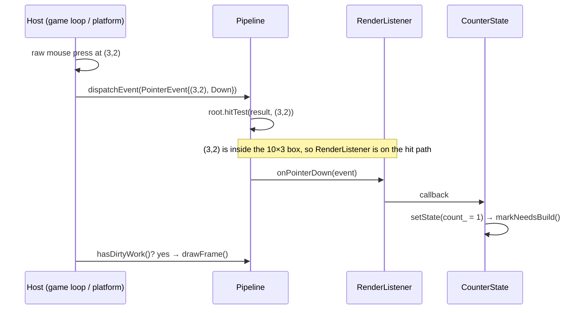

**Second frame: only what changed runs again.**

1. `flushBuild` rebuilds only `CounterState`'s element, the one dirty element.
2. The new `Listener` widget passes `canUpdate`, so the `RenderListener` is kept and gets the new callback.
3. `Container` builds again. `ColoredBox` and `Padding` get matching widgets and are updated in place. The colour and insets are unchanged, so nothing is marked from them.
4. `Text` builds a `Paragraph` with `"Count: 1"`. `RenderParagraph` sees different text and calls `markNeedsLayout()`, which bubbles up to the root.
5. Layout measures the paragraph again: still 8×1, so the box is unchanged.
6. Paint emits the same two commands, now with the new text.

The terminal backend's diff finds that only the `0` cell changed, and writes one cursor move plus `1`. The Raylib adapter simply draws the new frame. Either way, rebuilding a widget tree is cheap: one subtree is rebuilt, layout only touches the sparse render tree, and the backend does as little as its medium allows.

---

# 8. Cross-cutting concerns

## 8.1 Backend independence (summary)

| Mechanism     | Raylib adapter [MVP]                        | Terminal [Later]                  | SDL [Later]          |
| ------------- | ------------------------------------------- | --------------------------------- | -------------------- |
| Layout unit   | 1 logical px (game's logical size)          | 1 cell (rounded at rasterization) | 1 logical px         |
| Text measure  | `engine` font metrics                       | `wcwidth`, height 1               | SDL_ttf              |
| Present       | the game's frame                            | ANSI diff                         | `SDL_RenderPresent`  |
| Redraw policy | resubmit the cached `PaintList` every frame | only on dirty frames              | only on dirty frames |

One framework, one `Surface` per backend. Nothing above layer 4 branches on the backend.

## 8.2 Performance

- **Virtual calls aren't the cost, memory is.** A predicted virtual call costs ~1–3 ns, a last-level cache miss ~100–300 ns. The heavy OOP sits on the *cold* widget-authoring side. The per-frame *hot* path is the sparse render tree, which is reused across frames.
- **Widget allocation.** [MVP] `WidgetPtr = std::shared_ptr<const Widget>`. It's correct by construction: an element keeps its current widget alive, and an unchanged subtree keeps last frame's widgets without copying them. [Later] If a profile shows widget allocation is hot, use a pool allocator through `std::allocate_shared`. A per-frame arena that is *reset* each frame isn't possible, because elements that weren't rebuilt still point to widgets from earlier frames.
- **Dirty batching** turns N `setState` calls into one frame. The sparse render tree means layout and paint only touch geometry nodes.
- **Do the simple thing first:** a relayout from the root and a full repaint are fine for menus. Add relayout and repaint boundaries only when a profile asks for them (OQ-6).

## 8.3 Threading

The framework is **single-threaded**: event dispatch and `drawFrame` run on the thread that owns the window (the game's main thread). Nothing in `kollection` is thread-safe.

---

# 9. Decisions and open questions

| #     | Question                                             | Decision / current lean                                                                                                                                |
| ----- | ---------------------------------------------------- | ------------------------------------------------------------------------------------------------------------------------------------------------------ |
| OQ-1  | Widget ownership                                     | **Resolved:** `shared_ptr<const Widget>`; elements and render objects are `unique_ptr`-owned by their parent element; pool allocation only if profiled |
| OQ-2  | `Color` internal model                               | Truecolor internally, `std::optional<Color>` where "unset" matters; the terminal backend converts to 256/16 colours                                    |
| OQ-3  | Coordinate type                                      | `double` everywhere; the terminal rounds at rasterization, the Raylib adapter converts to `float`                                                      |
| OQ-4  | Loop ownership                                       | **Resolved:** the host owns the loop (the game's frame loop, or a standalone `Platform`) and calls `dispatchEvent` / `drawFrame`                       |
| OQ-5  | Frame scheduling                                     | Embedded: checked every game frame. Standalone: event-driven, clock-driven once animation lands                                                        |
| OQ-6  | Relayout / repaint boundaries                        | None yet: `markNeedsLayout` bubbles to the root, any paint repaints everything. Add when profiled                                                      |
| OQ-7  | `parentData` extension                               | **Resolved:** `ParentData` base with `offset`, subclassed per parent (`FlexParentData`); installed by `setupParentData`                                |
| OQ-8  | Equality for `updateShouldNotify` and render updates | `= default` `operator==` on value types and config fields                                                                                              |
| OQ-9  | Text measurement                                     | **Resolved:** `TextMeasurer` provided by the `Surface`, reached through the pipeline during layout                                                     |
| OQ-10 | Focus traversal                                      | Tree order (next/previous) now; spatial navigation later                                                                                               |
| OQ-11 | Element destruction                                  | **Resolved:** deactivated subtrees are parked and destroyed at the end of the build phase, bottom-up                                                   |

---

# 10. Roadmap

1. **MVP.**
   - Core: the `core` value types; `Widget`/`Element`/`State` with `updateChild`, the dirty list and deferred destruction; `RenderObject` with box layout, `ParentData` and hit-testing; `PaintList`; focus.
   - Widgets: `Container`, `Padding`, `Align`, `ConstrainedBox`/`SizedBox`, `ColoredBox`, `Text`/`Paragraph`, `Row`/`Column` (no flex factors, children matched by index), `Listener`, `Focus`, `Button`, `DefaultTextStyle` (ancestor-walk lookup).
   - Integration: the `backend::raylib::RaylibSurface` adapter; mouse and gamepad events in `engine_input`.
2. **Next.** `Expanded` + `FlexParentData`; keyed child-list diffing; an inherited `Theme`; `StrokeRect`-based focus outlines in every widget; `DrawLine`, clip and translate in the Raylib adapter (needs scissor support in `engine_render`).
3. **Later.**
   - The terminal platform and backend, then the SDL platform and backend, to parity.
   - `MediaQuery`; pipe-operator decorators; the O(1) inherited map; relayout and repaint boundaries.
   - Event bubbling or a gesture arena; spatial focus navigation; a text field (needs text input in `engine_input`); multi-line paragraphs.
4. **Much later.** Animation and tickers (clock-driven frames); scrolling (sliver protocol); semantics and accessibility; text selection; image widgets backed by `SpriteCmd`.

---

# Appendix A — Glossary

- **Widget**: an immutable description; the thing you author.
- **Element**: a persistent tree node. Holds identity, `State` and inherited dependencies, and *is* the `BuildContext`.
- **RenderObject**: lays out and paints. Created only by render widgets, owned by their element.
- **`createElement` / `canUpdate`**: the widget→element bridge / the reuse-or-replace predicate.
- **`updateChild`**: the reconciliation primitive (keep / reuse / replace / create / remove).
- **Constraints / Size / ParentData**: limits that flow down / the size that flows up / data the parent writes on its child (offset, flex).
- **PaintList**: an ordered list of backend-independent drawing commands; the layer 4 contract.
- **Surface**: the framework↔host contract: size and text measurement in, command list out.
- **Pipeline**: owns the root element, the dirty sets, focus and `drawFrame`.
- **`drawFrame`**: one build → layout → paint → submit cycle.

# Appendix B — Suggested module layout

```
core/            size.hpp offset.hpp rect.hpp color.hpp edge_insets.hpp alignment.hpp
                 constraints.hpp text_style.hpp widget_key.hpp event.hpp      → kollection::core
widget/          widget.hpp stateless.hpp stateful.hpp render_widget.hpp
                 proxy.hpp inherited.hpp state.hpp make.hpp
                 container.* counter.* colored_box.* padding.* align.*
                 constrained_box.* text.* paragraph.* flex.* listener.*
                 focus.* button.* default_text_style.*                         → kollection::widget
framework/       element.* component_element.* render_object_element.*
                 build_context.hpp render_object.* render_proxy_box.*
                 render_flex.* render_paragraph.* hit_test.* focus.*
                 pipeline.* surface.hpp text_measurer.hpp                      → kollection::framework
paint/           paint_command.hpp paint_context.hpp                           → kollection::paint
platform/        platform.hpp run.*                                            → kollection::platform        [Later]
platform/term/   terminal_platform.* input_parser.*                            → kollection::platform::term  [Later]
platform/sdl/    sdl_platform.*                                                → kollection::platform::sdl   [Later]
backend/raylib/  raylib_surface.*                                              → kollection::backend::raylib [MVP]
backend/term/    terminal_backend.* cell.hpp ansi.*                            → kollection::backend::term   [Later]
backend/sdl/     sdl_backend.* font_cache.*                                    → kollection::backend::sdl    [Later]
```

The directory structure mirrors the namespace map 1:1, so a file's path tells you its namespace and its layer. Includes only go downward: `backend` includes `paint` and `core`, plus `framework/surface.hpp` and `framework/text_measurer.hpp` for the two interfaces it implements, and never `widget` or the rest of `framework`. Only `backend/raylib` includes `engine/...` headers.

---

# Appendix C — Changes from revision 1

**Bugs fixed**

| §        | Problem in rev. 1                                                                                                                 | Fix                                                                                                   |
| -------- | --------------------------------------------------------------------------------------------------------------------------------- | ----------------------------------------------------------------------------------------------------- |
| 3.2, 8.2 | A per-frame arena freed widgets that elements which weren't rebuilt still pointed to                                              | `WidgetPtr = shared_ptr<const Widget>`; the element owns its current widget                           |
| 3.2      | `namespace engine { … }` written *inside* `kollection::widget` declared `kollection::widget::engine::Element`                     | Forward declarations at namespace scope, in `kollection::framework`                                   |
| 3.2      | `using namespace kollection::core;` in a header, against the §2.1 convention                                                      | Qualified names / single `using` declarations                                                         |
| 4.4      | `flushBuild` used a range-for over `dirty_` while rebuilds `push_back` into it (undefined behaviour)                              | Index loop + re-sort of the remaining range                                                           |
| 4.4      | Elements removed during the build pass could be destroyed while still in the dirty list                                           | Deactivated subtrees parked in the pipeline, destroyed in `finalizeTree()`                            |
| 4.4      | Duplicate dirty-list entries                                                                                                      | `inDirtyList_` guard                                                                                  |
| 4.4      | `updateChild` set `widget_` after construction and called an undefined `adopt`                                                    | Element constructed with its widget; ownership through `unique_ptr` return values                     |
| 4.4      | `State` had no `didUpdateWidget` / `dispose`, and `setState` could run on an unmounted element                                    | Added both hooks; `setState` is a no-op once unmounted                                                |
| 4.6      | `markNeedsLayout` didn't bubble, so the memo in `layout()` hid dirty children forever                                             | Bubbles to the root while there are no relayout boundaries                                            |
| 4.6      | `parentUsesSize` was a parameter nobody read                                                                                      | Removed until relayout boundaries exist                                                               |
| 4.6      | `BoxConstraints::expand()` had min = ∞, and an empty `ColoredBox` sized itself to "as big as allowed", giving ∞ in unbounded axes | `enforce()` against the parent, minimum used in unbounded axes; an empty proxy box takes `smallest()` |
| 4.6      | `RenderColoredBox::child` was "set during attach" with no API                                                                     | `insertChild` / `removeChild` / `setupParentData`; ownership defined                                  |
| 4.7      | The hit path was described as root → target but built target → root                                                               | Documented as deepest first, and dispatch goes deepest first                                          |
| 4.7      | `RenderListener` kept the first build's callbacks                                                                                 | `updateRenderObject` copies the new closures                                                          |
| 4.10     | `drawFrame` called `surface_->rootConstraints()`, which `Surface` doesn't declare                                                 | `BoxConstraints::loose(surface.sizeInUnits())`                                                        |
| 3.8      | `RenderParagraph` had to measure text but the core can't name a font backend                                                      | `TextMeasurer` interface provided by the `Surface`                                                    |
| 5.4      | `write(…, /*len*/)` had no length; SGR mouse coordinates are 1-based                                                              | `string_view` length; parser subtracts 1                                                              |
| 6.1      | Terminal buffers had no resize path                                                                                               | `resize()` reallocates and forces a full redraw                                                       |

**Consistency**

- `kollection::engine` → `kollection::framework`, and the `Engine` class → `Pipeline`. This avoids clashing with the repo's `::engine` namespace.
- `Key` was used for both widget identity and keyboard keys: now `WidgetKey` and `KeyCode`. Events are in `core`, as the namespace map already said.
- Every concrete widget follows the same `Config` + `explicit T(Config)` + `make<T>()` rule. `ColoredBox`'s `key_set` and `DefaultTextStyle`'s missing `Config`/child are fixed.
- Optional fields are `std::optional` (`Container::Config`, `TextStyle`). The undefined `isSet()` / `hasValue()` and the "alpha 0 = unset" convention are gone.
- `PaintCommand` is a `std::variant` of per-command structs, like the engine's `DrawCommand`. The undefined `Matrix` transform is replaced by translation only.
- The `MultiChildRenderWidget` row of §3.1 points to `Row`/`Column`, which are now specified (§4.6.4), together with `ParentData` (OQ-7 resolved).
- §7 is described in abstract units, and its second frame covers both the diffing and the redraw-every-frame backends.

**Scope**

- The host owns the loop (OQ-4): the game embeds the pipeline (§5.2). The standalone `Platform` loop is kept for the terminal and SDL [Later].
- Added focus and keyboard routing, and `Button` (§4.8), to the MVP.
- Added the `backend::raylib` adapter and the `engine_input` prerequisites.
- Moved `Row`/`Column` to the MVP. Moved the terminal and SDL backends, the arena, the O(1) inherited map and transforms to [Next]/[Later].
