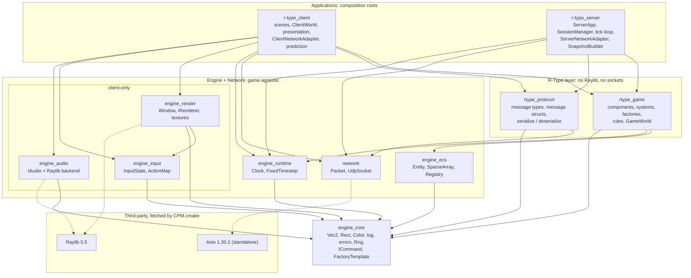

# Architecture overview

Part 1 delivers a playable, networked R-Type prototype for up to 4 players, built on an engine split into decoupled modules: Engine, Network, Protocol, Game and the two applications. This page fixes the module boundaries and the rules between them. Each module has its own page under [`modules/`](../modules/).

## Goals for Part 1

- A central `r-type_server` with final authority over the game; one `r-type_client` per player.
- A scrolling starfield, 4 players who can tell their ships apart, Bydos slaves spawning on the right, and missiles fired by both sides.
- Visible, decoupled layers for Rendering, Networking and Game Logic, built as separate CMake targets.
- A binary UDP protocol that a third party can implement from the [RFC](../protocol/RFC-rtype.md) alone.
- Builds on Linux (required) and Windows (should). Dependencies come through a package manager.

## Non-goals for Part 1

These are deliberately left for Part 2, so that no empty modules exist now:

- No plugin system, scripting, physics engine, level editor or asset hot-reload.
- No lobby or rooms. One server process runs exactly one game.
- No acknowledgements or resending. The protocol is state-based instead (see [ADR 0002](../decisions/0002-state-based-replication.md)).
- No lag compensation or rollback. Only simple prediction of your own ship.
- No TCP. Every message goes over UDP.
- Splitting the engine into its own standalone project is Part 2 work. Part 1 only follows the dependency rules that make that split possible later.

## Glossary

| Term | Meaning in these pages |
| --- | --- |
| Entity | An integer index in the ECS registry. It has no behaviour of its own. |
| Component | A plain data struct attached to an entity (`Transform`, `Health`, …). |
| System | A free function that reads and writes components every tick. |
| Tick | One fixed simulation step on the server: 1/60 s. |
| NetId | A 32-bit id that names one replicated entity on every machine. ECS indices are local to each process and never go on the wire. |
| Snapshot | The complete list of replicated entities and players at one server tick, sent 30 times per second. |
| Chunk | One datagram of a snapshot. A large snapshot is split into several chunks. |
| Session | The server's record of one connected client: endpoint, player slot, last time heard from. |
| Adapter | Code that translates between game commands/events and protocol messages. It is the only code that knows both. |
| Composition root | `main()` of an application, where concrete modules are created and wired together. |

## Layers

The system is 5 layers of CMake targets. A target may depend only on targets in its own layer or the layers below it. The two applications are the only places where concrete classes get chosen and wired together. Game code never touches Raylib or sockets, and the server never links a graphics, input or audio library.



Read it from the top down: an application pulls in the R-Type layer, which pulls in the generic engine and network targets, which all sit on `engine_core`. Dashed arrows mark third-party libraries.

## Module responsibilities

| Target | Kind | Owns | Must not know about |
| --- | --- | --- | --- |
| `engine_core` | static lib | Math types, colours, logging, error types, RNG, asset path lookup, `ICommand` and `FactoryTemplate` | Everything above it |
| `engine_ecs` | header-only (INTERFACE) | Entities, component storage, views, deferred destruction | Game components, rendering, networking |
| `engine_runtime` | static lib | Steady clock, fixed-timestep accumulator, fixed-rate ticker | What runs inside a tick |
| `engine_render` | static lib, client only | Window, draw-command queue, texture cache, Raylib rendering backend, translation of Raylib key state into input events | Game components, the protocol |
| `engine_input` | static lib, client only | Engine key codes, per-frame input state, rebindable action map | Game actions' meaning, the network |
| `engine_audio` | static lib, client only | Sound and music playback, volume, mute; a `NullAudio` for tests | When to play what |
| `network` | static lib | `Packet` (bounds-checked serialization), `UdpSocket` (Asio socket on its own IO thread) | Players, sessions, R-Type message types |
| `rtype_protocol` | static lib | R-Type message types, header, message structs and their serialize/deserialize | Sockets, the ECS, Raylib |
| `rtype_game` | static lib | Components, simulation systems, factories, rules, `GameWorld` | Sockets, packets, Raylib, keyboards |
| `r-type_server` | executable | Sessions, the tick loop, adapters, snapshots | Raylib |
| `r-type_client` | executable | Scenes, the replicated world, presentation systems, prediction, adapters | Authority over game outcomes |

## Dependency rules

Code review enforces these, backed by `target_link_libraries` scopes. Breaking one is a blocking review comment.

1. **Downward only.** No target includes a header from a layer above it. Within a layer, `engine_render` may depend on `engine_input` (for `InputEvent`), and no other sideways dependency is allowed.
2. **Raylib stays inside two targets.** `engine_render` and `engine_audio` link Raylib `PRIVATE`, and only their `.cpp` files include `raylib.h`. Their public headers expose engine types only (`render::DrawCommand`, `input::InputEvent`, …), never Raylib's `Texture2D`, `Rectangle` or `KEY_*`. `engine_input` uses no Raylib.
3. **Asio stays in the network code.** Only `network/UdpSocket.hpp` and the two applications' network classes include Asio. `net::Packet` doesn't, so `rtype_protocol` and `rtype_game` compile without it. Asio types are used directly; there is no wrapper around them (see [ADR 0001](../decisions/0001-standalone-asio.md)).
4. **The game is pure.** `rtype_game` links only `engine_core`, `engine_ecs` and `engine_runtime`. It produces `GameEvent`s and consumes `PlayerCommand`s, so it can be unit-tested without a window or a socket.
5. **Adapters are the only bridges.** `ServerNetworkAdapter` and `ClientNetworkAdapter` are the only classes that include both `rtype_game` and `rtype_protocol` headers.
6. **Raylib and Asio never meet in one file.** On Windows, Asio includes `windows.h`, which declares functions and types with the same names as Raylib's (`Rectangle`, `CloseWindow`, `ShowCursor`, `DrawText`, `PlaySound`, …). A `.cpp` file that includes both does not compile. Rules 2 and 3 keep them apart: Raylib is only included by `engine_render` and `engine_audio` sources, Asio only by network code.
7. **ECS indices never leave a process.** Anything sent on the wire names an entity by its `NetId`.

## Target link graph

| Target | Links PUBLIC | Links PRIVATE |
| --- | --- | --- |
| `engine_core` | `project_options` | — |
| `engine_ecs` | `engine_core` | — |
| `engine_runtime` | `engine_core` | — |
| `engine_input` | `engine_core` | — |
| `engine_render` | `engine_core`, `engine_input` | `raylib` |
| `engine_audio` | `engine_core` | `raylib` |
| `network` | `asio` (INTERFACE target, see [development handbook](../handbook/development.md#build-dependencies-and-platforms)) | `ws2_32`, `mswsock` (Windows only) |
| `rtype_protocol` | `network`, `engine_core` | — |
| `rtype_game` | `engine_ecs`, `engine_runtime`, `engine_core` | — |
| `r-type_server` | — | `rtype_game`, `rtype_protocol`, `network`, `engine_runtime` |
| `r-type_client` | — | `client_logic` (only `main.cpp` is compiled here) |
| `client_logic` | `rtype_game`, `rtype_protocol`, `network`, `engine_render`, `engine_input`, `engine_audio`, `engine_runtime` | — |
| `<module>_tests` | — | the library under test, `GTest::gtest_main` |

`rtype_protocol` links `network` only for `net::Packet`, not for sockets. The client links `rtype_game` for its component definitions, rule constants and the `movePlayer()` step it reuses for prediction. It never runs the server's systems.

## Repository layout

Each target is one directory, and its public headers sit under a path named after its namespace. `#include "engine/ecs/Registry.hpp"` therefore tells you the target and the namespace at once.

```text
r-type/
├── CMakeLists.txt              # top level: options, dependencies, add_subdirectory()
├── CMakePresets.json           # linux-debug, linux-release, windows-msvc-*
├── cmake/
│   ├── CPM.cmake               # pinned package manager bootstrap
│   ├── Dependencies.cmake      # Raylib, Asio, GoogleTest via CPMAddPackage
│   └── ProjectOptions.cmake    # warnings, sanitizers, C++20
├── engine/
│   ├── core/      include/engine/core/*.hpp      src/*.cpp
│   ├── ecs/       include/engine/ecs/*.hpp       (header-only)
│   ├── runtime/   include/engine/runtime/*.hpp   src/*.cpp
│   ├── render/    include/engine/render/*.hpp    src/*.cpp  src/raylib/*.cpp
│   ├── input/     include/engine/input/*.hpp     src/*.cpp
│   └── audio/     include/engine/audio/*.hpp     src/*.cpp  src/raylib/*.cpp
├── network/       include/network/*.hpp          src/*.cpp
├── rtype/
│   ├── protocol/  include/rtype/protocol/*.hpp   src/*.cpp
│   └── game/      include/rtype/game/*.hpp       src/*.cpp  src/systems/*.cpp
├── apps/
│   ├── server/    src/*.hpp src/*.cpp            # r-type_server
│   └── client/    src/*.hpp src/*.cpp            # r-type_client
├── assets/        sprites/ sounds/ music/ fonts/
├── config/        client.cfg keybindings.cfg     # defaults, copied next to the binaries
├── tests/         engine/ network/ protocol/ game/ client/
└── docs/          architecture/ modules/ protocol/ handbook/ decisions/
```

## Namespaces and naming

| Namespace | Target |
| --- | --- |
| `engine::core`, `engine::ecs`, `engine::runtime`, `engine::render`, `engine::input`, `engine::audio` | engine targets |
| `net` | `network` |
| `rtype::protocol` | `rtype_protocol` |
| `rtype::game` | `rtype_game` |
| `rtype::server`, `rtype::client` | applications |

Names follow the repository's `.clang-tidy`: `CamelCase` types, `camelBack` functions, methods, variables and parameters, `_camelBack` for private and protected members, `UPPER_CASE` enum constants, global constants and macros. All class diagrams in these pages use these names.
