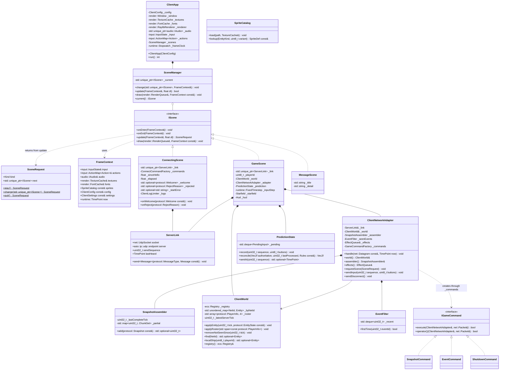

# Client application (`r-type_client`)

The client displays the server's world and sends the player's buttons back. It keeps its own ECS registry holding replicated entities plus presentation components (sprites, animation, interpolation). It never decides a hit, a death or a spawn. The one thing it predicts is how its own ship moves, so the controls feel instant.

## Command line

```text
r-type_client [-h HOST] [-p PORT] [-n NAME] [--fullscreen] [--log-level LEVEL] [--help]
```

The defaults are `-h 127.0.0.1`, `-p 4242`, and `-n` set to the OS user name, cut to 16 characters. Bad arguments exit with 84. Key bindings start from the defaults in `bindDefaults` (arrows and WASD to move, SPACE and LCTRL to fire, F1 for the controls overlay, ESCAPE to quit, ENTER to confirm), then `config/keybindings.json` overrides the actions it lists. Volumes and the other settings are read from `config/client.json`, if it exists. `--fullscreen` overrides `fullscreen` from `client.json`.

## Threads

| Thread | Runs | Owns |
| --- | --- | --- |
| Main | Window events, the network adapter, simulation, rendering, audio | Everything except the socket |
| Network IO | `net::UdpSocket` | The socket |

Raylib requires window, input, rendering and texture calls to stay on the thread that called `InitWindow`, which is why all presentation code stays on the main thread. Datagrams reach it only through `UdpSocket::receiveAll()`.

## Class diagram



### Scenes

- **`SceneManager`** holds the current scene. `change` calls `onExit` on the old scene, if there is one, then `onEnter` on the new one, and ignores a null scene. `update` runs the current scene's `update` and applies the `SceneRequest` it returns: `STAY` keeps the scene, `CHANGE` switches to `next` once the scene's `update` has returned, and `QUIT` makes `update` return `false` so the client loop stops. It also returns `false` when there is no scene. `draw` draws the current scene, if there is one.
- **`SceneRequest`** is built with `stay()`, `change(next)` or `quit()`. `change(nullptr)` gives `stay()`, so a scene can't switch to nothing.
- **`FrameContext`** is what a scene gets each frame: the input state and action map, audio, the texture and font caches, the sprite catalog, the command-line config, the settings, and the frame's time.
- **`ConnectingScene`** opens its link in `onEnter`, not in its constructor, so building the scene never throws: `resolveServer` resolves `-h`/`-p` to an IPv4 endpoint with `asio::ip::udp::resolver`, then it starts a `ServerLink` on a free local port and sends HELLO, again every 0.5 s. An unknown host or an unavailable port (`NetworkError`) is kept and shown by the first `update` as "Can't reach the server". Its `WelcomeCommand` and `RejectCommand` call back into it; only the first WELCOME counts, since every HELLO gets one. On WELCOME it moves the `ServerLink` into a new `GameScene`, so the socket is never recreated. On REJECT, or after 5 s with no answer, it switches to a `MessageScene` with the reason. Meanwhile it draws "Connecting to host:port..." with the seconds waited.
- **`GameScene`** is the game itself (next sections). It switches to a `MessageScene` when the server sends SHUTDOWN or stays silent for 5 s.
- **`MessageScene`** shows a title and a detail line ("Server full", "Connection lost", "Server closed"). ENTER reconnects through a new `ConnectingScene`, ESCAPE quits.

## Message commands

The client uses the same Command + Factory pattern as the server ([ADR 0003](../decisions/0003-command-factory-handlers.md)), with one factory per scene that receives messages:

```cpp
namespace rtype::client {

using IConnectCommand = designPattern::ICommand<ConnectingScene&, net::Packet&>;
using ConnectCommandFactory = designPattern::FactoryTemplate<IConnectCommand, protocol::MessageType>;

using IGameCommand = designPattern::ICommand<ClientNetworkAdapter&, net::Packet&>;
using GameCommandFactory = designPattern::FactoryTemplate<IGameCommand, protocol::MessageType>;

void ConnectingScene::registerCommands() noexcept
{
    _commands.registerCreator<WelcomeCommand>(protocol::MessageType::WELCOME);
    _commands.registerCreator<RejectCommand>(protocol::MessageType::REJECT);
}

void ClientNetworkAdapter::registerCommands() noexcept
{
    _commands.registerCreator<SnapshotCommand>(protocol::MessageType::SNAPSHOT);
    _commands.registerCreator<EventCommand>(protocol::MessageType::EVENT);
    _commands.registerCreator<ShutdownCommand>(protocol::MessageType::SHUTDOWN);
}

}
```

Both scenes check each datagram with the same function, `checkFromServer(datagram, link, logs, now)` (`ClientDispatch.hpp`), in the order of the [RFC's error handling](../protocol/RFC-rtype.md#10-error-handling):

1. **Not from the server:** dropped silently if `datagram.from != link.server`. Anyone can send to the client's port, so logging these would let a stranger fill the log.
2. **Size:** `protocol::checkDatagramSize`.
3. **Header:** the `net::Packet` is built from the bytes and the `Header` read from it (a bad magic throws).
4. **Version:** dropped silently if it isn't 1.
5. **Direction:** `protocol::checkType(type, Direction::SERVER_TO_CLIENT)`, so an unknown type, or a HELLO sent back to the client, is rejected.

On success it returns the header and the packet positioned right after it, ready for the command's `decode`. A `net::PacketError` is caught, logged as `classify(error)` if `ClientLogLimiter::shouldLog` allows it (at most one line per second per `DecodeError`, so a flood of bad datagrams can't flood the log), and the datagram is dropped. Unlike the server, the client counts no offences: it can't kick the server.

The scene then runs the command only if its type has one (`hasKey`), so a message meant for the other scene is dropped: a SNAPSHOT that overtakes the WELCOME while connecting, or a late repeat of WELCOME in game. The command runs inside its own `try`/`catch (const net::PacketError&)`, logged through the same limiter, since `decode` throws for a truncated body or trailing bytes. A message that decodes sets `link.lastHeard`.

## Applying snapshots

| Command | Message | Handling |
| --- | --- |
| `SnapshotCommand` | SNAPSHOT | Ignored if older than the assembler's last complete tick. Otherwise each `EntityState` goes to `world.applyEntity(tick, state)`: it creates the entity if the NetId is new (with components from the `SpriteCatalog` for its kind and variant) and adds a sample. Chunk 0's roster goes to `world.applyRoster()`. If `assembler.add(chunk)` reports tick T complete, `world.removeNotSeenSince(T)` deletes vanished entities. |
| `EventCommand` | EVENT | Ignored if `seenEvents.firstTime(eventId)` is false. Otherwise pushed to the effect queue: sounds, explosions at (x, y), HUD banners. |
| `ShutdownCommand` | SHUTDOWN | Switch to `MessageScene("Server closed")`. |

These are the [client rules in RFC §6.5](../protocol/RFC-rtype.md#65-snapshot-0x83-server--client). The client never needs a SPAWN or DESTROY message, so packet loss can't leave a ghost entity behind.

## Client-only components and systems

These live in `apps/client/` because they refer to `render::TextureId`, which the shared game module must never depend on.

| Component | Fields |
| --- | --- |
| `Sprite` | `TextureId texture`, `IntRect frame`, `int16_t layer`, `Color tint`, `Vec2f scale` |
| `Animation` | `std::vector<IntRect> frames`, `float frameTime`, `float timer`, `size_t index`, `bool loop` |
| `NetSamples` | Ring of the last 3 `{uint32_t tick, Vec2f position, Vec2f velocity}`, plus `uint32_t lastSeenTick` |
| `LocalPlayer` | Tag on the ship whose NetId equals the roster's `shipNetId` for our `playerId` |
| `PlayerLabel` | `uint8_t playerId`, drawn as `P1`–`P4` above the ship |
| `TransientEffect` | `float remaining`: explosions, which are never replicated |

These systems are registered in `ClientWorld`'s registry, in two stages: `UPDATE` (`interpolationSystem` → `predictionSystem` → `animationSystem` → `effectSystem` → `starfieldSystem`) and `RENDER` (`renderSystem` → `hudSystem`). The `RenderQueue` is a registry resource that the render stage fills. `renderSystem` is the only system that creates `DrawCommand`s for entities. It reads `Transform` and `Sprite` and nothing else, which matches the subject's point that the renderer needs only appearance and position.

## Frame loop, interpolation and prediction

Each frame of `GameScene`, with `dt = frameClock.restart()` capped at 0.25 s:

1. `window.pollEvents()` → `input.apply(e)`. `WINDOW_CLOSED` and the QUIT action send DISCONNECT and exit.
2. `for (auto& d : link.socket.receiveAll()) adapter.handle(d, now)`.
3. `inputStep.advance(dt)` returns *n*. For each of the *n* steps, sample the buttons from the action map, `sendInput(++sequence, buttons)`, `prediction.record(...)`, and move the local ship with `movePlayer(...)`. INPUT therefore goes out at exactly 60 Hz whatever the frame rate.
4. If `now − link.lastHeard > 5 s`, switch to `MessageScene("Connection lost")`.
5. Set the `DeltaTime` resource, run the `UPDATE` stage then the `RENDER` stage (which fills the `RenderQueue`), then `renderer.beginFrame / submit / endFrame`, and `audio.update()`.

**Interpolation for remote entities.** Everything except the local ship is drawn 100 ms in the past. That is `renderTick = latestServerTick − 6` ticks, so there are normally two snapshots to blend between. The position is a linear interpolation between the two samples on either side of `renderTick`. If the newer sample is missing (packet loss), the entity is extrapolated along its last velocity for at most 100 ms and then held in place. A new entity is drawn at its first sample until a second one arrives.

**Prediction for the local ship.** On each SNAPSHOT that contains the local ship:

1. Take the server's position *P* for the local ship and the snapshot's `lastProcessedInput` *L*.
2. Discard pending inputs with a sequence ≤ *L*.
3. Replay the remaining inputs on *P* with `movePlayer`. That gives the corrected position *C*.
4. If *C* is more than 64 units away from the drawn position, snap to it. Otherwise close 20% of the gap each frame.

On a LAN the correction is invisible. With high latency, the player still sees their ship react immediately. The server remains the only judge of collisions (requirement F-14).

**Ping.** `prediction.sentAt(L)` gives the time INPUT *L* was sent. `now − sentAt(L)` is an upper estimate of the round trip, off by at most one snapshot interval (33 ms). The HUD shows its average over the last second.

## Presentation

**Starfield (F-02, F-08).** There are 3 parallax layers of procedurally placed stars: 70 far stars at 20 u/s, 40 mid stars at 55 u/s and 20 near stars at 120 u/s. A star that leaves the left edge wraps to the right at a new random y. The starfield runs entirely on the client and is driven by `dt`, so its speed doesn't depend on frame rate, and it needs no network traffic.

**Sprites.** `SpriteCatalog` reads `assets/sprites/catalog.json`, which maps each `(EntityKind, variant)` to a sheet, frame rectangles and a frame time. The rectangles are measured from the sprite sheets provided with the subject. Keeping them in data rather than code lets the art change without recompiling. Each player's colour row (cyan, magenta, green, red) is picked by `variant = playerId`.

**Sound (F-13).**

| Trigger | Sound |
| --- | --- |
| EVENT PLAYER_FIRED (local ship) | `shot.wav` at full volume |
| EVENT PLAYER_FIRED (another ship) | `shot.wav` at 40% volume |
| EVENT ENEMY_KILLED | `explosion_small.wav`, plus an explosion effect at (x, y) |
| EVENT PLAYER_KILLED | `explosion_big.wav`, plus an explosion effect at (x, y) |
| EVENT PLAYER_JOINED / PLAYER_LEFT | `ui_join.wav` / `ui_leave.wav` |
| In game | `stage1.ogg` looping music |

**HUD.** Each slot shows `P1`–`P4`, the player's name, lives and score (all from the roster), plus the team score, the ping, and transient banners such as "P3 lost connection" or "GAME OVER – restarting in 5". All HUD text uses the font size from `client.json` (default 20 px at 720p).
