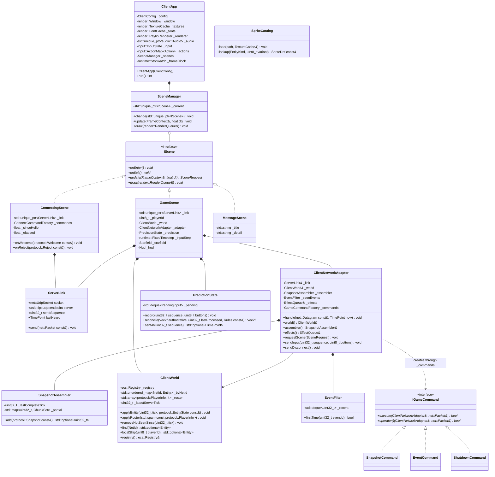

# Client application (`r-type_client`)

The client displays the server's world and sends the player's buttons back. It keeps its own ECS registry holding replicated entities plus presentation components (sprites, animation, interpolation). It never decides a hit, a death or a spawn. The one thing it predicts is how its own ship moves, so the controls feel instant.

## Command line

```text
r-type_client [-h HOST] [-p PORT] [-n NAME] [--fullscreen] [--log-level LEVEL] [--help]
```

The defaults are `-h 127.0.0.1`, `-p 4242`, and `-n` set to the OS user name, cut to 16 characters. Bad arguments exit with 84. Key bindings and volumes are read from `config/client.cfg` and `config/keybindings.cfg` if those files exist.

## Threads

| Thread | Runs | Owns |
| --- | --- | --- |
| Main | Window events, the network adapter, simulation, rendering, audio | Everything except the socket |
| Network IO | `net::UdpSocket` | The socket |

Raylib requires window, input, rendering and texture calls to stay on the thread that called `InitWindow`, which is why all presentation code stays on the main thread. Datagrams reach it only through `UdpSocket::receiveAll()`.

## Class diagram



### Scenes

- **`ConnectingScene`** resolves `-h`/`-p` with `asio::ip::udp::resolver`, starts a `ServerLink` on a free local port, and sends HELLO every 0.5 s. Its `WelcomeCommand` and `RejectCommand` call back into it. On WELCOME it moves the `ServerLink` into a new `GameScene`, so the socket is never recreated. On REJECT, or after 5 s with no answer, it switches to a `MessageScene` with the reason.
- **`GameScene`** is the game itself (next sections). It switches to a `MessageScene` when the server sends SHUTDOWN or stays silent for 5 s.
- **`MessageScene`** shows a title and a detail line ("Server full", "Connection lost", "Server closed"). ENTER reconnects through a new `ConnectingScene`, ESCAPE quits.

## Message commands

The client uses the same Command + Factory pattern as the server ([ADR 0003](../decisions/0003-command-factory-handlers.md)), with one factory per scene that receives messages:

```cpp
namespace rtype::client {

using IConnectCommand = engine::core::ICommand<ConnectingScene&, net::Packet&>;
using ConnectCommandFactory = engine::core::FactoryTemplate<IConnectCommand, protocol::MessageType>;

using IGameCommand = engine::core::ICommand<ClientNetworkAdapter&, net::Packet&>;
using GameCommandFactory = engine::core::FactoryTemplate<IGameCommand, protocol::MessageType>;

void ConnectingScene::registerCommands() noexcept
{
    _commands.registerCreator<WelcomeCommand>(protocol::MessageType::WELCOME);
    _commands.registerCreator<RejectCommand>(protocol::MessageType::REJECT);
}

void ClientNetworkAdapter::registerCommands() noexcept
{
    _commands.registerCreator<SnapshotCommand>(protocol::MessageType::SNAPSHOT);
    _commands.registerCreator<EventCommand>(protocol::MessageType::EVENT);
    _commands.registerCreator<ShutdownCommand>(protocol::MessageType::SHUTDOWN);
}

}
```

Each scene's `handle()` decodes the header inside a `try`/`catch (const net::PacketError&)`, exactly as the server does. It drops datagrams that are malformed, that don't come from the server's endpoint, or whose type has no registered command (`hasKey`). A late repeat of WELCOME in game is dropped that way. A valid datagram from the server sets `link.lastHeard`.

## Applying snapshots

| Command | Message | Handling |
| --- | --- |
| `SnapshotCommand` | SNAPSHOT | Ignored if older than the assembler's last complete tick. Otherwise each `EntityState` goes to `world.applyEntity(tick, state)`: it creates the entity if the NetId is new (with components from the `SpriteCatalog` for its kind and variant) and adds a sample. Chunk 0's roster goes to `world.applyRoster()`. If `assembler.add(chunk)` reports tick T complete, `world.removeNotSeenSince(T)` deletes vanished entities. |
| `EventCommand` | EVENT | Ignored if `seenEvents.firstTime(eventId)` is false. Otherwise pushed to the effect queue: sounds, explosions at (x, y), HUD banners. |
| `ShutdownCommand` | SHUTDOWN | Switch to `MessageScene("Server closed")`. |

These are the [client rules in RFC §6.5](../protocol/RFC-rtype.md#65-snapshot-0x83-server--client). The client never needs a SPAWN or DESTROY message, so packet loss can't leave a ghost entity behind.

## Client-only components and systems

These live in `apps/client/` because they refer to `render::TextureId`, which the shared game module must never depend on.

| Component | Fields |
| --- | --- |
| `Sprite` | `TextureId texture`, `IntRect frame`, `int16_t layer`, `Color tint`, `Vec2f scale` |
| `Animation` | `std::vector<IntRect> frames`, `float frameTime`, `float timer`, `size_t index`, `bool loop` |
| `NetSamples` | Ring of the last 3 `{uint32_t tick, Vec2f position, Vec2f velocity}`, plus `uint32_t lastSeenTick` |
| `LocalPlayer` | Tag on the ship whose NetId equals the roster's `shipNetId` for our `playerId` |
| `PlayerLabel` | `uint8_t playerId`, drawn as `P1`–`P4` above the ship |
| `TransientEffect` | `float remaining`: explosions, which are never replicated |

The frame runs these systems in order: `interpolationSystem` → `predictionSystem` → `animationSystem` → `effectSystem` → `starfieldSystem` → `renderSystem` → `hudSystem`. `renderSystem` is the only system that creates `DrawCommand`s for entities. It reads `Transform` and `Sprite` and nothing else, which matches the subject's point that the renderer needs only appearance and position.

## Frame loop, interpolation and prediction

Each frame of `GameScene`, with `dt = frameClock.restart()` capped at 0.25 s:

1. `window.pollEvents()` → `input.apply(e)`. `WINDOW_CLOSED` and the QUIT action send DISCONNECT and exit.
2. `for (auto& d : link.socket.receiveAll()) adapter.handle(d, now)`.
3. `inputStep.advance(dt)` returns *n*. For each of the *n* steps, sample the buttons from the action map, `sendInput(++sequence, buttons)`, `prediction.record(...)`, and move the local ship with `movePlayer(...)`. INPUT therefore goes out at exactly 60 Hz whatever the frame rate.
4. If `now − link.lastHeard > 5 s`, switch to `MessageScene("Connection lost")`.
5. Run the presentation systems, build the `RenderQueue`, then `renderer.beginFrame / submit / endFrame`, and `audio.update()`.

**Interpolation for remote entities.** Everything except the local ship is drawn 100 ms in the past. That is `renderTick = latestServerTick − 6` ticks, so there are normally two snapshots to blend between. The position is a linear interpolation between the two samples on either side of `renderTick`. If the newer sample is missing (packet loss), the entity is extrapolated along its last velocity for at most 100 ms and then held in place. A new entity is drawn at its first sample until a second one arrives.

**Prediction for the local ship.** On each SNAPSHOT that contains the local ship:

1. Take the server's position *P* for the local ship and the snapshot's `lastProcessedInput` *L*.
2. Discard pending inputs with a sequence ≤ *L*.
3. Replay the remaining inputs on *P* with `movePlayer`. That gives the corrected position *C*.
4. If *C* is more than 64 units away from the drawn position, snap to it. Otherwise close 20% of the gap each frame.

On a LAN the correction is invisible. With high latency, the player still sees their ship react immediately. The server remains the only judge of collisions (requirement F-14).

**Ping.** `prediction.sentAt(L)` gives the time INPUT *L* was sent. `now − sentAt(L)` is an upper estimate of the round trip, off by at most one snapshot interval (33 ms). The HUD shows its average over the last second.

## Presentation

**Starfield (F-02, F-08).** There are 3 parallax layers of procedurally placed stars: 70 far stars at 20 u/s, 40 mid stars at 55 u/s and 20 near stars at 120 u/s. A star that leaves the left edge wraps to the right at a new random y. The starfield runs entirely on the client and is driven by `dt`, so its speed doesn't depend on frame rate, and it needs no network traffic.

**Sprites.** `SpriteCatalog` reads `assets/sprites/catalog.cfg`, which maps each `(EntityKind, variant)` to a sheet, frame rectangles and a frame time. The rectangles are measured from the sprite sheets provided with the subject. Keeping them in data rather than code lets the art change without recompiling. Each player's colour row (cyan, magenta, green, red) is picked by `variant = playerId`.

**Sound (F-13).**

| Trigger | Sound |
| --- | --- |
| EVENT PLAYER_FIRED (local ship) | `shot.wav` at full volume |
| EVENT PLAYER_FIRED (another ship) | `shot.wav` at 40% volume |
| EVENT ENEMY_KILLED | `explosion_small.wav`, plus an explosion effect at (x, y) |
| EVENT PLAYER_KILLED | `explosion_big.wav`, plus an explosion effect at (x, y) |
| EVENT PLAYER_JOINED / PLAYER_LEFT | `ui_join.wav` / `ui_leave.wav` |
| In game | `stage1.ogg` looping music |

**HUD.** Each slot shows `P1`–`P4`, the player's name, lives and score (all from the roster), plus the team score, the ping, and transient banners such as "P3 lost connection" or "GAME OVER – restarting in 5". All HUD text uses the font size from `client.cfg` (default 20 px at 720p).
