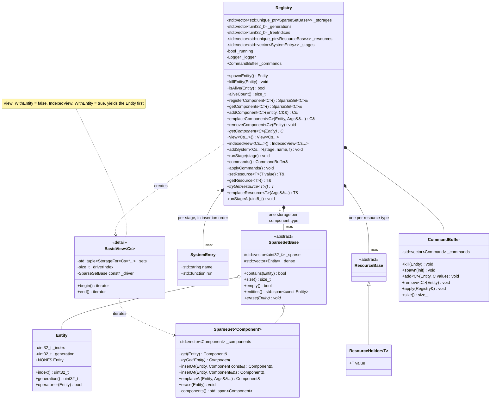
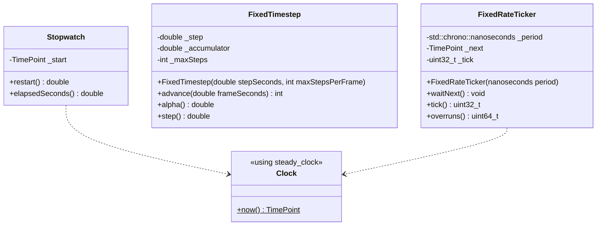
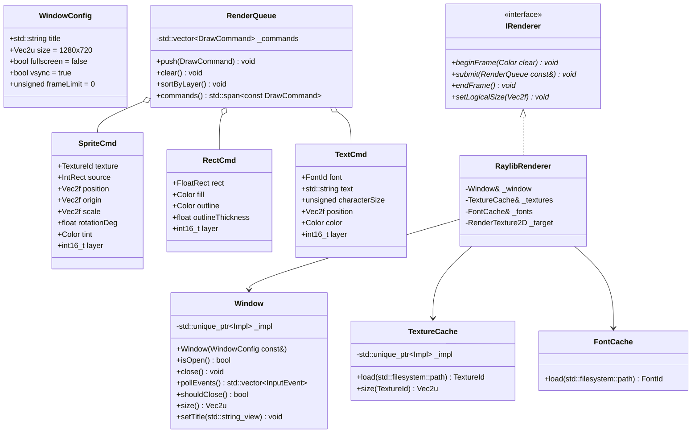
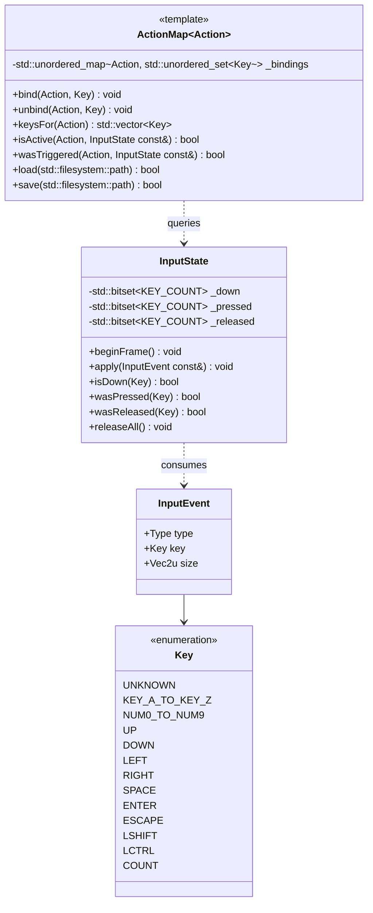
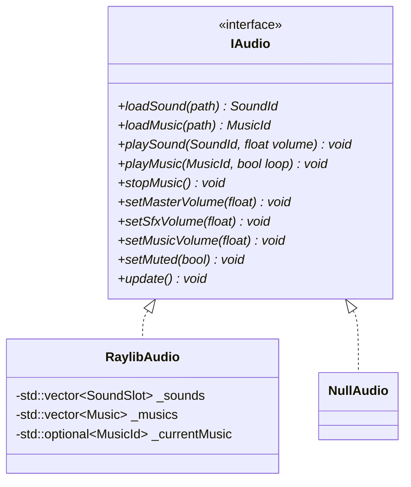

# Engine module

The engine is six small targets. They give a game the means to run (time, entities, drawing, input, sound) without deciding anything about it. Nothing under `engine/` may name an R-Type concept: no player, Bydos, missile or packet type.

## Core (`engine_core`)

Core holds the vocabulary types every other target shares, plus a handful of utilities. Anything new added here must be needed by at least two targets. Otherwise it belongs in the target that uses it.

```mermaid
classDiagram
    class Vec2~T~ {
        +T x
        +T y
        +operator+(Vec2~T~) Vec2~T~
        +operator-(Vec2~T~) Vec2~T~
        +operator*(T scalar) Vec2~T~
        +operator+=(Vec2~T~) Vec2~T~&
        +lengthSquared() T
        +length() T
        +normalized() Vec2~T~
    }
    class Rect~T~ {
        +T left
        +T top
        +T width
        +T height
        +contains(Vec2~T~ point) bool
        +intersects(Rect~T~ other) bool
        +center() Vec2~T~
        +fromCenter(Vec2~T~ center, Vec2~T~ halfSize)$ Rect~T~
    }
    class Color {
        +uint8_t r
        +uint8_t g
        +uint8_t b
        +uint8_t a
        +WHITE$ Color
        +BLACK$ Color
    }
    class Rng {
        -std::mt19937 _engine
        +Rng(uint32_t seed)
        +uniformInt(int lo, int hi) int
        +uniformFloat(float lo, float hi) float
        +chance(float probability) bool
        +seed() uint32_t
    }
    class EngineError {
        <<exception>>
    }
    class ResourceError
    class ConfigError
    class NetworkError
    class Level {
        <<enumeration>>
        TRACE
        DEBUG
        INFO
        WARN
        ERR
        OFF
    }
    class Logger {
        -std::string _context
        +Logger(std::string context)
        +trace() LogLine
        +debug() LogLine
        +info() LogLine
        +warn() LogLine
        +error() LogLine
        +trace(format_string fmt, Args... args) void
        +debug(format_string fmt, Args... args) void
        +info(format_string fmt, Args... args) void
        +warn(format_string fmt, Args... args) void
        +error(format_string fmt, Args... args) void
    }
    class LogLine {
        -Level _level
        -std::string_view _context
        -bool _active
        -std::ostringstream _buffer
        +operator<<(T const& value) LogLine&
        +~LogLine()
    }
    Logger ..> LogLine : creates
    Logger ..> Level
    class AssetLocator {
        -std::filesystem::path _root
        +AssetLocator(std::optional~path~ override)
        +resolve(std::string_view relative) path
        +root() path
    }
    class ICommand~Args~ {
        <<interface>>
        +execute(Args... args)* bool
        +operator()(Args... args) bool
    }
    class FactoryTemplate~Base, Key, Args~ {
        -std::unordered_map~Key, CreatorCallable~ _creators
        +registerCreator~Concrete~(Key key) void
        +unregisterCreator(Key key) void
        +create(Key const& key, Args... args) std::unique_ptr~Base~
        +hasKey(Key const& key) bool
    }
    FactoryTemplate ..> ICommand : creates implementations of
    EngineError <|-- ResourceError
    EngineError <|-- ConfigError
    EngineError <|-- NetworkError
```



| Element | Contract |
| --- | --- |
| `Vec2<T>`, `Rect<T>` | Plain aggregates, `constexpr` where possible. Aliases: `Vec2f`, `Vec2i`, `Vec2u`, `FloatRect`, `IntRect`. Coordinates use a y-down screen convention, in **logical units** ([game rules](game.md#rules-and-tuning-values)). |
| `Rng` | The only source of randomness in the game. The server seeds it from `std::random_device` unless `--seed` is given, which makes test runs reproducible. Never use `std::rand`. |
| `Logger`, `LogLine`, `log::*` | Thread-safe logging with a stream style and a `std::format` style, one line at a time, to `std::cerr`, coloured per level. See [Logging](#logging) below. |
| Error types | Thrown only during start-up or for a fatal, unrecoverable state. Per-frame code never throws on bad input; it returns `bool` or `std::optional`. The one exception is `net::PacketError`, which is thrown and caught inside the packet decode boundary ([network](network.md#netpacket), [handbook](../handbook/development.md#error-handling-policy)). |
| `ICommand<Args...>` | Generic command interface: `execute(Args...)` returns `false` when the command could not be carried out, and `operator()` is a non-virtual member that forwards to `execute`, so commands only implement `execute`. Used for the server's and client's message commands. |
| `FactoryTemplate<Base, Key, Args...>` | Maps a key to a creator. `registerCreator<Concrete>(key)` only compiles if `Concrete::create(Args...)` returns `std::unique_ptr<Base>` (enforced by the `HasCreateMethod` concept). `create(key, args...)` throws `std::runtime_error` for an unknown key, so callers check `hasKey` first on untrusted keys. The key type needs `std::hash` and `operator<<` (used in that error message). Copy and move are deleted. |
| `AssetLocator` | Finds `assets/` from, in order: the `--assets` flag, the `RTYPE_ASSETS_DIR` environment variable, `<executable dir>/assets`, then `<cwd>/assets`. Throws `ResourceError` with every path it tried. |

### Logging

One logging facility for the whole project, in `engine/core/include/engine/core/Log.hpp` and `src/Log.cpp`. It looks like `std::cout`, can also be used like `std::format`, and is safe to call from the network IO thread and the game thread at the same time.

#### Usage

```cpp
using namespace engine::core;

// std::format style (same syntax as std::format and C++23's std::println)
log::info("player {} joined from {}", id, endpoint);
log::error("cannot bind UDP port {}: {}", port, reason);

// Stream style, like std::cout: the line is written when the statement ends
log::info() << "player " << id << " joined from " << endpoint;

// With a context: one Logger per module or class, the context is printed on every line
Logger netLog{"net"};
netLog.warn("dropped {} datagrams", count);
netLog.debug() << "received " << bytes << " bytes from " << endpoint;
```

```text
[14:02:07.415] [INFO] [main] player 2 joined from 10.0.0.5:51234
[14:02:07.416] [WARN] [net-io] [net] dropped 3 datagrams
```

The free functions `log::trace()` … `log::error()` use a default `Logger` with no context.

#### API

```cpp
namespace engine::core {

enum class Level : std::uint8_t { TRACE, DEBUG, INFO, WARN, ERR, OFF };

class LogLine {                       // a single line being built
public:
    LogLine(Level level, std::string_view context);
    ~LogLine();                       // writes the whole line, once
    LogLine(LogLine&&) noexcept;      // movable, not copyable
    LogLine(const LogLine&) = delete;

    template <typename T>
    LogLine& operator<<(const T& value);
};

class Logger {
public:
    explicit Logger(std::string context = "");

    [[nodiscard]] LogLine info() const;                                // stream style
    template <typename... Args>
    void info(std::format_string<Args...> fmt, Args&&... args) const;  // format style
    // same pair for trace, debug, warn and error
};

namespace log {
    void setLevel(Level level);
    Level level();
    std::optional<Level> parseLevel(std::string_view name);   // "trace" | "debug" | "info" | "warn" | "error"
    void setThreadName(std::string_view name);                // e.g. "main", "net-io"
    void setOutput(std::ostream& stream);                     // std::cerr by default; tests redirect it
    void setColors(bool enabled);                             // default: on only if the output is a terminal

    LogLine info();                                           // and trace, debug, warn, error
    template <typename... Args>
    void info(std::format_string<Args...> fmt, Args&&... args);
}

}
```

#### Rules

| Rule | Detail |
| --- | --- |
| Level order | `TRACE < DEBUG < INFO < WARN < ERR < OFF`. A message is printed when its level is **≥** the threshold set with `setLevel` (default `INFO`). `OFF` silences everything. |
| `ERR`, not `ERROR` | Windows' `wingdi.h` defines `ERROR` as a macro, which breaks the name even inside an enum. The method `error()` is fine: it's lowercase. |
| One stream | Every level goes to the same stream: `std::cerr`. It's unbuffered, so a line reaches the terminal immediately, even just before a crash. Diagnostics stay off `std::cout`, so `./r-type_server 2> server.log` captures the whole log. |
| One line, written once | A `LogLine` builds its text in its own buffer, and its destructor writes the full line to the stream in a single call, under one global mutex. Lines from two threads never mix, and there is no end marker to forget: the line ends with the statement. |
| Colours per level | `TRACE` grey, `DEBUG` cyan, `INFO` green, `WARN` yellow, `ERR` red. For every level except `ERR`, the colour applies to the prefix only (`[time] [LEVEL] [thread] [context]`) and the message stays in the terminal's normal colour, so long messages stay readable. For `ERR`, the **whole line** is red, so errors stand out when scrolling. A reset code ends the coloured part. Colours are on by default only when the output is a terminal (`isatty` on Linux, `_isatty` on Windows), so CI logs and files stay free of escape codes. |
| Line format | `[HH:MM:SS.mmm] [LEVEL] [thread] [context] message`. The `[context]` part is omitted when the context is empty. The time is UTC, written with `std::format("{:%T}", std::chrono::floor<std::chrono::milliseconds>(now))`, which works on GCC 13 and MSVC without time-zone support. The thread name is a `thread_local`, `"?"` until `setThreadName` is called. |
| Cost when filtered out | The format style checks the level before calling `std::format`, so a disabled call costs one comparison. A filtered-out `LogLine` ignores its `<<` calls, but the expressions on the right of `<<` are still evaluated: don't put expensive computations in a log line. The threshold is a `std::atomic<Level>`. |
| No `printf` style | `"%d"`-style formatting isn't offered: it isn't type-safe, and `std::format` covers the same need. `std::println` is C++23, and we build in C++20, so the format style uses `std::format` with the same syntax. |
| `[[nodiscard]]` | The stream-style methods are `[[nodiscard]]`, so `log::info();` alone (a line that would print nothing) triggers a compiler warning, which `-Werror` turns into an error. |

## ECS (`engine_ecs`)

The ECS stores game data as components in **sparse sets**, one per component type, and runs **systems** registered in the registry, grouped in **stages**. Entities are **generational** handles, structural changes made during iteration go through a **command buffer**, and shared objects that aren't components (the random generator, the rules, `dt`) are **resources**.

The design follows the journey written while building the bootstrap ECS ([ECS journey](../reference/ECS_JOURNEY.md)), taken directly to its final form: the sparse sets and views of its steps 8–9, plus its steps 10 (own type erasure, no `std::any`), 11 (generational entities) and 12 (command buffer, resources, stages). Parallel scheduling of systems is left for Part 2. The reasons are in [ADR 0005](../decisions/0005-ecs-design.md).

Namespace `engine::ecs`, headers in `../../engine/ecs/include/engine/ecs` (template definitions in `.tpp` files included at the end of their header), non-template code in `engine/ecs/src/`. It knows no game type: the game registers its components, systems and resources at start-up.



### Entities

| Rule | Detail |
| --- | --- |
| Generational handle | An `Entity` is an **index** (`std::uint32_t`, the row in the storages) plus a **generation** (`std::uint32_t`, how many times that index has been reused). Killing an entity increments its index's generation, so any handle kept from before is detected as dead. |
| Only the registry creates them | The constructor is private (`friend class Registry`). Copying is public, so handles can be stored and passed around. Tests and engine internals that need an entity without a registry use `detail::EntityAccess::make(index, generation)`; it lives in `detail` so that any other use stands out in review. |
| `Entity::NONE` | A constant meaning "no entity" (all bits set), for fields like a missile's target. There is no default constructor. |
| No implicit conversion to an integer | Unlike the bootstrap, an `Entity` doesn't convert to `std::size_t`: that would silently drop the generation. Code that needs the row uses `index()`. |
| `isAlive(e)` | True only if `e.index()` is in range **and** its generation matches the registry's current one. A stale handle is never alive. |
| Spawning | Reuses freed indices first (LIFO, with their incremented generation), so storages stay as large as the maximum number of entities alive at the same time. |
| Killing | Erases the entity from every storage (one virtual `erase` per storage, no lookup), increments the generation and frees the index. Killing a dead or stale handle does nothing. |

Storing an `Entity` beyond the current tick is now safe: a dead target is detected with `isAlive`. Anything sent over the network still uses a `NetId` (overview rule 7), because entity indices are local to each process.

### Storage: sparse sets

Each component type is stored in a `SparseSet<Component>`: a `_sparse` array (entity index → position), a packed `_dense` array of entities and a packed `_components` array, aligned with `_dense`.

```text
entity index:   0     1     2     3     4
_sparse:     [npos,   1,  npos,   0,  npos]      index → position in the packed arrays
_dense:        [e3,   e1]                        position → entity (index + generation)
_components:   [C3,   C1]                        position → component
```

| Rule | Detail |
| --- | --- |
| Untyped base, typed storage | `SparseSetBase` holds `_sparse`, `_dense`, `contains`, `size`, `entities()` and a pure virtual `erase(Entity)`. `SparseSet<C>` adds the components. The registry and views work through the base when the type doesn't matter. |
| `contains(e)` checks the generation | `_sparse[e.index()]` must point to a position whose `_dense` entry equals `e`, so a stale handle never reads a new entity's component. |
| Erase is swap-and-pop, O(1) | The last element moves into the hole, in both packed arrays, and its `_sparse` entry is fixed. Order isn't stable. |
| Strong exception guarantee on insert | If inserting throws, the three arrays are left exactly as before. The order of operations is in the journey, step 8 ("Design decisions"). |
| `get` vs `tryGet` | `get` asserts the component exists (a bug otherwise); `tryGet` returns `nullptr` when it doesn't. |
| Spans, not vectors | `entities()` and `components()` return `std::span`, so callers can't resize the arrays and break the invariants. |
| Components | Any type satisfying the `ComponentConcept` concept: an object type, not `const`, movable (move-constructible and move-assignable). Move-only components (holding a `std::unique_ptr`) are allowed. |

### Registry

| Area | Functions | Behaviour |
| --- | --- | --- |
| Type ids | `detail::typeId<T>()` | A small integer per type, assigned on first use and stable for the process's lifetime. Storages and resources are vectors indexed by it: a lookup is an array access, not a hash. **Never sent over the network or saved**: ids depend on first-use order. |
| Components | `registerComponent<C>()`, `getComponents<C>()` (+ `const`) | Registering is idempotent. `getComponents` on an unregistered type throws `EngineError` naming the type. |
| Entity data | `addComponent`, `emplaceComponent`, `removeComponent`, `getComponent` (`nullptr` if absent or stale) | Adding to a dead entity throws `EngineError` (detectable now, thanks to generations). |
| Copying | (none) | The registry is **move-only**: it owns its storages through `std::unique_ptr`. A game has one registry per process. |
| Threads | (none) | **Not thread-safe.** Only the game thread touches the registry; the network thread hands data over through `UdpSocket`'s queue. |

### Views

`registry.view<Position, const Velocity>()` iterates every entity that has all the listed components, yielding references (`const` where the type is `const`). `indexedView<…>()` also yields the `Entity` first. Both work with structured bindings:

```cpp
for (auto&& [pos, vel] : registry.view<Position, const Velocity>()) …
for (auto&& [entity, health] : registry.indexedView<Health>()) …
```

| Rule | Detail |
| --- | --- |
| Driver | The **smallest** of the listed sets drives the iteration, chosen once when the view is built and held as a `const SparseSetBase*` plus its position in the list. Every other set is checked with `contains`. Cost follows the smallest set, not the number of entities. |
| Backwards | The driver is walked from its last element to its first, so erasing the **current** entity is safe: swap-and-pop brings in an element that was already visited. |
| Types | Each listed type is a component, possibly `const`, and a `const` type yields a `const` reference. A view needs at least one type and can't list the same one twice (checked at compile time). On a `const Registry&`, every type must be `const`. |
| `indexedView` | Same iteration as `view`, through the same iterator. The `Entity` yielded is the full handle, generation included, so it can be passed to `killEntity` directly. |
| Performance target | Within 10% of a hand-written join at every density, with GCC and Clang (see [handbook: benchmarks](../handbook/development.md#benchmarks)). |

### Systems and stages

```cpp
registry.addSystem<Transform, const Velocity>(Stage::FIXED_UPDATE, "movement", movementSystem);
// movementSystem(Registry&, SparseSet<Transform>&, const SparseSet<Velocity>&)

registry.runStage(Stage::FIXED_UPDATE);   // runs that stage's systems in insertion order
```

| Rule | Detail |
| --- | --- |
| Signature | A system receives the `Registry&` first, then one storage per listed component, in the listed order. A `const` component gives a `const SparseSet<C>&`, and a system taking a non-`const` storage for it doesn't compile. Checked at compile time with a readable `static_assert` message. |
| Stages | Systems belong to a stage: any enumeration (`enum class` or plain `enum`) whose underlying type is `std::uint8_t`, defined by the game (for example `FIXED_UPDATE`, `RENDER`), checked by `StageConcept`. Systems are kept in a vector indexed by the stage's value, so stages use small values starting at 0. `runStage` runs one stage's systems in the order they were added. A stage with no systems does nothing. The server never adds render systems. |
| Names | Each system has a name, logged at `trace` level through a `Logger{"ecs"}` with its run time (`<name> took <µs> us`), which makes the tick order and its cost visible. Until the logger has a global level, this line is written on every run. |
| Registration | Adding a system registers its component types. Adding a system while a stage is running is a programming error, caught with an `assert`. |
| Callables | Stored in `std::function`, so systems must be copyable callables (free functions and lambdas without move-only captures). Move-only state goes in a resource. The registry keeps one copy and calls it on every run, so a `mutable` lambda keeps its state across runs. |
| Running guard | A flag is set for the whole stage and reset by an RAII object. Calling `runStage` from inside a system is a programming error, caught with an `assert`. If a system throws, the exception reaches the caller of `runStage`, the rest of that stage doesn't run, and the next `runStage` works normally. |

### Command buffer

Structural changes requested while iterating are recorded in `registry.commands()` and applied later, in order:

| Command | Effect when applied |
| --- | --- |
| `kill(e)` | `killEntity(e)` (ignored if `e` is already dead) |
| `spawn(init)` | spawns an entity, then calls `init(Registry&, Entity)` to add its components |
| `add<C>(e, value)` | `addComponent(e, value)` (ignored if `e` died meanwhile) |
| `remove<C>(e)` | `removeComponent<C>(e)` |

- The registry applies the buffer **after each system** in `runStage`, so the next system sees a consistent world. `applyCommands()` applies it on demand, for code outside a stage.
- Commands are stored as `std::function`, so a value passed to a deferred `add` must be copyable. A move-only component is added immediately, outside any view loop.

### Resources

Objects that every system may need but that aren't components: the game's random generator, rules, event outbox, `dt`. There is one instance per type, found through `detail::typeId<T>()` like the storages, but kept in a **separate vector**: a type used both as a component and as a resource gets two independent objects.

Each resource lives in a `detail::ResourceHolder<T>`, behind a `std::unique_ptr` to a small base with a virtual destructor (`Resources.hpp`). So a resource never moves in memory: setting other resource types, or moving the registry, leaves references to it valid.

| Function | Behaviour |
| --- | --- |
| `setResource<T>(T value) -> T&` | Creates the resource, or **move-assigns** the new value into the existing one, so references taken earlier stay valid. `T` must be movable. |
| `emplaceResource<T>(Args&&...) -> T&` | Builds the resource in place from the arguments, for types that can't be moved (a mutex) or are costly to move. Replacing an existing one **destroys it**, so earlier references dangle. The new object is built before the old one is destroyed: if its constructor throws, the old resource is kept. |
| `getResource<T>() -> T&` (+ `const`) | Throws `EngineError("resource not set: <type>")` if it was never set. The `const` overload returns `const T&`. |
| `tryGetResource<T>() -> T*` (+ `const`) | `nullptr` if never set. The `const` overload returns `const T*`. |

- `T` is any non-`const`, non-reference object type (`ResourceConcept`, the same rule as type ids). Unlike components, a resource doesn't have to be movable.
- `DeltaTime` is the only resource the ECS defines: `{ float seconds = 0; }`. Whoever runs a stage sets it first. Systems read it and never read a clock (requirement F-08).

### Contract

Unit tests check every rule. Each one maps to a "Check yourself" list in the journey.

1. **Registration.** The game registers every component type when its world is created. Using an unregistered type throws `EngineError` naming it.
2. **Inside a view loop, only the current entity may change immediately.** Killing it or removing one of its components is safe. Killing *other* entities, spawning, or adding components goes through `commands()`. Component references taken in the loop dangle after an add, so don't keep them.
3. **Commands are applied after each system**, in the order they were recorded.
4. **Stale handles are detected.** After a kill, the old handle is not alive, `getComponent` through it returns `nullptr`, and adding to it throws.
5. **Iteration order is unspecified.** Systems must not depend on it.
6. **Type ids are process-local.** Never serialize them.
7. **Single-threaded.** Only the game thread uses the registry.
8. **Stages don't nest.** A system never calls `runStage` or `addSystem`. Both are checked with an `assert`.

### Benchmarks

The ECS ships with a Google Benchmark suite (`ecs_benchmarks`, in `benchmarks/ecs/`), built only with `RTYPE_BUILD_BENCHMARKS=ON` in a Release build. It covers the journey's measurements, with these acceptance targets:

| Benchmark | Target |
| --- | --- |
| `getComponents<T>()` lookup | a few nanoseconds (array index, no hash) |
| `isAlive` on random handles, half stale | under 5 ns |
| spawn + add + kill, with 1, 8 and 32 registered types | grows linearly with the type count, with a small slope (one virtual call per storage) |
| `view<A, B>()` vs a hand-written join, densities 0.1% to 100% | within 10% at every density, GCC and Clang, `-O2` and `-O3` |
| memory per component | reported as a counter (`_sparse` + `_dense` + component) |

How to run and compare them: [handbook: benchmarks](../handbook/development.md#benchmarks).

## Runtime (`engine_runtime`)

Runtime turns wall-clock time into the fixed steps that requirement F-08 asks for. Nothing in the game reads the clock directly: the owner of the registry turns these classes' output into the `DeltaTime` resource before running a stage, and systems read `dt` from there.



| Class | Used by | Behaviour |
| --- | --- | --- |
| `Stopwatch` | client frame loop | `restart()` returns the seconds since the last call and starts timing again. |
| `FixedTimestep` | client prediction and input sending | `advance(frame)` adds `min(frame, 0.25 s)` to an accumulator and returns how many whole steps to run, capped at `maxStepsPerFrame` (5). When the cap is hit, the time it could not run is discarded, so the next frames don't hit the cap too (the "spiral of death"). `alpha()` is the leftover fraction, always in `[0, 1)`, used for render interpolation. |
| `FixedRateTicker` | server simulation thread | `waitNext()` sleeps until the next deadline with `sleep_until`. If the thread falls more than 250 ms behind, it resets the deadline to now, adds one to `overruns()`, and logs a warning instead of trying to catch up. |

## Render (`engine_render`)

Render takes a list of engine-level draw commands and puts them on screen with Raylib. It owns the window, so it also turns Raylib's keyboard and window state into engine `input::InputEvent`s. Because of that, `engine_input` needs no Raylib at all. All Raylib code lives in `src/raylib/`, behind a pimpl, so no public header includes `raylib.h`.



- `DrawCommand` is `std::variant<SpriteCmd, RectCmd, TextCmd>`. Commands are plain values, so the client's render system can build them without knowing which backend draws them.
- `TextureId` and `FontId` are strong `uint16_t` wrappers. Loading the same path twice returns the same id. A missing file throws `ResourceError` at start-up, never mid-game.
- **Logical resolution.** The game draws in a fixed 1280 × 720 logical space, so every player sees the same playfield ([game rules](game.md#rules-and-tuning-values)). `beginFrame` starts drawing into a 1280 × 720 `RenderTexture2D` (`BeginTextureMode`). `endFrame` ends it, then draws that texture scaled and letterboxed into the real window with `DrawTexturePro`. Raylib render textures are stored upside down, so the source rectangle has a negative height.
- **Commands to Raylib calls.** `SpriteCmd` becomes `DrawTexturePro`, `RectCmd` becomes `DrawRectangleRec` plus `DrawRectangleLinesEx`, and `TextCmd` becomes `DrawTextEx`. A `TextCmd` with no font uses Raylib's built-in font (`GetFontDefault()`), so the HUD works without a font file.
- **One window, created first, closed last.** Raylib keeps a single global window and OpenGL context. `Window`'s constructor calls `InitWindow` and asserts that no other `Window` exists, and its destructor calls `CloseWindow`. Textures and fonts can only be loaded once the window exists, and must be unloaded before it closes. `ClientApp` therefore declares `_window` before `_textures` and `_fonts`, so C++ builds them in that order and destroys them in reverse.
- `sortByLayer()` is a stable sort, so commands on the same layer keep the order they were pushed in. The layers are: 0 far stars, 10 near stars, 100 enemies, 110 missiles, 120 players, 200 explosions, 1000 HUD.

## Input (`engine_input`)

Input keeps track of which keys are held, using engine key codes, and maps them to game actions through a table the player can rebind. It contains no Raylib: the events come from `render::Window::pollEvents()`.



- `InputEvent::Type` is one of `KEY_PRESSED`, `KEY_RELEASED`, `WINDOW_CLOSED`, `FOCUS_LOST`, `FOCUS_GAINED` or `RESIZED`. On `FOCUS_LOST`, the client calls `releaseAll()` so that a ship doesn't keep moving after the player switches windows.
- **Where the events come from.** Raylib has no event queue: it answers questions like `IsKeyPressed(KEY_UP)` about the current frame. `Window::pollEvents()` turns those answers into events. For each engine `Key`, it asks Raylib `IsKeyPressed` and `IsKeyReleased` for the matching `KEY_*` code, through one fixed translation table. It reports `WindowShouldClose()` as `WINDOW_CLOSED`, a change of `IsWindowFocused()` as `FOCUS_LOST` or `FOCUS_GAINED`, and `IsWindowResized()` as `RESIZED`.
- **Escape is a normal key.** By default Raylib closes the window when Escape is pressed. `Window` calls `SetExitKey(KEY_NULL)` to turn that off, so Escape goes through the `QUIT` action like any other binding.
- `beginFrame()` clears the pressed and released sets. `apply()` updates all three sets. OS key-repeat events are ignored, and a key counts as pressed only on its first down event.
- The client defines `enum class Action { MOVE_UP, MOVE_DOWN, MOVE_LEFT, MOVE_RIGHT, FIRE, TOGGLE_HUD_HELP, QUIT }`. Default bindings are the arrow keys (required by F-09) plus WASD, with `SPACE` and `LCTRL` to fire. Bindings are saved to `config/keybindings.cfg` ([accessibility](../architecture/accessibility.md)).
- **An action has a set of keys.** Binding the same pair twice stores it once, and `unbind` removes one key. A key can belong to several actions.
- **The bindings file is JSON.** One entry per action, with its name and its keys:
  ```json
  {
    "config": [
      { "name": "FIRE", "keys": ["SPACE", "LCTRL"] },
      { "name": "MOVE_UP", "keys": ["UP", "KEY_W"] }
    ]
  }
  ```
- **Names in the bindings file.** Key names are the enum's: `KEY_A` to `KEY_Z`, `NUM0` to `NUM9`, `UP`, `SPACE`, `LCTRL`, and so on, in any case. `engine_input` provides `toString(Key)` and `keyFromString`. Actions belong to the client, so `ActionMap` finds `toString(Action)` and `fromString(std::string_view, Action&)` by ADL, the same pattern as the `Packet` serializers. `ActionMap` is constrained on a concept that checks both functions exist.
- **Loading.** A missing file returns `false` and keeps the default bindings. Each action in the file replaces its keys, and actions missing from the file keep theirs. An unknown action or key is skipped with a warning naming the entry, and an action left with no valid key keeps its old keys. A file that isn't valid JSON, or whose fields have the wrong type, is rejected as a whole with a warning, and nothing changes.
- **Saving** writes every binding, creating the parent folder if needed. The order isn't fixed, because the bindings are stored in hash containers. An I/O error returns `false` with a warning.

## Audio (`engine_audio`)

Audio plays short sound effects and one music track. The client decides what to play based on game events. Audio only knows how to play it.



- **`update()` once per frame.** Raylib streams music in small pieces and needs `UpdateMusicStream` to be called every frame, or the music stutters and stops. The client calls `audio.update()` once per frame. `NullAudio::update()` does nothing.
- **Overlapping sounds.** A Raylib `Sound` can only play once at a time. Each `SoundSlot` holds the loaded sound plus 4 aliases made with `LoadSoundAlias`, which share the same sample data. `playSound` uses the first copy that isn't playing, or restarts the oldest one when all 5 are busy. That keeps memory flat even during heavy explosions.
- **Device lifetime.** The constructor calls `InitAudioDevice` and the destructor `CloseAudioDevice`, after unloading every sound and music. If `IsAudioDeviceReady()` is false, the constructor throws. The client never builds `RaylibAudio` directly: it calls `makeAudio()`, which tries `RaylibAudio` and, on failure, logs a warning and returns `NullAudio` instead of failing.
- Volumes go from 0 to 1, and the effective volume is master × channel.
- Raylib types appear only in the `.cpp` file. The diagram shows the private members to explain the design, but the header holds a pimpl.

