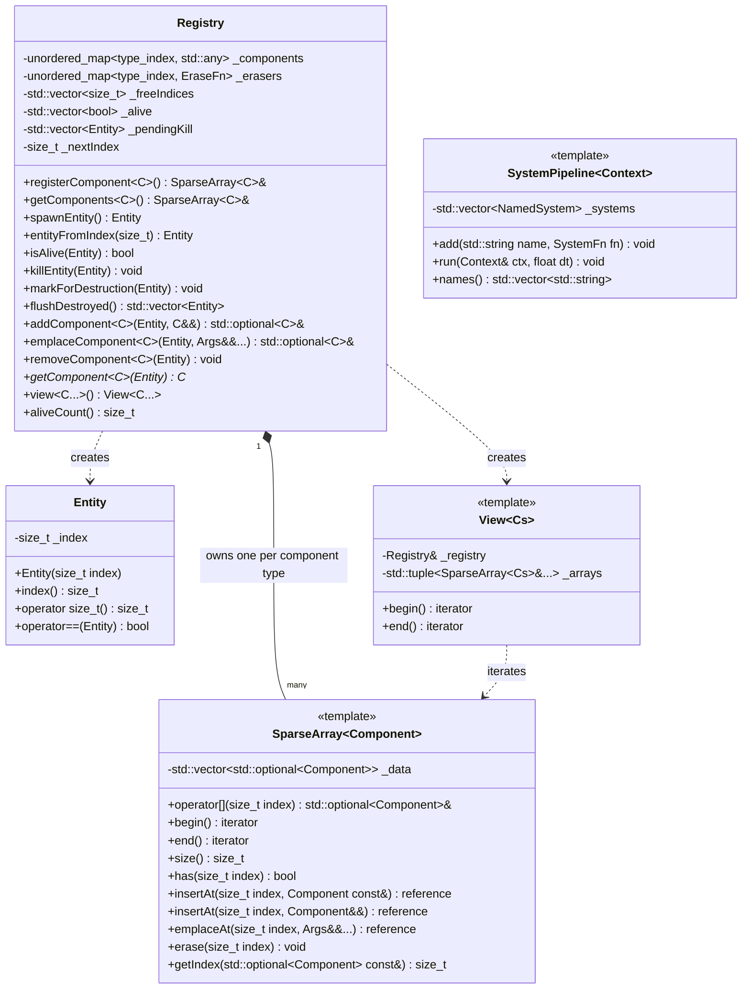
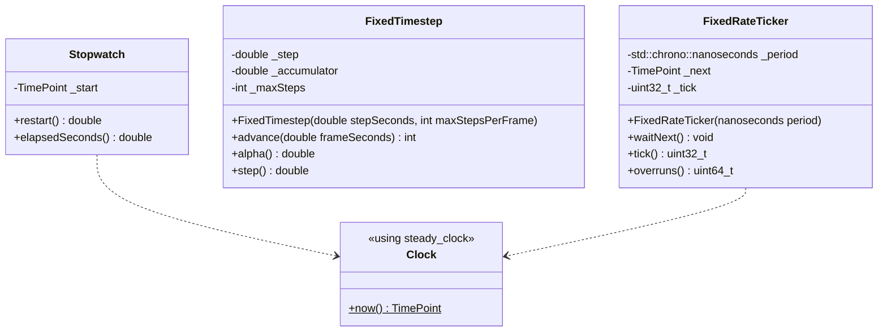
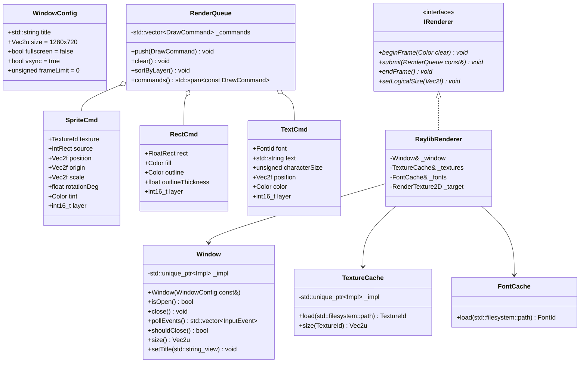
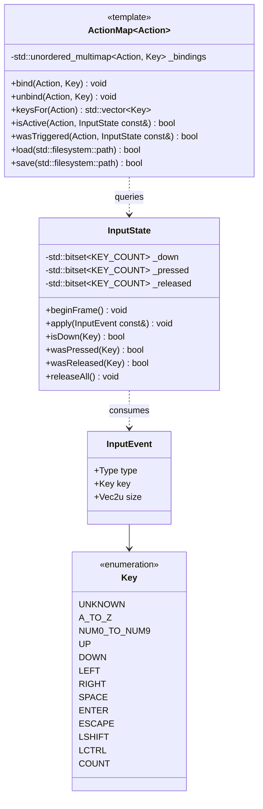
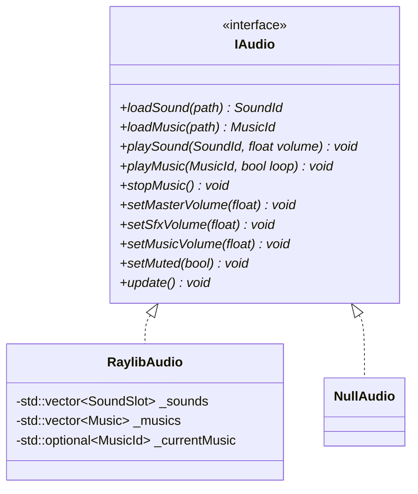

# Engine module

The engine is six small targets. They give a game the means to run (time, entities, drawing, input, sound) without deciding anything about it. Nothing under `engine/` may name an R-Type concept: no player, Bydos, missile or packet type.

## Core (`engine_core`)

Core holds the vocabulary types every other target shares, plus a handful of utilities. Anything new added here must be needed by at least two targets. Otherwise it belongs in the target that uses it.

```mermaid
classDiagram
    class Vec2~T~ {
        +T x
        +T y
        +operator+(Vec2~T~) Vec2~T~
        +operator-(Vec2~T~) Vec2~T~
        +operator*(T scalar) Vec2~T~
        +operator+=(Vec2~T~) Vec2~T~&
        +lengthSquared() T
        +length() T
        +normalized() Vec2~T~
    }
    class Rect~T~ {
        +T left
        +T top
        +T width
        +T height
        +contains(Vec2~T~ point) bool
        +intersects(Rect~T~ other) bool
        +center() Vec2~T~
        +fromCenter(Vec2~T~ center, Vec2~T~ halfSize)$ Rect~T~
    }
    class Color {
        +uint8_t r
        +uint8_t g
        +uint8_t b
        +uint8_t a
        +WHITE$ Color
        +BLACK$ Color
    }
    class Rng {
        -std::mt19937 _engine
        +Rng(uint32_t seed)
        +uniformInt(int lo, int hi) int
        +uniformFloat(float lo, float hi) float
        +chance(float probability) bool
        +seed() uint32_t
    }
    class EngineError {
        <<exception>>
    }
    class ResourceError
    class ConfigError
    class NetworkError
    class Log {
        <<namespace>>
        +setLevel(Level)$
        +trace(fmt, args)$
        +debug(fmt, args)$
        +info(fmt, args)$
        +warn(fmt, args)$
        +error(fmt, args)$
    }
    class AssetLocator {
        -std::filesystem::path _root
        +AssetLocator(std::optional~path~ override)
        +resolve(std::string_view relative) path
        +root() path
    }
    class ICommand~Args~ {
        <<interface>>
        +execute(Args... args)* bool
        +operator()(Args... args)* bool
    }
    class FactoryTemplate~Base, Key, Args~ {
        -std::unordered_map~Key, CreatorCallable~ _creators
        +registerCreator~Concrete~(Key key) void
        +unregisterCreator(Key key) void
        +create(Key const& key, Args... args) std::unique_ptr~Base~
        +hasKey(Key const& key) bool
    }
    FactoryTemplate ..> ICommand : creates implementations of
    EngineError <|-- ResourceError
    EngineError <|-- ConfigError
    EngineError <|-- NetworkError
```



| Element | Contract |
| --- | --- |
| `Vec2<T>`, `Rect<T>` | Plain aggregates, `constexpr` where possible. Aliases: `Vec2f`, `Vec2i`, `Vec2u`, `FloatRect`, `IntRect`. Coordinates use a y-down screen convention, in **logical units** ([game rules](game.md#rules-and-tuning-values)). |
| `Rng` | The only source of randomness in the game. The server seeds it from `std::random_device` unless `--seed` is given, which makes test runs reproducible. Never use `std::rand`. |
| `log::*` | Thread-safe and built on `std::format`. Each line is `[HH:MM:SS.mmm] [LEVEL] [thread] message` on `stderr`. The level comes from `--log-level`. There is no file sink in Part 1. |
| Error types | Thrown only during start-up or for a fatal, unrecoverable state. Per-frame code never throws on bad input; it returns `bool` or `std::optional`. The one exception is `net::PacketError`, which is thrown and caught inside the packet decode boundary ([network](network.md#netpacket), [handbook](../handbook/development.md#error-handling-policy)). |
| `ICommand<Args...>` | Generic command interface: `execute(Args...)` returns `false` when the command could not be carried out, and `operator()` forwards to `execute`. Used for the server's and client's message commands. |
| `FactoryTemplate<Base, Key, Args...>` | Maps a key to a creator. `registerCreator<Concrete>(key)` only compiles if `Concrete::create(Args...)` returns `std::unique_ptr<Base>` (enforced by the `HasCreateMethod` concept). `create(key, args...)` throws `std::runtime_error` for an unknown key, so callers check `hasKey` first on untrusted keys. The key type needs `std::hash` and `operator<<` (used in that error message). Copy and move are deleted. |
| `AssetLocator` | Finds `assets/` from, in order: the `--assets` flag, the `RTYPE_ASSETS_DIR` environment variable, `<executable dir>/assets`, then `<cwd>/assets`. Throws `ResourceError` with every path it tried. |

## ECS (`engine_ecs`)

The ECS uses the classic Epitech design: each component type gets one `SparseArray<Component>`, indexed by the entity's index. It is header-only because everything in it is a template. Gameplay types are unknown to it. The game registers its components at start-up.



The full public API of `Registry` that the game codes against:

```cpp
namespace engine::ecs {
class Registry {
public:
    template <class C> SparseArray<C>& registerComponent();   // idempotent
    template <class C> SparseArray<C>& getComponents();       // throws EngineError if C was never registered
    template <class C> const SparseArray<C>& getComponents() const;

    Entity spawnEntity();                     // reuses freed indices (LIFO)
    Entity entityFromIndex(std::size_t index);
    bool isAlive(Entity e) const;
    void killEntity(Entity e);                // immediate: erases from every SparseArray
    void markForDestruction(Entity e);        // deferred: safe inside a view loop
    std::vector<Entity> flushDestroyed();     // kills marked entities, returns them

    template <class C> std::optional<C>& addComponent(Entity e, C&& component);
    template <class C, class... Args> std::optional<C>& emplaceComponent(Entity e, Args&&... args);
    template <class C> void removeComponent(Entity e);
    template <class C> C* getComponent(Entity e);             // nullptr when absent

    template <class... Cs> View<Cs...> view();                // yields std::tuple<Entity, Cs&...>
    std::size_t aliveCount() const;
};
}
```

These rules are part of the contract. Unit tests check every one of them.

1. **Registration.** `rtype::game::registerComponents(Registry&)` registers every game component exactly once, when the world is created. A missing registration fails fast with an `EngineError` that names the type.
2. **No structural changes inside a view.** A system iterating `view<A, B>()` must not add or remove `A` or `B`, or spawn entities, inside the loop, because a `SparseArray` may reallocate. It collects requests in a local vector and applies them after the loop. Kills always go through `markForDestruction`.
3. **One flush per tick.** `flushDestroyed()` runs once, at the end of the simulation tick ([game systems](game.md#systems-and-tick-order)). The game releases the `NetId`s of the entities it returns.
4. **Index reuse.** Freed indices are reused, so an `Entity` value is valid only within the tick that produced it. Anything that lives longer, such as a projectile's owner, stores a `NetId` instead.
5. **Iteration order.** `view` goes by ascending index and yields only entities that have all the requested components. Systems must not rely on any other order.

`SystemPipeline<Context>` is a named, ordered list of `std::function<void(Context&, float)>`. The game provides the `Context` (`rtype::game::SimContext`, see [game](game.md#world-context-commands-and-events)), so the engine never learns what a system needs. Names are logged at debug level, which makes the tick order easy to trace.

## Runtime (`engine_runtime`)

Runtime turns wall-clock time into the fixed steps that requirement F-08 asks for. Nothing in the game reads the clock directly: every system receives `dt` from these classes.



| Class | Used by | Behaviour |
| --- | --- | --- |
| `Stopwatch` | client frame loop | `restart()` returns the seconds since the last call and starts timing again. |
| `FixedTimestep` | client prediction and input sending | `advance(frame)` adds `min(frame, 0.25 s)` to an accumulator and returns how many whole steps to run, capped at `maxStepsPerFrame` (5). `alpha()` is the leftover fraction, used for render interpolation. |
| `FixedRateTicker` | server simulation thread | `waitNext()` sleeps until the next deadline with `sleep_until`. If the thread falls more than 250 ms behind, it resets the deadline to now, adds one to `overruns()`, and logs a warning instead of trying to catch up. |

## Render (`engine_render`)

Render takes a list of engine-level draw commands and puts them on screen with Raylib. It owns the window, so it also turns Raylib's keyboard and window state into engine `input::InputEvent`s. Because of that, `engine_input` needs no Raylib at all. All Raylib code lives in `src/raylib/`, behind a pimpl, so no public header includes `raylib.h`.



- `DrawCommand` is `std::variant<SpriteCmd, RectCmd, TextCmd>`. Commands are plain values, so the client's render system can build them without knowing which backend draws them.
- `TextureId` and `FontId` are strong `uint16_t` wrappers. Loading the same path twice returns the same id. A missing file throws `ResourceError` at start-up, never mid-game.
- **Logical resolution.** The game draws in a fixed 1280 × 720 logical space, so every player sees the same playfield ([game rules](game.md#rules-and-tuning-values)). `beginFrame` starts drawing into a 1280 × 720 `RenderTexture2D` (`BeginTextureMode`). `endFrame` ends it, then draws that texture scaled and letterboxed into the real window with `DrawTexturePro`. Raylib render textures are stored upside down, so the source rectangle has a negative height.
- **Commands to Raylib calls.** `SpriteCmd` becomes `DrawTexturePro`, `RectCmd` becomes `DrawRectangleRec` plus `DrawRectangleLinesEx`, and `TextCmd` becomes `DrawTextEx`. A `TextCmd` with no font uses Raylib's built-in font (`GetFontDefault()`), so the HUD works without a font file.
- **One window, created first, closed last.** Raylib keeps a single global window and OpenGL context. `Window`'s constructor calls `InitWindow` and asserts that no other `Window` exists, and its destructor calls `CloseWindow`. Textures and fonts can only be loaded once the window exists, and must be unloaded before it closes. `ClientApp` therefore declares `_window` before `_textures` and `_fonts`, so C++ builds them in that order and destroys them in reverse.
- `sortByLayer()` is a stable sort, so commands on the same layer keep the order they were pushed in. The layers are: 0 far stars, 10 near stars, 100 enemies, 110 missiles, 120 players, 200 explosions, 1000 HUD.

## Input (`engine_input`)

Input keeps track of which keys are held, using engine key codes, and maps them to game actions through a table the player can rebind. It contains no Raylib: the events come from `render::Window::pollEvents()`.



- `InputEvent::Type` is one of `KEY_PRESSED`, `KEY_RELEASED`, `WINDOW_CLOSED`, `FOCUS_LOST`, `FOCUS_GAINED` or `RESIZED`. On `FOCUS_LOST`, the client calls `releaseAll()` so that a ship doesn't keep moving after the player switches windows.
- **Where the events come from.** Raylib has no event queue: it answers questions like `IsKeyPressed(KEY_UP)` about the current frame. `Window::pollEvents()` turns those answers into events. For each engine `Key`, it asks Raylib `IsKeyPressed` and `IsKeyReleased` for the matching `KEY_*` code, through one fixed translation table. It reports `WindowShouldClose()` as `WINDOW_CLOSED`, a change of `IsWindowFocused()` as `FOCUS_LOST` or `FOCUS_GAINED`, and `IsWindowResized()` as `RESIZED`.
- **Escape is a normal key.** By default Raylib closes the window when Escape is pressed. `Window` calls `SetExitKey(KEY_NULL)` to turn that off, so Escape goes through the `QUIT` action like any other binding.
- `beginFrame()` clears the pressed and released sets. `apply()` updates all three sets. OS key-repeat events are ignored, and a key counts as pressed only on its first down event.
- The client defines `enum class Action { MOVE_UP, MOVE_DOWN, MOVE_LEFT, MOVE_RIGHT, FIRE, TOGGLE_HUD_HELP, QUIT }`. Default bindings are the arrow keys (required by F-09) plus WASD, with `SPACE` and `LCTRL` to fire. Bindings are saved to `config/keybindings.cfg`, one `ACTION=KEY` per line ([accessibility](../architecture/accessibility.md)).

## Audio (`engine_audio`)

Audio plays short sound effects and one music track. The client decides what to play based on game events. Audio only knows how to play it.



- **`update()` once per frame.** Raylib streams music in small pieces and needs `UpdateMusicStream` to be called every frame, or the music stutters and stops. The client calls `audio.update()` once per frame. `NullAudio::update()` does nothing.
- **Overlapping sounds.** A Raylib `Sound` can only play once at a time. Each `SoundSlot` holds the loaded sound plus 4 aliases made with `LoadSoundAlias`, which share the same sample data. `playSound` uses the first copy that isn't playing, or restarts the oldest one when all 5 are busy. That keeps memory flat even during heavy explosions.
- **Device lifetime.** The constructor calls `InitAudioDevice` and the destructor `CloseAudioDevice`, after unloading every sound and music. If `IsAudioDeviceReady()` is false, the client logs a warning and switches to `NullAudio` instead of failing.
- Volumes go from 0 to 1, and the effective volume is master × channel.
- Raylib types appear only in the `.cpp` file. The diagram shows the private members to explain the design, but the header holds a pimpl.

