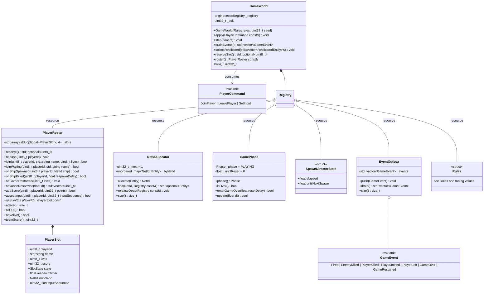
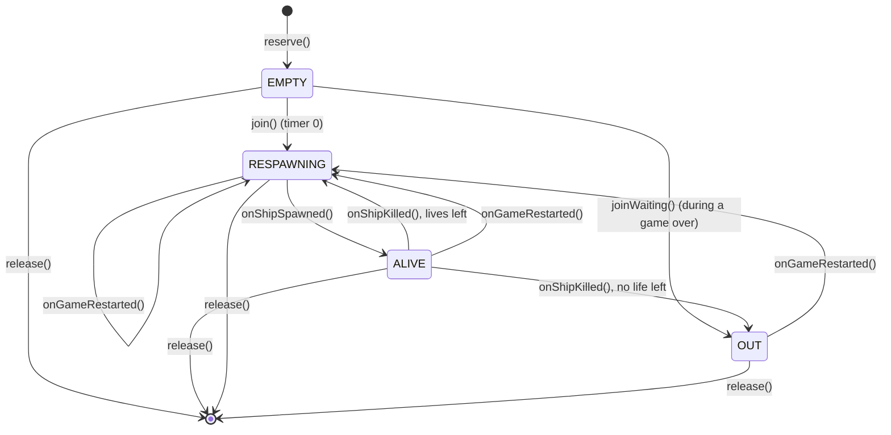

# Game module (`rtype_game`)

The game module is the R-Type simulation: data in components, behaviour in systems, entity recipes in builders, and numbers in one `Rules` struct. Its whole interface is commands in and events out, so the server can run it and the tests can drive it without a socket or a window.

## Components

Every component is a plain aggregate with no methods and no pointers. Entities are just combinations of these components, put together by the [builders](#builders).

| Component | Fields | Meaning |
| --- | --- | --- |
| `Transform` | `Vec2f position` | Centre of the entity, in logical units |
| `Velocity` | `Vec2f value` | Units per second |
| `Collider` | `Vec2f halfSize`, `CollisionLayer layer` | Axis-aligned box centred on `position` |
| `Health` | `int16_t current`, `int16_t max` | The entity dies at 0 or below |
| `Damage` | `int16_t amount` | Damage dealt on contact |
| `Replicated` | `NetId netId`, `EntityKind kind`, `uint8_t variant` | Marks the entity for the network. The only component `collectReplicated()` reads |
| `PlayerShip` | `uint8_t playerId`, `InputButtons buttons`, `float invulnerableFor` | Present only on player ships |
| `Weapon` | `float cooldown`, `float timer`, `Vec2f muzzleOffset`, `float projectileSpeed`, `Vec2f aim`, `bool triggered` | Fires when `triggered` is set and `timer` ≤ 0. `aim` is the unit direction of the next shot: (1, 0) for a ship, set by `aimedShooterSystem` for an enemy |
| `StraightMover` | `float speed` | Moves left at `speed` |
| `SineMover` | `float speed`, `float baseY`, `float amplitude`, `float frequency`, `float age` | Moves left at `speed` while oscillating around `baseY` |
| `AimedShooter` | `FloatRange interval`, `float timer` | Fires at the nearest ship every random `interval` |
| `Projectile` | `NetId owner`, `uint8_t ownerPlayerId` | Who fired it. `ownerPlayerId` survives the shooter's death, and is `NO_PLAYER` for enemy missiles |
| `LastHit` | `NetId by`, `uint8_t byPlayerId` | Who dealt the last damage, so `healthSystem` knows whom to credit and whom to name as the killer |
| `Lifetime` | `float remaining` | The entity is destroyed when it reaches 0 |
| `ConfinedToPlayfield` | (none) | Clamped so its collider stays inside 1280 × 720 |
| `DespawnOutsidePlayfield` | `float margin` | Destroyed once more than `margin` outside the playfield |
| `ScoreValue` | `uint32_t points` | Points awarded to the killer |

`registerComponents(Registry &)` registers all 17. Registering is idempotent, so calling it twice is harmless.

**Behaviour components.** An enemy's behaviour is the set of components it has, not a type switch: `StraightMover` or `SineMover` for its movement, `AimedShooter` for its attack. Each has its own system and only writes plain data (`Velocity`, `Weapon.aim`, `Weapon.triggered`). A new movement or attack is a new component and a new system, with no change to the existing ones. `MovePattern` remains as the BYDOS_SLAVE's network `variant` (0 = STRAIGHT, 1 = SINE) and as the argument `makeBydosSlave` uses to pick the mover.

**Which components each entity has** (Collider in full sizes, see [sizes](#sizes-follow-the-sprite-frames)):

| Kind | Transform | Velocity | Collider | Health | Damage | Replicated | Extra |
| --- | --- | --- | --- | --- | --- | --- | --- |
| PLAYER_SHIP | yes | yes | PLAYER, 32 × 14 | 1 | 1 | yes | `PlayerShip`, `Weapon`, `ConfinedToPlayfield` |
| BYDOS_SLAVE | yes | yes | ENEMY, 21 × 24 | 1 | 1 | yes | `StraightMover` or `SineMover`, `AimedShooter`, `Weapon`, `DespawnOutsidePlayfield`, `ScoreValue(100)` |
| PLAYER_MISSILE | yes | yes | PLAYER_SHOT, 12 × 4 | 1 | 1 | yes | `Projectile`, `Lifetime(2 s)`, `DespawnOutsidePlayfield` |
| ENEMY_MISSILE | yes | yes | ENEMY_SHOT, 7 × 6 | 1 | 1 | yes | `Projectile`, `Lifetime(4 s)`, `DespawnOutsidePlayfield` |

**Which layers collide** (anything not listed never collides):

| A | B | Effect |
| --- | --- | --- |
| PLAYER | ENEMY | Both take the other's `Damage` |
| PLAYER | ENEMY_SHOT | The ship takes damage, the missile is destroyed |
| PLAYER_SHOT | ENEMY | The enemy takes damage, the missile is destroyed |

A ship with `invulnerableFor > 0` ignores every collision.

## World, resources, commands and events

`GameWorld` owns one ECS `Registry` and configures it in its constructor: it registers the components, sets the resources, and adds the systems of the `SIMULATION` stage in the order of [Systems and tick order](#systems-and-tick-order). Everything a system needs beyond components is a **registry resource** ([engine: ECS](engine.md#resources)), so there is no separate context object.

**Resources set by `GameWorld`:**

| Resource | Used by |
| --- | --- |
| `Rules` | every system that needs a tuning value |
| `engine::core::Rng` | spawn positions, movement patterns, fire timers |
| `NetIdAllocator` | builders (allocate), `netIdCleanupSystem` (release) |
| `PlayerRoster` | input, health, respawn, game-over systems |
| `GamePhase` | `gameOverSystem` (enters and leaves GAME_OVER), `apply(JoinPlayer)` (`join` or `joinWaiting`) |
| `SpawnDirectorState` | `spawnDirectorSystem`: elapsed time and the countdown to the next spawn, so systems hold no `static` state |
| `EventOutbox` | every system that emits a `GameEvent` |
| `engine::ecs::DeltaTime` | every system that moves or counts down; set by `step(dt)` |

- **Commands.** `JoinPlayer{playerId, name}` spawns a ship in the reserved slot with 3 lives. `LeavePlayer{playerId, reason}` destroys the ship and that player's missiles and frees the slot. `SetInput{playerId, inputSequence, buttons}` is ignored unless `inputSequence` is newer than the slot's `lastInputSequence`.
- **Events** say *why* something happened, for sounds, effects and banners. They are values with no references into the registry, so the adapter can keep them after `step()` returns:

    | Event | Fields | Emitted by |
    | --- | --- | --- |
    | `Fired` | `NetId shooter`, `NetId missile`, `Side side`, `Vec2f position` | `weaponSystem` |
    | `EnemyKilled` | `NetId killerShip`, `NetId enemy`, `Vec2f position` | `healthSystem` |
    | `PlayerKilled` | `NetId killer`, `NetId ship`, `uint8_t playerId`, `Vec2f position` | `healthSystem` |
    | `PlayerJoined` | `uint8_t playerId` | `apply(JoinPlayer)` |
    | `PlayerLeft` | `uint8_t playerId`, `LeaveReason reason` | `apply(LeavePlayer)` |
    | `GameOver` | `uint32_t teamScore` | `gameOverSystem` |
    | `GameRestarted` | (none) | `gameOverSystem` |

- **State is not an event.** Spawns, moves, deaths and roster changes reach clients through snapshots, not through events. A lost event only costs a sound or a banner, never a wrong world ([ADR 0002](../decisions/0002-state-based-replication.md)).
- **This is the Mediator pattern the subject recommends.** Systems never call the network or the audio. They push events into `EventOutbox`, and whatever owns the world decides what each event means: the server sends packets, and a future local mode could play sounds.
- `collectReplicated()` fills a caller-owned vector with one `ReplicatedEntity{netId, kind, variant, position, velocity}` per entity that has `Replicated`. The server's `SnapshotBuilder` turns it into SNAPSHOT chunks. A player who joins mid-game gets the full world from their first snapshot, with no special case.
- `PlayerRoster` is a resource, not a component, because lives and score must outlast the ship entity, which is destroyed and spawned again on each death.
- `NetIdAllocator::find` only returns an entity that is still alive, thanks to generational handles. `releaseDead` forgets the NetIds of dead entities. NetIds are never reused during a run, and running out of the 2³² − 1 values throws `engine::core::EngineError`.
- `EventOutbox::drain` returns the events in push order and leaves the outbox empty. Every event and command struct has a defaulted `operator==`, so tests compare whole lists.
- **Why `std::variant` for events and commands,** and not command classes with a factory: the set is closed and known at compile time, the values need no allocation, and `std::visit` refuses to compile if a case is forgotten. The Factory pattern ([ADR 0003](../decisions/0003-command-factory-handlers.md)) is for keys that arrive at run time: the network messages.

### State machines

**Only `PlayerRoster` changes a slot's state, and only `GamePhase` changes the game phase.** Systems read them through `const` accessors (`get` returns a `PlayerSlot const*`) and change them through the named transitions only, so no system can make an invalid transition.

| Transition | From | To, and effects |
| --- | --- | --- |
| `reserve()` | free | EMPTY, `playerId` set. Returns the lowest free id, or `nullopt` if the 4 are taken |
| `join(id, name, lives)` | EMPTY | RESPAWNING, with `name`, `lives`, a score of 0 and `respawnTimer = 0`. The ship appears on the next tick, through `respawnSystem` |
| `joinWaiting(id, name)` | EMPTY | OUT, with `name` and 0 lives: joining during a game over, waiting for the restart |
| `onShipSpawned(id, ship)` | RESPAWNING | ALIVE, `shipNetId = ship` |
| `onShipKilled(id, delay)` | ALIVE | `lives − 1`, `shipNetId = 0`. RESPAWNING with `respawnTimer = delay` if lives are left, OUT otherwise |
| `onGameRestarted(lives)` | every slot but EMPTY | RESPAWNING, with `lives`, a score of 0, `respawnTimer = 0` and `shipNetId = 0` |
| `advanceRespawns(dt)` | RESPAWNING | counts the timers down to 0 and returns the ids whose timer is 0. They stay RESPAWNING until `onShipSpawned`, so a failed spawn is retried on the next tick |
| `addScore(id, points)` | any reserved state | `score += points`: a missile can kill after its shooter died |
| `acceptInput(id, seq)` | any reserved state | returns `true` and stores `seq` only if `seq > lastInputSequence`. A late or duplicate INPUT returns `false` without logging |
| `release(id)` | any | free. A free slot, or an id ≥ 4, does nothing |

- **A transition from the wrong state changes nothing.** It logs an error with the transition's name and the actual state, and returns `false`. The same goes for a free slot or an id ≥ 4. A bug in one system can't crash the server mid-tick, and a ship hit twice in one tick loses one life only.
- **Queries:** `active` counts the reserved slots, EMPTY included. `allOut` is true when at least one slot has joined (any state but EMPTY) and every joined slot is OUT. `anyAlive` is true when a slot is ALIVE. `teamScore` sums the scores.
- **`GamePhase`** has two states. `enterGameOver(delay)` goes from PLAYING to GAME_OVER and starts the countdown; it returns `false` and changes nothing when already GAME_OVER, so `GameOver` is emitted once. `update(dt)` counts down in GAME_OVER, and when the countdown reaches 0 it switches back to PLAYING and returns `true`, exactly once per game over. In PLAYING it does nothing and returns `false`.

## Systems and tick order

`GameWorld::step(dt)` sets the `DeltaTime` resource (`dt = 1/60 s`) and runs the `SIMULATION` stage. Its systems were added in the order below, and the order is part of the specification: moving a system changes the game. Kills and spawns requested inside a view loop go through `registry.commands()`, which the registry applies after each system ([engine: command buffer](engine.md#command-buffer)).

| # | System | Reads | Writes | Behaviour |
| --- | --- | --- | --- | --- |
| 1 | `playerInputSystem` | `PlayerShip` | `Velocity`, `Weapon.triggered` | Turns held buttons into velocity using `rules.playerSpeed`. Diagonals are normalised. FIRE sets `triggered`. |
| 2 | `enemyBrainSystem` | `EnemyBrain`, `Transform` | `Velocity`, `Weapon.triggered` | STRAIGHT moves left at `speed`. SINE sets vy so that `y = baseY + amplitude × sin(2π × frequency × age)`. Counts down `fireTimer`, then fires at the nearest ship. |
| 3 | `weaponSystem` | `Weapon`, `Transform` | spawn commands | Decrements `timer`. When triggered and ready, records a missile spawn command, resets `timer` to `cooldown`, and emits `Fired`. The missiles exist when the system ends. |
| 4 | `movementSystem` | `Velocity` | `Transform` | `position += value × dt` |
| 5 | `playfieldSystem` | `ConfinedToPlayfield`, `DespawnOutsidePlayfield` | `Transform`, kill commands | Clamps ships inside the playfield. Records a kill for anything else outside its margin. |
| 6 | `collisionSystem` | `Collider`, `Transform` | `Health` | Checks every pair of colliding layers (n ≤ ~100, so a plain double loop is fast enough). Applies `Damage` both ways. |
| 7 | `healthSystem` | `Health`, `ScoreValue`, `Projectile` | kill commands, roster | At 0 HP: records a kill and credits the score to the missile owner's slot. For a ship, takes a life and moves the slot to RESPAWNING or OUT. Emits `EnemyKilled` or `PlayerKilled`. |
| 8 | `lifetimeSystem` | `Lifetime` | kill commands | Records a kill at 0 |
| 9 | `spawnDirectorSystem` | rules, roster | new enemies | Only when at least one player is ALIVE. Spawns a Bydos at x = 1312 and a random y in [40, 680] every `spawnInterval`. The interval shrinks over time. Respects `maxEnemies`. |
| 10 | `respawnSystem` | roster | new ships | Counts down `respawnTimer`, then spawns the ship at its slot position with `invulnerableFor = 2 s`. |
| 11 | `gameOverSystem` | roster | world reset | When `allOut()`, emits `GameOver` once. After 5 s, kills every entity, gives every connected slot 3 lives again, and emits `GameRestarted`. |
| 12 | `netIdCleanupSystem` | `NetIdAllocator` | `NetIdAllocator` | Releases the NetIds of entities killed during this tick (`releaseDead`). Every earlier system's commands have been applied by then. |

**Randomness** (random spawn position, sine parameters, fire timers) comes only from the `Rng` resource. With a fixed `--seed` and the same commands at the same ticks, the simulation produces the same events, which makes a determinism test possible later ([handbook](../handbook/development.md#other-kinds-of-tests-later)).

**Prediction helper.** The motion helpers in `rtype/game/Motion.hpp` are pure functions: no registry, no resource, no randomness.

| Helper | Result |
| --- | --- |
| `Vec2f inputDirection(InputButtons)` | UP is −y, DOWN +y, LEFT −x, RIGHT +x. Opposite buttons cancel out, FIRE is ignored. Normalised, so a diagonal isn't faster; (0, 0) when nothing moves |
| `Vec2f confineToPlayfield(Vec2f position, Vec2f halfSize, Rules const&)` | the position clamped so the whole box stays inside `[0, playfield]`: x in [16, 1264] and y in [7, 713] for a ship |
| `Vec2f movePlayer(Vec2f position, InputButtons, float dt, Rules const&)` | `confineToPlayfield(position + inputDirection(buttons) × playerSpeed × dt, playerHalfSize, rules)` |

`playerInputSystem`, `movementSystem` and `playfieldSystem` together are equivalent to calling `movePlayer` on a ship, because **the systems use the same helpers**: `inputDirection` for the velocity, `confineToPlayfield` for the clamp. The client calls `movePlayer` to predict its own ship, so both sides run the very same code, not a copy of it ([client: prediction](client.md#frame-loop-interpolation-and-prediction)).

## Builders

Builders are free functions in `rtype/game/Builders.hpp`. Each one turns an **already spawned** entity into a player ship, a Bydos or a missile: it attaches the component set listed under [Components](#components), allocates a NetId through the `NetIdAllocator` resource, and **returns that NetId**, so the caller can use it right away: `respawnSystem` passes it to `PlayerRoster::onShipSpawned`, and `weaponSystem` puts it in the `Fired` event. Nothing else in the game builds a replicated entity.

| Builder | Builds |
| --- | --- |
| `NetId makePlayerShip(Registry&, Entity, uint8_t playerId)` | a ship at `rules.playerSpawn[playerId]`. A `playerId` ≥ 4 throws `EngineError` before anything is attached or allocated |
| `NetId makeBydosSlave(Registry&, Entity, Vec2f position, MovePattern)` | an enemy, with the mover of its pattern |
| `NetId makePlayerMissile(Registry&, Entity, NetId owner, uint8_t ownerPlayerId, Vec2f position)` | a player missile flying right |
| `NetId makeEnemyMissile(Registry&, Entity, NetId owner, Vec2f position, Vec2f direction)` | an enemy missile flying along `direction` |
| `registerComponents(Registry&)` | registers every component type of the game |

- **Resources.** Builders read `Rules` and, for the Bydos, `engine::core::Rng` from the registry. A missing resource throws `EngineError`, through `getResource`.
- **Each builder attaches exactly its row** of the table below, plus `Replicated{netId, kind, variant}`. No other component, so a test can check all 17 types.
- **They don't spawn the entity and don't touch the roster.** Slot transitions belong to `PlayerRoster`, called by whoever builds the ship.

| Builder | Components and values |
| --- | --- |
| `makePlayerShip` | `Transform{playerSpawn[playerId]}`, `Velocity{0, 0}`, `Collider{playerHalfSize, PLAYER}`, `Health{1, 1}`, `Damage{1}`, `PlayerShip{playerId, {}, respawnInvulnerability}` (every spawn starts protected), `Weapon{playerFireCooldown, 0, playerMuzzleOffset, playerMissileSpeed, (1, 0), false}`, `ConfinedToPlayfield`. `variant = playerId` |
| `makeBydosSlave` | `Transform{position}`, `Velocity{−speed, 0}`, `Collider{enemyHalfSize, ENEMY}`, `Health{1, 1}`, `Damage{1}`, `StraightMover{speed}` **or** `SineMover{speed, position.y, amplitude, frequency, 0}`, `AimedShooter{enemyFireInterval, timer}`, `Weapon{0, 0, enemyMuzzleOffset, enemyMissileSpeed, (−1, 0), false}`, `ScoreValue{killScore}`, `DespawnOutsidePlayfield{despawnMargin}`. `variant` = the pattern's value |
| `makePlayerMissile` | `Transform{position}`, `Velocity{playerMissileSpeed, 0}`, `Collider{playerMissileHalfSize, PLAYER_SHOT}`, `Health{1, 1}`, `Damage{1}`, `Projectile{owner, ownerPlayerId}`, `Lifetime{playerMissileLifetime}`, `DespawnOutsidePlayfield{despawnMargin}`. `variant = 0` |
| `makeEnemyMissile` | `Transform{position}`, `Velocity{direction.normalized() × enemyMissileSpeed}`, `Collider{enemyMissileHalfSize, ENEMY_SHOT}`, `Health{1, 1}`, `Damage{1}`, `Projectile{owner, NO_PLAYER}`, `Lifetime{enemyMissileLifetime}`, `DespawnOutsidePlayfield{despawnMargin}`. `variant = 0` |

- **Randomness.** `makeBydosSlave` draws every random value from `Rng`, always in the same order: `speed` in `enemySpeed`, then `amplitude` and `frequency` in their ranges for a SINE, then the first fire `timer` in `enemyFireInterval`. With the same seed, the same builder calls give the same components.
- **A zero `direction`** for `makeEnemyMissile` is a bug: it asserts in Debug, and fires straight left, (−1, 0), in Release.
- **The missile's `position` is given by the caller,** who adds the shooter's `Weapon.muzzleOffset`, so the builders don't need to know the shooter.

They're called *builders*, not factories, on purpose: "factory" in this code base means the `FactoryTemplate` pattern (a run-time key mapped to a creator, as for network message commands). Here the caller always knows at compile time what it builds, and each kind takes different parameters, so plain functions are simpler.

Taking the entity as a parameter makes the same builder usable both ways:
- **immediately**, outside any view loop: `makeBydosSlave(registry, registry.spawnEntity(), position, pattern)`;
- **deferred**, from inside a view loop: `registry.commands().spawn(…)` with an initializer that calls the builder on the new entity.

## Rules and tuning values

Every gameplay number lives in `struct Rules` with these defaults. Nothing in a system is a hard-coded literal, so balancing means editing one file.

| Rule | Default | Notes |
| --- | --- | --- |
| `playfield` | 1280 × 720 | Logical units. The client letterboxes it to its window. |
| `maxPlayers` | 4 |  |
| `playerSpeed` | 320 u/s |  |
| `playerSpawn[0..3]` | (120, 144), (120, 288), (120, 432), (120, 576) | One lane per player |
| `playerLives` | 3 |  |
| `respawnDelay` / `respawnInvulnerability` | 2 s / 2 s |  |
| `playerFireCooldown` | 0.20 s | 5 shots per second while held |
| `playerMissileSpeed` / `playerMissileLifetime` | 900 u/s / 2 s | Fired straight right |
| `enemySpeed` | random 160–240 u/s |  |
| `sineAmplitude` / `sineFrequency` | random 40–120 u / 0.5–1.2 Hz |  |
| `sineChance` | 0.5 | Half of the spawned Bydos get `SineMover` |
| `enemyFireInterval` | random 1.5–3.0 s | Aimed at the nearest ship |
| `enemyMissileSpeed` / `enemyMissileLifetime` | 420 u/s / 4 s |  |
| `spawnIntervalStart` / `spawnIntervalStep` / `spawnIntervalStepEvery` / `spawnIntervalMin` | 1.6 s / 0.05 s / 10 s / 0.5 s | Starts at 1.6 s, 0.05 s shorter every 10 s, never below 0.5 s |
| `enemySpawnX` / `enemySpawnY` | 1312 / random 40–680 | Just off the right edge |
| `maxEnemies` | 30 |  |
| `killScore` | 100 |  |
| `gameOverResetDelay` | 5 s |  |
| `despawnMargin` | 64 u | Larger than the gap between `enemySpawnX` and the edge, so an enemy isn't destroyed as soon as it spawns |
| `playerHalfSize` / `enemyHalfSize` | 16 × 7 / 10.5 × 12 | See below |
| `playerMissileHalfSize` / `enemyMissileHalfSize` | 6 × 2 / 3.5 × 3 | See below |
| `playerMuzzleOffset` | (16, 0) | The ship's half width: a missile starts at its nose |
| `enemyMuzzleOffset` | (−10.5, 0) | Minus the Bydos's half width: its shots leave from its left edge |

Each default is checked by `RulesTests.cpp`, so changing a number is a deliberate change to both this table and the test.

### Sizes follow the sprite frames

One game unit is one pixel of the 1280 × 720 logical screen, and sprites are drawn at scale 1, so a size measured on a sprite sheet is a size in game units. Each collider is the tight box of the visible pixels, the largest over all the entity's frames, so the hitbox matches what's drawn. The frames are those of `assets/sprites/catalog.json`, whose sheets come from ManuelR-T/R-Type.

| Entity | Sheet and frames | Visible pixels | Full size | `halfSize` |
| --- | --- | --- | --- | --- |
| Player ship | `r-typesheet42.gif`, 33 × 17 cells | 32 × 12 idle, up to 32 × 14 tilted | 32 × 14 | 16 × 7 |
| Bydos slave | `r-typesheet5.gif`, 21 × 24 frames | 21 × 7 to 21 × 24 while it turns | 21 × 24 | 10.5 × 12 |
| Player missile | `r-typesheet1.gif`, frame `[337, 255, 12, 4]` | 12 × 4 | 12 × 4 | 6 × 2 |
| Enemy missile | `r-typesheet43.png`, the ball's 4 frames | 7 × 6 in every frame | 7 × 6 | 3.5 × 3 |

`confineToPlayfield` uses `playerHalfSize`, so the ship's visible pixels never leave the playfield. The 33 × 17 cell drawn around them overhangs by at most 1.5 pixels, which are transparent.

**If a frame in `catalog.json` is re-measured, its size here and in `Rules` must follow.**

**Telling players apart (requirement F-12).** Player 0 is cyan, player 1 magenta, player 2 green and player 3 red. These are the colour rows of the provided sprite sheet. Every ship also shows a `P1`–`P4` label, so players stay distinguishable without relying on colour ([accessibility](../architecture/accessibility.md)).

