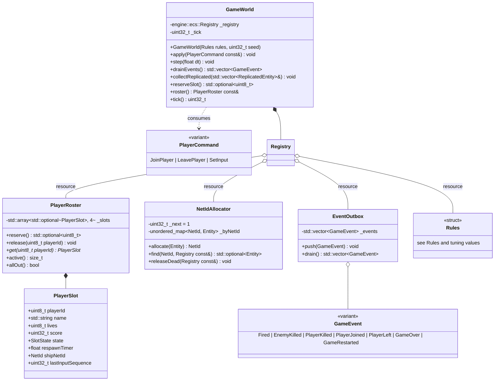

# Game module (`rtype_game`)

The game module is the R-Type simulation: data in components, behaviour in systems, entity recipes in builders, and numbers in one `Rules` struct. Its whole interface is commands in and events out, so the server can run it and the tests can drive it without a socket or a window.

## Components

Every component is a plain aggregate with no methods and no pointers. Entities are just combinations of these components, put together by the [builders](#builders).

| Component | Fields | Meaning |
| --- | --- | --- |
| `Transform` | `Vec2f position` | Centre of the entity, in logical units |
| `Velocity` | `Vec2f value` | Units per second |
| `Collider` | `Vec2f halfSize`, `CollisionLayer layer` | Axis-aligned box centred on `position` |
| `Health` | `int16_t current`, `int16_t max` | The entity dies at 0 or below |
| `Damage` | `int16_t amount` | Damage dealt on contact |
| `Replicated` | `NetId netId`, `EntityKind kind`, `uint8_t variant` | Marks the entity for the network. The only component `collectReplicated()` reads |
| `PlayerShip` | `uint8_t playerId`, `InputButtons buttons`, `float invulnerableFor` | Present only on player ships |
| `Weapon` | `float cooldown`, `float timer`, `Vec2f muzzleOffset`, `float projectileSpeed`, `bool triggered` | Fires when `triggered` is set and `timer` ≤ 0 |
| `EnemyBrain` | `MovePattern pattern`, `float baseY`, `float amplitude`, `float frequency`, `float age`, `float fireTimer` | Bydos movement and firing state |
| `Projectile` | `NetId owner` | Who to credit for a kill |
| `Lifetime` | `float remaining` | The entity is destroyed when it reaches 0 |
| `ConfinedToPlayfield` | (none) | Clamped inside 1280 × 720 |
| `DespawnOutsidePlayfield` | `float margin` | Destroyed once more than `margin` outside the playfield |
| `ScoreValue` | `uint32_t points` | Points awarded to the killer |

**Which components each entity has:**

| Kind | Transform | Velocity | Collider | Health | Damage | Replicated | Extra |
| --- | --- | --- | --- | --- | --- | --- | --- |
| PLAYER_SHIP | yes | yes | PLAYER, 16×8 | 1 | 1 | yes | `PlayerShip`, `Weapon`, `ConfinedToPlayfield` |
| BYDOS_SLAVE | yes | yes | ENEMY, 16×16 | 1 | 1 | yes | `EnemyBrain`, `Weapon`, `DespawnOutsidePlayfield`, `ScoreValue(100)` |
| PLAYER_MISSILE | yes | yes | PLAYER_SHOT, 8×3 | 1 | 1 | yes | `Projectile`, `Lifetime(2 s)`, `DespawnOutsidePlayfield` |
| ENEMY_MISSILE | yes | yes | ENEMY_SHOT, 4×4 | 1 | 1 | yes | `Projectile`, `Lifetime(4 s)`, `DespawnOutsidePlayfield` |

**Which layers collide** (anything not listed never collides):

| A | B | Effect |
| --- | --- | --- |
| PLAYER | ENEMY | Both take the other's `Damage` |
| PLAYER | ENEMY_SHOT | The ship takes damage, the missile is destroyed |
| PLAYER_SHOT | ENEMY | The enemy takes damage, the missile is destroyed |

A ship with `invulnerableFor > 0` ignores every collision.

## World, resources, commands and events

`GameWorld` owns one ECS `Registry` and configures it in its constructor: it registers the components, sets the resources, and adds the systems of the `SIMULATION` stage in the order of [Systems and tick order](#systems-and-tick-order). Everything a system needs beyond components is a **registry resource** ([engine: ECS](engine.md#resources)), so there is no separate context object.

**Resources set by `GameWorld`:**

| Resource | Used by |
| --- | --- |
| `Rules` | every system that needs a tuning value |
| `engine::core::Rng` | spawn positions, movement patterns, fire timers |
| `NetIdAllocator` | builders (allocate), `netIdCleanupSystem` (release) |
| `PlayerRoster` | input, health, respawn, game-over systems |
| `EventOutbox` | every system that emits a `GameEvent` |
| `engine::ecs::DeltaTime` | every system that moves or counts down; set by `step(dt)` |

- **Commands.** `JoinPlayer{playerId, name}` spawns a ship in the reserved slot with 3 lives. `LeavePlayer{playerId, reason}` destroys the ship and that player's missiles and frees the slot. `SetInput{playerId, inputSequence, buttons}` is ignored unless `inputSequence` is newer than the slot's `lastInputSequence`.
- **Events** say *why* something happened, for sounds, effects and banners. They are values with no references into the registry, so the adapter can keep them after `step()` returns:

    | Event | Fields | Emitted by |
    | --- | --- | --- |
    | `Fired` | `NetId shooter`, `NetId missile`, `Side side`, `Vec2f position` | `weaponSystem` |
    | `EnemyKilled` | `NetId killerShip`, `NetId enemy`, `Vec2f position` | `healthSystem` |
    | `PlayerKilled` | `NetId killer`, `NetId ship`, `uint8_t playerId`, `Vec2f position` | `healthSystem` |
    | `PlayerJoined` | `uint8_t playerId` | `apply(JoinPlayer)` |
    | `PlayerLeft` | `uint8_t playerId`, `LeaveReason reason` | `apply(LeavePlayer)` |
    | `GameOver` | `uint32_t teamScore` | `gameOverSystem` |
    | `GameRestarted` | (none) | `gameOverSystem` |

- **State is not an event.** Spawns, moves, deaths and roster changes reach clients through snapshots, not through events. A lost event only costs a sound or a banner, never a wrong world ([ADR 0002](../decisions/0002-state-based-replication.md)).
- **This is the Mediator pattern the subject recommends.** Systems never call the network or the audio. They push events into `EventOutbox`, and whatever owns the world decides what each event means: the server sends packets, and a future local mode could play sounds.
- `collectReplicated()` fills a caller-owned vector with one `ReplicatedEntity{netId, kind, variant, position, velocity}` per entity that has `Replicated`. The server's `SnapshotBuilder` turns it into SNAPSHOT chunks. A player who joins mid-game gets the full world from their first snapshot, with no special case.
- `PlayerRoster` is a resource, not a component, because lives and score must outlast the ship entity, which is destroyed and spawned again on each death.
- `NetIdAllocator::find` only returns an entity that is still alive, thanks to generational handles. `releaseDead` forgets the NetIds of dead entities.

## Systems and tick order

`GameWorld::step(dt)` sets the `DeltaTime` resource (`dt = 1/60 s`) and runs the `SIMULATION` stage. Its systems were added in the order below, and the order is part of the specification: moving a system changes the game. Kills and spawns requested inside a view loop go through `registry.commands()`, which the registry applies after each system ([engine: command buffer](engine.md#command-buffer)).

| # | System | Reads | Writes | Behaviour |
| --- | --- | --- | --- | --- |
| 1 | `playerInputSystem` | `PlayerShip` | `Velocity`, `Weapon.triggered` | Turns held buttons into velocity using `rules.playerSpeed`. Diagonals are normalised. FIRE sets `triggered`. |
| 2 | `enemyBrainSystem` | `EnemyBrain`, `Transform` | `Velocity`, `Weapon.triggered` | STRAIGHT moves left at `speed`. SINE sets vy so that `y = baseY + amplitude × sin(2π × frequency × age)`. Counts down `fireTimer`, then fires at the nearest ship. |
| 3 | `weaponSystem` | `Weapon`, `Transform` | spawn commands | Decrements `timer`. When triggered and ready, records a missile spawn command, resets `timer` to `cooldown`, and emits `Fired`. The missiles exist when the system ends. |
| 4 | `movementSystem` | `Velocity` | `Transform` | `position += value × dt` |
| 5 | `playfieldSystem` | `ConfinedToPlayfield`, `DespawnOutsidePlayfield` | `Transform`, kill commands | Clamps ships inside the playfield. Records a kill for anything else outside its margin. |
| 6 | `collisionSystem` | `Collider`, `Transform` | `Health` | Checks every pair of colliding layers (n ≤ ~100, so a plain double loop is fast enough). Applies `Damage` both ways. |
| 7 | `healthSystem` | `Health`, `ScoreValue`, `Projectile` | kill commands, roster | At 0 HP: records a kill and credits the score to the missile owner's slot. For a ship, takes a life and moves the slot to RESPAWNING or OUT. Emits `EnemyKilled` or `PlayerKilled`. |
| 8 | `lifetimeSystem` | `Lifetime` | kill commands | Records a kill at 0 |
| 9 | `spawnDirectorSystem` | rules, roster | new enemies | Only when at least one player is ALIVE. Spawns a Bydos at x = 1312 and a random y in [40, 680] every `spawnInterval`. The interval shrinks over time. Respects `maxEnemies`. |
| 10 | `respawnSystem` | roster | new ships | Counts down `respawnTimer`, then spawns the ship at its slot position with `invulnerableFor = 2 s`. |
| 11 | `gameOverSystem` | roster | world reset | When `allOut()`, emits `GameOver` once. After 5 s, kills every entity, gives every connected slot 3 lives again, and emits `GameRestarted`. |
| 12 | `netIdCleanupSystem` | `NetIdAllocator` | `NetIdAllocator` | Releases the NetIds of entities killed during this tick (`releaseDead`). Every earlier system's commands have been applied by then. |

**Randomness** (random spawn position, sine parameters, fire timers) comes only from the `Rng` resource. With a fixed `--seed` and the same commands at the same ticks, the simulation produces the same events, which makes a determinism test possible later ([handbook](../handbook/development.md#other-kinds-of-tests-later)).

**Prediction helper.** `Vec2f movePlayer(Vec2f position, InputButtons buttons, float dt, Rules const&)` is a pure function. `playerInputSystem`, `movementSystem` and `playfieldSystem` together are equivalent to calling it on a ship. The client calls the same function to predict its own ship, so both sides compute the motion the same way ([client: prediction](client.md#frame-loop-interpolation-and-prediction)).

## Builders

Builders are free functions in `rtype/game/Builders.hpp`. Each one turns an **already spawned** entity into a player ship, a Bydos or a missile: it attaches the component set listed under [Components](#components) and allocates a NetId through the `NetIdAllocator` resource. Nothing else in the game builds a replicated entity.

| Builder | Builds |
| --- | --- |
| `makePlayerShip(Registry&, Entity, std::uint8_t playerId)` | a ship at `rules.playerSpawn[playerId]` |
| `makeBydosSlave(Registry&, Entity, Vec2f position, MovePattern)` | an enemy |
| `makePlayerMissile(Registry&, Entity, NetId owner, Vec2f position)` | a player missile |
| `makeEnemyMissile(Registry&, Entity, NetId owner, Vec2f position, Vec2f direction)` | an enemy missile |
| `registerComponents(Registry&)` | registers every component type of the game |

They're called *builders*, not factories, on purpose: "factory" in this code base means the `FactoryTemplate` pattern (a run-time key mapped to a creator, as for network message commands). Here the caller always knows at compile time what it builds, and each kind takes different parameters, so plain functions are simpler.

Taking the entity as a parameter makes the same builder usable both ways:
- **immediately**, outside any view loop: `makeBydosSlave(registry, registry.spawnEntity(), position, pattern)`;
- **deferred**, from inside a view loop: `registry.commands().spawn(…)` with an initializer that calls the builder on the new entity.

## Rules and tuning values

Every gameplay number lives in `struct Rules` with these defaults. Nothing in a system is a hard-coded literal, so balancing means editing one file.

| Rule | Default | Notes |
| --- | --- | --- |
| `playfield` | 1280 × 720 | Logical units. The client letterboxes it to its window. |
| `maxPlayers` | 4 |  |
| `playerSpeed` | 320 u/s |  |
| `playerSpawn[0..3]` | (120, 144), (120, 288), (120, 432), (120, 576) | One lane per player |
| `playerLives` | 3 |  |
| `respawnDelay` / `respawnInvulnerability` | 2 s / 2 s |  |
| `playerFireCooldown` | 0.20 s | 5 shots per second while held |
| `playerMissileSpeed` | 900 u/s | Fired straight right |
| `enemySpeed` | random 160–240 u/s |  |
| `sineAmplitude` / `sineFrequency` | random 40–120 u / 0.5–1.2 Hz | Half of the spawned Bydos use SINE |
| `enemyFireInterval` | random 1.5–3.0 s | Aimed at the nearest ship |
| `enemyMissileSpeed` | 420 u/s |  |
| `spawnInterval` | starts at 1.6 s, 0.05 s shorter every 10 s, minimum 0.5 s |  |
| `maxEnemies` | 30 |  |
| `killScore` | 100 |  |
| `gameOverResetDelay` | 5 s |  |

**Telling players apart (requirement F-12).** Player 0 is cyan, player 1 magenta, player 2 green and player 3 red. These are the colour rows of the provided sprite sheet. Every ship also shows a `P1`–`P4` label, so players stay distinguishable without relying on colour ([accessibility](../architecture/accessibility.md)).

