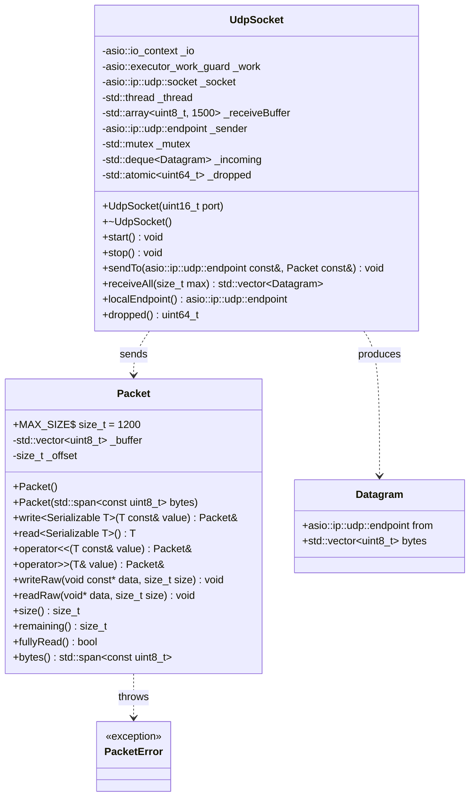

# Network module (`network`)

The network module is two classes. `net::Packet` turns values into bytes and back, with every read bounds-checked, and any type can be made serializable the way nlohmann::json does it. `net::UdpSocket` runs an Asio UDP socket on its own thread and hands received datagrams to the game thread through a locked queue. Everything else (endpoints, resolvers, the `io_context`) is plain Asio, used directly.

The module knows nothing about R-Type. Message types, the packet header and the meaning of each field live in [`rtype_protocol`](../protocol/RFC-rtype.md).



## `net::Packet`

`Packet` is the `write<T>()` / `read<T>()` design from the EPIJAM project, made generic in the style of nlohmann::json. Numbers and enums are copied with `memcpy`. Any other type becomes serializable when someone writes a `serialize` / `deserialize` pair for it, just as nlohmann finds `to_json` / `from_json`. Every write and read is bounds-checked, as the subject requires (F-07).

### The class

```cpp
// network/Packet.hpp
namespace net {

class PacketError : public std::runtime_error {
public:
    using std::runtime_error::runtime_error;
};

class Packet;

// Copied byte for byte with memcpy
template <typename T>
concept Primitive = (std::is_arithmetic_v<T> || std::is_enum_v<T>) && !std::is_same_v<T, bool>;

// Anything else needs serialize/deserialize, found by argument-dependent lookup (like to_json/from_json)
template <typename T>
concept Serializable = Primitive<T> || requires(Packet& packet, const T& in, T& out) {
    serialize(packet, in);
    deserialize(packet, out);
};

class Packet {
public:
    static constexpr std::size_t MAX_SIZE = 1200;

    Packet() = default;
    explicit Packet(std::span<const std::uint8_t> bytes);       // throws PacketError if bytes.size() > MAX_SIZE

    template <Serializable T>
    Packet& write(const T& value)
    {
        if constexpr (Primitive<T>)
            writeRaw(&value, sizeof(T));
        else
            serialize(*this, value);
        return *this;
    }

    template <Serializable T>
    [[nodiscard]] T read()
    {
        T value{};
        if constexpr (Primitive<T>)
            readRaw(&value, sizeof(T));
        else
            deserialize(*this, value);
        return value;
    }

    template <Serializable T>
    Packet& operator<<(const T& value) { return write(value); }

    template <Serializable T>
    Packet& operator>>(T& value) { value = read<T>(); return *this; }

    void writeRaw(const void* data, std::size_t size);   // throws PacketError past MAX_SIZE
    void readRaw(void* data, std::size_t size);          // throws PacketError past the end

    [[nodiscard]] std::size_t size() const noexcept { return _buffer.size(); }
    [[nodiscard]] std::size_t remaining() const noexcept { return _buffer.size() - _offset; }
    [[nodiscard]] bool fullyRead() const noexcept { return _offset == _buffer.size(); }
    [[nodiscard]] std::span<const std::uint8_t> bytes() const noexcept { return _buffer; }

private:
    std::vector<std::uint8_t> _buffer;
    std::size_t _offset = 0;
};

static_assert(std::endian::native == std::endian::little, "the wire format is little-endian");
static_assert(std::numeric_limits<float>::is_iec559, "floats must be IEEE-754");

}
```

```cpp
// network/Packet.cpp: the only two functions that touch the buffer directly
void Packet::writeRaw(const void* data, std::size_t size)
{
    if (size > MAX_SIZE - _buffer.size())
        throw PacketError("Packet::writeRaw: packet would exceed MAX_SIZE");
    const auto* bytes = static_cast<const std::uint8_t*>(data);
    _buffer.insert(_buffer.end(), bytes, bytes + size);
}

void Packet::readRaw(void* data, std::size_t size)
{
    if (size > remaining())
        throw PacketError("Packet::readRaw: not enough bytes");
    std::memcpy(data, _buffer.data() + _offset, size);
    _offset += size;
}
```

### Making your own type serializable

Write two free functions **in the same namespace as the type, in the same header, right after it**:

```cpp
namespace rtype::protocol {

struct EntityState {
    std::uint32_t netId;
    EntityKind kind;            // enum class EntityKind : std::uint8_t
    float x, y, vx, vy;
};

inline void serialize(net::Packet& packet, const EntityState& entity)
{
    packet << entity.netId << entity.kind << entity.x << entity.y << entity.vx << entity.vy;
}

inline void deserialize(net::Packet& packet, EntityState& entity)
{
    packet >> entity.netId >> entity.kind >> entity.x >> entity.y >> entity.vx >> entity.vy;
    if (!isValid(entity.kind))
        throw net::PacketError("EntityState: unknown kind");
}

}

// From then on, anywhere:
packet << state;
const auto copy = packet.read<rtype::protocol::EntityState>();
std::vector<rtype::protocol::EntityState> list = /* ... */;
packet << list;                // works too: see the built-in containers below
```

`serialize` writes the fields in the order the RFC lists them. `deserialize` reads them back in the same order. A chain of `<<` or `>>` always runs left to right (guaranteed since C++17), so the field order is exactly the order written.

**Why "same namespace, same header, right after the type":** `Packet` calls `serialize(*this, value)` without a namespace, and C++ finds the right overload by looking in the namespace of the argument's type. That is how nlohmann finds `to_json`. If the functions are declared somewhere else, or after a `Serializable<T>` check already happened for that type, the compiler reports that `T` is not `Serializable`.

### Built-in containers

`network/Serializers.hpp` provides these once, so nobody else writes length handling:

| Type | Wire format | Safety check on read |
| --- | --- | --- |
| `std::string` | `u8` length, then the bytes | Length ≤ `remaining()` |
| `std::vector<T>` | `u16` count, then each element | Count ≤ `remaining()`, since every element is at least 1 byte |
| `std::array<T, N>` | The N elements, no prefix | (fixed size) |

```cpp
namespace net {

template <Serializable T>
void deserialize(Packet& packet, std::vector<T>& out)
{
    const auto count = packet.read<std::uint16_t>();
    if (count > packet.remaining())
        throw PacketError("vector: count larger than the packet");
    out.clear();
    out.reserve(count);
    for (std::uint16_t i = 0; i < count; ++i)
        out.push_back(packet.read<T>());
}

}
```

That count check matters: a length field comes from the network, so an attacker could send `count = 65535` in a 10-byte packet. Without the check, the receiver would allocate and loop for nothing. Protocol-specific limits (a name of at most 16 characters, at most 48 entities per chunk) are checked in the protocol's own `deserialize` functions.

### Rules

1. **Byte order is little-endian, with no conversion.** `memcpy` copies the machine's own byte order. Every supported platform (Linux and Windows on x86-64 or ARM64) is little-endian, so the bytes are identical everywhere and Linux and Windows clients can play together. The two `static_assert`s stop the build on any platform where that isn't true.
2. **Structs are never copied whole.** Only `Primitive` types go through `memcpy`. A struct must have its own `serialize`/`deserialize` that writes field by field. Otherwise it doesn't compile. That way no padding bytes (the invisible gaps the compiler puts between fields for alignment) and no pointers ever reach the wire. `bool` is not `Primitive`: send it as a `std::uint8_t`.
3. **Fixed-size types only.** Use `std::uint8_t`, `std::int16_t`, `std::uint32_t`, `float` and so on, never `int`, `long` or `std::size_t`, whose size differs between platforms. Every enum sent on the wire declares its underlying type (`enum class EntityKind : std::uint8_t`).
4. **Reads throw, decoders catch.** `readRaw` throws `PacketError` on a short packet, and `deserialize` functions throw it on invalid values. The command dispatch catches it in one place and drops the datagram ([RFC §10](../protocol/RFC-rtype.md#10-validation-and-malformed-input)). This keeps every `deserialize` a straight list of reads.
5. **Enums are validated after reading.** `read<EntityKind>()` happily returns `EntityKind{200}`. Each `deserialize` that reads an enum checks it against the known values and throws `PacketError` otherwise.
6. **Leftover bytes are an error.** After decoding a message, the dispatcher checks `fullyRead()`. Extra bytes mean the sender and receiver disagree on the format.
7. **Size is capped.** A `Packet` never exceeds `MAX_SIZE` (1200 bytes) in either direction, so neither a sender bug nor an attacker can make one grow without limit.
8. **`read<T>()` needs a default-constructible `T`.** Message structs are plain aggregates, so they always are.

## `net::UdpSocket`

### Why it exists

The game loop runs 60 times per second and must never pause: the subject requires that the server "does not block or wait for clients' messages" (F-05). But receiving on a socket is waiting by nature: nothing comes back until a client sends something. So two jobs run side by side, on two threads:

| Job | Thread | Speed | Must never… |
| --- | --- | --- | --- |
| The game loop: simulate, send snapshots | `main` | Fixed, 60 ticks per second | …wait for the network |
| Listening on the socket | `net-io` | Whenever a client sends | …be blocked by the game |

`UdpSocket` is the meeting point between those two threads. Inside it are the Asio socket and the IO thread that listens forever, a queue protected by a mutex where the IO thread drops what it receives, `receiveAll()` that the game thread calls once per tick to collect what has arrived, and `sendTo()` that hands sending over to the IO thread, so the socket is only ever touched by one thread.

```text
      IO thread ("net-io")                         Game thread ("main"), 60×/s
      ────────────────────                         ───────────────────────────
  client sends ──► Asio receives 13 bytes
                   from 10.0.0.5:51234
                   wraps them in a Datagram
                   pushes it on the queue  ──┐
                                             │      tick N:
  client sends ──► Asio receives 13 bytes    ├────► receiveAll()  →  [Datagram, Datagram]
                   pushes it on the queue  ──┘        for each one:
                                                        decode, apply input
                                                      world.step()
                   Asio sends the bytes   ◄──────────  sendTo(client, snapshot)
```

Without it, each of us would write that thread, mutex and queue ourselves, in both the server and the client. That is the code most likely to deadlock or crash, so it is written once.

### What a `Datagram` is

A `Datagram` is one received message, as it waits in the queue:

| Field | Holds | Why it's needed |
| --- | --- | --- |
| `bytes` | The raw bytes that arrived, for example the 13 bytes of an INPUT | It's the message itself |
| `from` | The sender's address and port, for example `10.0.0.5:51234` | UDP has no connections: the bytes alone don't say who sent them |

`from` is the important part. With TCP, each client has its own socket, so you always know who is talking. With UDP, every client sends to the **same** socket, and the sender address that comes with each datagram is the only way to tell them apart. The server uses it to find the client's session (`sessions.find(datagram.from)` → player 2), to answer the right client (`sendTo(datagram.from, …)`), and to spot a new client (an unknown address sending HELLO).

### `Datagram` versus `Packet`

| | `Datagram` | `Packet` |
| --- | --- | --- |
| Level | Transport: what arrived, and from whom | Serialization: reading and writing values |
| Contains | bytes and sender | bytes and a read position |
| Made by | `UdpSocket`, on the IO thread | the game thread, from `datagram.bytes` |
| Used for | handing a message from one thread to the other | `packet.read<Header>()`, `packet >> input` |

```text
receiveAll() ──► Datagram { from = 10.0.0.5:51234, bytes = 54 52 01 02 … }
                     │
                     ├── from  ──► sessions.find(from)        → player 2
                     └── bytes ──► Packet packet(bytes)
                                   packet.read<Header>()      → type = INPUT
                                   InputCommand reads Input   → UP + FIRE
```

The `Datagram` is only the envelope; the `Packet` is how the letter inside gets read.

### API

```cpp
namespace net {

struct Datagram {
    asio::ip::udp::endpoint from;
    std::vector<std::uint8_t> bytes;
};

class UdpSocket {
public:
    explicit UdpSocket(std::uint16_t port = 0);   // 0 = any free port (client side)
    ~UdpSocket();                                  // calls stop()

    UdpSocket(const UdpSocket&) = delete;
    UdpSocket& operator=(const UdpSocket&) = delete;

    void start();                                  // throws NetworkError if the port can't be bound
    void stop();                                   // closes the socket, joins the thread

    void sendTo(const asio::ip::udp::endpoint& to, const Packet& packet);  // any thread
    std::vector<Datagram> receiveAll(std::size_t max = 1024);              // never blocks

    asio::ip::udp::endpoint localEndpoint() const;
    std::uint64_t dropped() const noexcept;
};

}
```

### Behaviour

- **Receive.** One `async_receive_from` is always outstanding, into a 1500-byte buffer. Its handler drops datagrams of 0 bytes or more than `Packet::MAX_SIZE` bytes, pushes the rest onto `_incoming` under `_mutex`, and starts the next receive. If `_incoming` already holds 4096 datagrams, the new one is dropped and `_dropped` goes up by 1, so memory stays bounded however fast a client sends.
- **Collect.** `receiveAll(max)` moves up to `max` datagrams out of the queue under the lock and returns them. It never waits.
- **Send.** `sendTo` copies the packet's bytes into a `std::shared_ptr<std::vector<std::uint8_t>>` and `asio::post`s an `async_send_to` onto the IO thread. The shared pointer keeps the bytes alive until the send completes. A failed send is logged at debug level and otherwise ignored, because UDP gives no delivery guarantee anyway.
- **Errors.** `connection_refused` and `connection_reset` are ignored and the receive is re-armed. On Windows these arrive when an ICMP "port unreachable" comes back, typically right after a client crashes, and they must not stop the receive loop. `operation_aborted` during `stop()` ends the loop quietly. Anything else is logged and the receive is re-armed.
- **Lifetime.** `start()` opens and binds the socket, then starts the thread. `stop()` is idempotent: it closes the socket, resets the work guard, stops the context and joins the thread. The destructor calls `stop()`.

### What stays in the applications

These are plain Asio and don't need wrapping:

| Need | Use |
| --- | --- |
| Address of a peer | `asio::ip::udp::endpoint`. It has `operator<` and `operator==`, so the server keys its session map with `std::map<asio::ip::udp::endpoint, ClientSession>` |
| Turning `-h host -p port` into an endpoint (client) | `asio::ip::udp::resolver` on a local `io_context`, once, before `UdpSocket::start()` |
| Printing an endpoint in logs | `endpoint.address().to_string()` and `endpoint.port()` |

## Threading

| Thread | Touches |
| --- | --- |
| IO thread (inside `UdpSocket`) | The socket, `_receiveBuffer`, `_sender`, and `_incoming` under `_mutex` |
| Caller (server tick thread or client main thread) | `receiveAll`, `sendTo`, everything above the network module |

`_incoming` and the posted sends are the only things the two threads share. Nothing in `rtype_game` or `rtype_protocol` is ever called from the IO thread.

## Limits

| Constant | Value | Why |
| --- | --- | --- |
| `Packet::MAX_SIZE` | 1200 bytes | Below the 1280-byte IPv6 minimum MTU once IP and UDP headers are added, so packets never fragment |
| Incoming queue | 4096 datagrams | About 1.5 s of traffic at full load; caps memory at roughly 5 MB |
| Receive buffer | 1500 bytes | Larger than any valid packet, so an oversized datagram is seen whole and dropped rather than silently truncated |

## Tests

- `Packet`: every `Primitive` type round-trips; reading past the end throws; writing past `MAX_SIZE` throws; `fullyRead()` is true only at the exact end; a vector or string whose length field exceeds the bytes left throws without allocating; a struct without `serialize` fails to compile (checked with a `static_assert(!Serializable<...>)` test).
- `UdpSocket`: two sockets on loopback exchange 1000 packets; `receiveAll` on an empty queue returns at once; a flood of 10 000 datagrams never leaves more than 4096 queued, and queued + `dropped()` ≤ 10 000 (the operating system may drop part of the flood itself, so exact counts aren't asserted); `stop()` twice is harmless.
