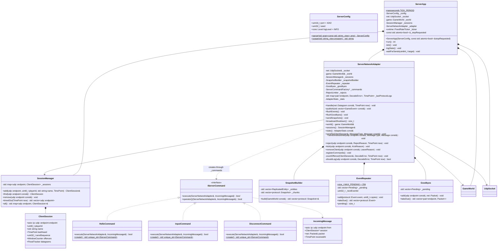

# Server application (`r-type_server`)

The server runs one authoritative `GameWorld` at 60 ticks per second on its main thread. All socket I/O happens on the `UdpSocket` thread, and the two threads share only the socket's locked queue. The game never waits for a client, and one client's crash or malformed packets never affect the others.

## Command line

```text
r-type_server --seed N [-p PORT] [--log-level trace|debug|info|warn|error] [-h]
```

| Option | Default | Effect |
| --- | --- | --- |
| `-p`, `--port` | 4242 | UDP port to bind on every interface |
| `--seed` | required | Seeds `Rng`, so every run can be replayed |
| `--log-level` | `info` | Minimum level printed |
| `-h`, `--help` | | Prints usage and exits with 0 |

`ServerConfig::parse` reads the options with CLI11 and throws `HelpRequested` on `-h`, or `ConfigError` naming the option at fault; `main` prints and picks the exit code. The help is the one CLI11 generates (`ServerConfig::usage`). `--seed` is required: without it, parsing fails like any other invalid argument. Ports and seeds must be whole decimal numbers: `+5`, `42x` or an empty value are refused, and so is port 0. An invalid argument or a port that can't be bound prints the reason plus the usage to `stderr` and exits with **84** (the Epitech convention). On `SIGINT` or `SIGTERM`, the server sends SHUTDOWN to every client and exits with 0.

Everything except `main.cpp` is built as the static library `server_logic`, which links `rtype_game`, `rtype_protocol`, `network` and `engine_runtime` publicly, and CLI11 privately. The `r-type_server` executable is `main.cpp` alone linked to `server_logic`, and it lands at the repository root. The server tests link `server_logic` too, so they exercise `ServerConfig::parse`, `ServerApp` and the sessions without going through `main`.

## Threads

This is how the server meets requirement F-05 (multithreaded, never blocks on clients).

| Thread | Runs | Owns | Shares |
| --- | --- | --- | --- |
| Main (simulation) | `ServerApp::run()`: the tick loop | `GameWorld`, `SessionManager`, the adapter | `UdpSocket`'s incoming queue and posted sends, the `std::atomic<bool>` stop flag |
| Network IO | `asio::io_context::run()` inside `UdpSocket` | The socket and its receive buffer | The same queue |

`main()` owns a global `std::atomic<bool>` stop flag and passes it to `ServerApp` by reference. The signal handler only stores `true` into it, so it never touches an object that can be destroyed; tests pass their own flag and set it from their thread. No lock is held across a tick. The main thread collects datagrams with `receiveAll()`, which never waits, so a silent or flooding client can't stall the simulation.

## Class diagram



The members of `ServerApp` are declared in construction order. They are destroyed in reverse, so the adapter goes before the world and the socket thread stops last.

### Message dispatch: one command per message type

Each client-to-server message type has its own command class. The adapter creates the right one through a `FactoryTemplate` keyed by `MessageType`, the same Command + Factory pattern as the Zappy protocol handlers ([ADR 0003](../decisions/0003-command-factory-handlers.md)). The generic `ICommand` and `FactoryTemplate` templates live in [`engine_core`](engine.md#core-engine_core).

```cpp
namespace rtype::server {

struct IncomingMessage {
    asio::ip::udp::endpoint from;
    ClientSession* session;     // nullptr when the address has no session yet
    net::Packet& packet;        // positioned right after the header
    TimePoint receivedAt;
};

using IServerCommand = designPattern::ICommand<ServerNetworkAdapter&, IncomingMessage&>;
using ServerCommandFactory = designPattern::FactoryTemplate<IServerCommand, protocol::MessageType>;

void ServerNetworkAdapter::registerCommands() noexcept
{
    _commands.registerCreator<HelloCommand>(protocol::MessageType::HELLO);
    _commands.registerCreator<InputCommand>(protocol::MessageType::INPUT);
    _commands.registerCreator<DisconnectCommand>(protocol::MessageType::DISCONNECT);
}

}
```

A command decodes its own payload with `protocol::decode<protocol::Input>(message.packet)`, not `read`: `decode` also rejects leftover bytes with `TRAILING_BYTES` ([RFC § 10](../protocol/RFC-rtype.md#10-error-handling)). Then it acts through the adapter. It returns `false` when the message is well-formed but not acceptable (for example, an INPUT from a client with no slot):

```cpp
bool InputCommand::execute(ServerNetworkAdapter& adapter, IncomingMessage& message)
{
    if (message.session == nullptr)
        return false;
    const auto input = protocol::decode<protocol::Input>(message.packet);   // throws PacketError if malformed
    adapter.world().apply(game::SetInput{message.session->playerId, input.inputSequence, toGame(input.buttons)});
    return true;
}

std::unique_ptr<IServerCommand> InputCommand::create()
{
    return std::make_unique<InputCommand>();
}
```

| Command | Message | Does |
| --- | --- | --- |
| `HelloCommand` | HELLO | Version check, slot reservation, session creation, WELCOME (see [Joining](#joining-leaving-and-crashing)) |
| `InputCommand` | INPUT | `world().apply(SetInput{...})` |
| `DisconnectCommand` | DISCONNECT | `removeClient(from, QUIT)` |

Adding a message type means one new command class and one `registerCreator` line.

`handle(datagram, now)` is the single decode boundary around the commands. It follows the dispatch order of the [RFC's error handling](../protocol/RFC-rtype.md#10-error-handling):

1. **The session and the flood rule.** `session = sessions.find(datagram.from)`. A session may send 240 datagrams per second; the excess is dropped. After 3 seconds in which it went over, the session is kicked with RATE_LIMITED. An address with no session has no counter here: its datagrams are dropped by step 5.
2. **In a `try` block:** `protocol::checkDatagramSize`, then the `net::Packet` is built and the `Header` read with `packet >> header` (a bad magic throws).
3. **Version.** If `header.version` isn't 1, the datagram is dropped. A HELLO from an address with no session also gets `reject(from, VERSION_MISMATCH, now)`.
4. **No session.** A datagram from an address with no session is dropped, with no reply and no offence, unless it's a HELLO.
5. **Direction.** `protocol::checkType(header.type, Direction::CLIENT_TO_SERVER)`: an unknown type or a server-to-client type throws. Every client-to-server type has a command, so after this `hasKey` is only asserted.
6. **The command.** `_commands->create(header.type)->execute(*this, message)`.
7. **After it,** the session is looked up again by address, because HELLO may have created it and DISCONNECT may have removed it. A `false` return counts an `OUT_OF_RANGE` offence; success sets `session.lastHeard = now`.
8. **`catch (const net::PacketError&)`:** the code from `classify(error)` is counted in `AdapterStats`, and if there's a session, it counts an offence: 10 in one second kick the client with PROTOCOL_ERROR. The failure is logged at most once per second per address and code. `BAD_SIZE` and `BAD_MAGIC` from an address with no session are logged at debug level only, since they're usually Internet noise.
9. **`catch (const std::exception&)`:** the last line of defence. It logs an error and kicks the session, if there is one, with PROTOCOL_ERROR.

`FactoryTemplate::create` builds its error message with `operator<<` on the key. `rtype_protocol` therefore provides `std::ostream& operator<<(std::ostream&, MessageType)`, which also serves the logs.

## The tick

`ServerApp::run()` loops on `while (!_stopRequested) { tick(); _ticker.waitNext(); }`. One tick does, in this order:

1. `now = Clock::now()`.
2. `for (auto& d : socket.receiveAll()) adapter.handle(d, now)`. Commands reach the world through `world.apply(...)`.
3. For each endpoint in `sessions.timedOut(now)` (5 s without a valid datagram): `removeClient(endpoint, TIMEOUT)`.
4. `world.step(1/60)`.
5. `adapter.publish(world.drainEvents())` turns each game event into a protocol EVENT (`toProtocol`) and hands it to the `EventRepeater`, with 1 or 3 copies depending on its type ([RFC §6.6](../protocol/RFC-rtype.md#66-event-0x84-server--client)). The repeater gives it the next `eventId`.
6. `adapter.flushEvents()` sends one copy of every pending event to every session. An event with 3 copies goes out on 3 consecutive ticks with the same `eventId`.
7. `adapter.flushGoodbyes()` sends the due copy of each queued KICK (see [Leaving](#joining-leaving-and-crashing)).
8. Every 600 ticks (10 s), `logStats()` prints one line: players, entities, tick overruns, datagrams in and out, drops, offences and kicks.
9. On even ticks (30 Hz), `adapter.sendSnapshots()`. `SnapshotBuilder` builds the snapshot **once** (the tick, the roster from `rosterToProtocol`, every entity through `toProtocol`) and splits it into chunks. Only `lastProcessedInput` differs between clients, so it's set on each chunk just before that client's copy is encoded. It's the slot's `lastInputSequence`, which the game updates when it accepts a newer INPUT. Each chunk is one datagram.

Every datagram sent to a session is numbered with that session's own sequence, starting at 1 (RFC § 4). A REJECT goes to an address with no session, so it's always sequence 1.

| `GameEvent` | EVENT type | Copies |
| --- | --- | --- |
| `Fired` (player) | PLAYER_FIRED | 1 |
| `Fired` (enemy) | ENEMY_FIRED | 1 |
| `EnemyKilled` | ENEMY_KILLED | 1 |
| `PlayerKilled` | PLAYER_KILLED | 3 |
| `PlayerJoined` | PLAYER_JOINED | 3 |
| `PlayerLeft` | PLAYER_LEFT | 3 |
| `GameOver` | GAME_OVER | 3 |
| `GameRestarted` | GAME_RESTARTED | 3 |

## Joining, leaving and crashing

`HelloCommand` handles both cases below.

A HELLO whose `protocolVersion` isn't 1 gets REJECT(VERSION_MISMATCH), like one whose header version isn't 1. Every REJECT is limited to one per second per address.

**HELLO from an address that already has a session:** send WELCOME again and nothing else. That repairs a lost WELCOME (RFC § 6.2).

**HELLO from a new address:**

1. `world.reserveSlot()`. If no slot is free, send REJECT(SERVER_FULL).
2. `name = protocol::sanitizeName(hello.playerName, playerId)`: at most 16 bytes, every byte outside printable ASCII becomes `?`, and an empty name becomes "Player N" (slot + 1).
3. `sessions.add(from, playerId, name, now)`, then send WELCOME (`playerId`, 60, 30, 4, `world.tick()`).
4. `world.apply(JoinPlayer{playerId, name})`. The slot starts RESPAWNING, and the game's respawn system spawns the ship on the next `step`, so it appears one tick later, in the next snapshot for everyone. `PlayerJoined` becomes an EVENT.

The newcomer needs nothing else: their first snapshot already holds every entity and every player.

**Leaving or crashing.** DISCONNECT, a timeout and a kick all go through `removeClient(endpoint, reason)`:

1. `world.apply(LeavePlayer{playerId, reason})`. The ship and its missiles are destroyed and the slot is freed, so they vanish from the next snapshot. The world emits `PlayerLeft`, which goes out three times as EVENT PLAYER_LEFT.
2. `sessions.remove(endpoint)`.

The client sends DISCONNECT 3 times. The first removes the session; the 2 others find no session and are dropped silently.

**Kicks.** `kick(endpoint, reason)` queues one KICK packet in `Goodbyes`, numbered with the session's next sequence, then calls `removeClient(endpoint, KICKED)` and logs one warning with the address and the reason. `flushGoodbyes()` sends that same packet on 3 consecutive ticks, even though the session is gone. The copies share a sequence, so a client that gets two can drop the duplicate. The other players get PLAYER_LEFT(KICKED).

**Shutdown.** When `run()` leaves its loop, `broadcastShutdown()` sends SHUTDOWN to every session 3 times, 20 ms apart, and returns how many datagrams it queued. `UdpSocket::stop()` stops its IO context right away and may drop sends still queued, so `ServerApp` first waits until `socket.stats().sent + sendErrors` has grown by that number, at most 200 ms, then stops the socket.

Nothing else changes, and the other players keep playing (requirement F-06).

## Robustness rules

- A `try`/`catch(const std::exception&)` around each `handle()` call is the last line of defence: it logs the error and kicks only that session. In normal operation nothing other than `PacketError` is thrown there.
- No container grows with untrusted input beyond a fixed bound: sessions ≤ 4, the socket queue ≤ 4096, names ≤ 16 bytes, pending events ≤ 256 (`EventRepeater::MAX_PENDING`; above it the oldest 1-copy event is dropped first, then the oldest of the others, with one warning per tick), and the protocol-error log limiter ≤ 1024 (address, code) pairs (`MAX_LOG_ENTRIES`; when full, entries older than a second are pruned at most once a second, and otherwise the line is skipped while the stats still count it).
- The server never sends more than one REJECT per second to one address, and 20 per second in total, so it can't be used to flood a third party with replies.
- When the server falls behind (an overrun), it logs and drops the late ticks. It never runs dozens of steps in one burst.
