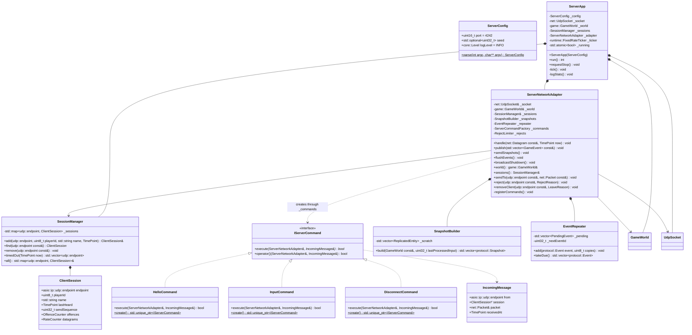

# Server application (`r-type_server`)

The server runs one authoritative `GameWorld` at 60 ticks per second on its main thread. All socket I/O happens on the `UdpSocket` thread, and the two threads share only the socket's locked queue. The game never waits for a client, and one client's crash or malformed packets never affect the others.

## Command line

```text
r-type_server [-p PORT] [--seed N] [--log-level trace|debug|info|warn|error] [-h]
```

| Option | Default | Effect |
| --- | --- | --- |
| `-p`, `--port` | 4242 | UDP port to bind on every interface |
| `--seed` | random | Seeds `Rng`, for reproducible runs and tests |
| `--log-level` | `info` | Minimum level printed |
| `-h`, `--help` | | Prints usage and exits with 0 |

An invalid argument or a port that can't be bound prints the reason plus the usage and exits with **84** (the Epitech convention). On `SIGINT` or `SIGTERM`, the server sends SHUTDOWN to every client and exits with 0.

## Threads

This is how the server meets requirement F-05 (multithreaded, never blocks on clients).

| Thread | Runs | Owns | Shares |
| --- | --- | --- | --- |
| Main (simulation) | `ServerApp::run()`: the tick loop | `GameWorld`, `SessionManager`, the adapter | `UdpSocket`'s incoming queue and posted sends, `std::atomic<bool> running` |
| Network IO | `asio::io_context::run()` inside `UdpSocket` | The socket and its receive buffer | The same queue |

The signal handler only stores `false` into `running`. No lock is held across a tick. The main thread collects datagrams with `receiveAll()`, which never waits, so a silent or flooding client can't stall the simulation.

## Class diagram



The members of `ServerApp` are declared in construction order. They are destroyed in reverse, so the adapter goes before the world and the socket thread stops last.

### Message dispatch: one command per message type

Each client-to-server message type has its own command class. The adapter creates the right one through a `FactoryTemplate` keyed by `MessageType`, the same Command + Factory pattern as the Zappy protocol handlers ([ADR 0003](../decisions/0003-command-factory-handlers.md)). The generic `ICommand` and `FactoryTemplate` templates live in [`engine_core`](engine.md#core-engine_core).

```cpp
namespace rtype::server {

struct IncomingMessage {
    asio::ip::udp::endpoint from;
    ClientSession* session;     // nullptr when the address has no session yet
    net::Packet& packet;        // positioned right after the header
    TimePoint receivedAt;
};

using IServerCommand = engine::core::ICommand<ServerNetworkAdapter&, IncomingMessage&>;
using ServerCommandFactory = engine::core::FactoryTemplate<IServerCommand, protocol::MessageType>;

void ServerNetworkAdapter::registerCommands() noexcept
{
    _commands.registerCreator<HelloCommand>(protocol::MessageType::HELLO);
    _commands.registerCreator<InputCommand>(protocol::MessageType::INPUT);
    _commands.registerCreator<DisconnectCommand>(protocol::MessageType::DISCONNECT);
}

}
```

A command decodes its own payload with `message.packet.read<protocol::Input>()` (which calls the message's `deserialize`), then acts through the adapter. It returns `false` when the message is well-formed but not acceptable (for example, an INPUT from a client with no slot):

```cpp
bool InputCommand::execute(ServerNetworkAdapter& adapter, IncomingMessage& message)
{
    if (message.session == nullptr)
        return false;
    const auto input = message.packet.read<protocol::Input>();   // throws PacketError if malformed
    adapter.world().apply(game::SetInput{message.session->playerId, input.inputSequence, input.buttons});
    return true;
}

std::unique_ptr<IServerCommand> InputCommand::create()
{
    return std::make_unique<InputCommand>();
}
```

| Command | Message | Does |
| --- | --- | --- |
| `HelloCommand` | HELLO | Version check, slot reservation, session creation, WELCOME (see [Joining](#joining-leaving-and-crashing)) |
| `InputCommand` | INPUT | `world().apply(SetInput{...})` |
| `DisconnectCommand` | DISCONNECT | `removeClient(from, QUIT)` |

Adding a message type means one new command class and one `registerCreator` line.

`handle()` is the single decode boundary around the commands:

1. Look up the session for `datagram.from`, and check its rate counter (240 datagrams per second).
2. In a `try` block: `net::Packet packet(datagram.bytes)`, then `const auto header = packet.read<protocol::Header>()` (which rejects a bad magic). If `header.version` is not 1, drop the datagram, and if it is a HELLO from an unknown address, `reject(from, VERSION_MISMATCH)`.
3. A datagram from an address with no session is dropped unless its type is HELLO.
4. If `_commands.hasKey(header.type)` is false (an unknown type, or a server-to-client type), count an offence and stop. Checking `hasKey` first avoids the exception `create()` throws for an unknown key.
5. `_commands.create(header.type)->execute(*this, message)`. A `false` return, or `!packet.fullyRead()` afterwards, counts an offence.
6. `catch (const net::PacketError&)`: drop the datagram and count an offence. Ten offences in one second kick the client.
7. On success, set `session.lastHeard = now`.

`FactoryTemplate::create` builds its error message with `operator<<` on the key. `rtype_protocol` therefore provides `std::ostream& operator<<(std::ostream&, MessageType)`, which also serves the logs.

## The tick

`ServerApp::run()` loops on `while (_running) { tick(); _ticker.waitNext(); }`. One tick does, in this order:

1. `now = Clock::now()`.
2. `for (auto& d : socket.receiveAll()) adapter.handle(d, now)`. Commands reach the world through `world.apply(...)`.
3. For each endpoint in `sessions.timedOut(now)` (5 s without a valid datagram): `removeClient(endpoint, TIMEOUT)`.
4. `world.step(1/60)`.
5. `adapter.publish(world.drainEvents())` turns each game event into a protocol EVENT and hands it to the `EventRepeater`, with 1 or 3 copies depending on its type ([RFC §6.6](../protocol/RFC-rtype.md#66-event-0x84-server--client)).
6. `adapter.flushEvents()` sends every event copy due this tick to every session.
7. On even ticks (30 Hz), `adapter.sendSnapshots()`: for each session, `SnapshotBuilder` produces the chunks with that session's `lastProcessedInput`, and each chunk is sent as one datagram.
8. Every 600 ticks (10 s), `logStats()` prints one line: players, entities, tick overruns, datagrams in and out, drops and offences.

| `GameEvent` | EVENT type | Copies |
| --- | --- | --- |
| `Fired` (player) | PLAYER_FIRED | 1 |
| `Fired` (enemy) | ENEMY_FIRED | 1 |
| `EnemyKilled` | ENEMY_KILLED | 1 |
| `PlayerKilled` | PLAYER_KILLED | 3 |
| `PlayerJoined` | PLAYER_JOINED | 3 |
| `PlayerLeft` | PLAYER_LEFT | 3 |
| `GameOver` | GAME_OVER | 3 |
| `GameRestarted` | GAME_RESTARTED | 3 |

## Joining, leaving and crashing

`HelloCommand` handles both cases below.

**HELLO from an address that already has a session:** send WELCOME again and nothing else. That repairs a lost WELCOME.

**HELLO from a new address:**

1. If `protocolVersion` ≠ 1, send REJECT(VERSION_MISMATCH), at most once per second per address.
2. `world.reserveSlot()`. If no slot is free, send REJECT(SERVER_FULL), with the same limit.
3. `sessions.add(...)`, then send WELCOME.
4. `world.apply(JoinPlayer)`. The new ship appears in the next snapshot for everyone, and `PlayerJoined` becomes an EVENT.

The newcomer needs nothing else: their first snapshot already holds every entity and every player.

**Leaving or crashing.** DISCONNECT, a timeout and a kick all go through `removeClient(endpoint, reason)`:

1. `world.apply(LeavePlayer{playerId, reason})`. The ship and its missiles are destroyed and the slot is freed, so they vanish from the next snapshot. The world emits `PlayerLeft`, which goes out three times as EVENT PLAYER_LEFT.
2. `sessions.remove(endpoint)`.

Nothing else changes, and the other players keep playing (requirement F-06).

## Robustness rules

- A `try`/`catch(const std::exception&)` around each `handle()` call is the last line of defence: it logs the error and kicks only that session. In normal operation nothing other than `PacketError` is thrown there.
- No container grows with untrusted input beyond a fixed bound: sessions ≤ 4, the socket queue ≤ 4096, names ≤ 16 bytes, pending event copies ≤ 3 × events per tick.
- The server never sends more than one REJECT per second to one address, and 20 per second in total, so it can't be used to flood a third party with replies.
- When the server falls behind (an overrun), it logs and drops the late ticks. It never runs dozens of steps in one burst.
