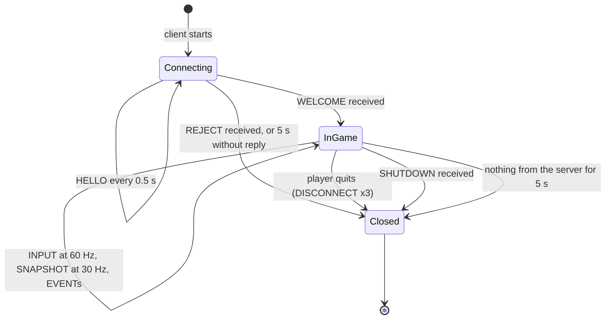

# RFC: R-Type network protocol, version 1

| | |
| --- | --- |
| Status | Draft for Part 1 |
| Protocol version | 1 |
| Transport | UDP, default server port 4242 |
| Reference implementation | `rtype_protocol` (see [Appendix A](#appendix-a-reference-implementation)) |

## 1. Introduction

This document specifies the binary protocol between an R-Type server and its clients. It is complete enough to write a compatible client without reading the server's code.

The protocol is **state-based**. Every snapshot the server sends describes the whole game: every entity and every player slot. A client that loses packets simply catches up on the next snapshot, 33 ms later. There are no acknowledgements and no resends. The few messages that matter beyond a single snapshot are repeated instead (sections 6.2 and 6.6).

The key words MUST, MUST NOT, SHOULD and MAY are used as defined in RFC 2119.

## 2. Transport

- All messages travel over UDP. There is no TCP connection.
- One datagram carries exactly one message: an 8-byte header followed by the message payload.
- A datagram MUST NOT exceed **1200 bytes**, header included.
- The server listens on port 4242 by default. A client sends from any port. The server answers to the source address and port of the datagrams it receives.

### 2.1 Why there is no length field

On TCP, data is a stream of bytes: one read can return half a message, or one and a half messages glued together. A TCP protocol therefore needs a length field and a leftover buffer to find where each message ends.

UDP keeps message boundaries instead. One receive always returns exactly one whole datagram, never part of one and never two merged together. If the receive buffer is too small, the end of the datagram is cut off and discarded; it does not arrive in the next read. The datagram's length is therefore the message's length, and a length field would only repeat it.

UDP loses datagrams because nothing resends them, not because it is fast. A router with a full queue, Wi-Fi interference or a full receive buffer drops a datagram silently. This protocol copes with that through state-based snapshots (section 6.5) rather than by reassembling or resending data.

### 2.2 Why datagrams are limited to 1200 bytes

The limit is not a read limit. It avoids **IP fragmentation**:

- A network link carries frames of limited size: about 1500 bytes on Ethernet and Wi-Fi.
- A larger UDP datagram (UDP allows up to about 65 KB) is split by IP into fragments, and if any one fragment is lost, the whole datagram is lost. Some routers and firewalls drop fragments on purpose.
- 1200 bytes stays below the 1280-byte minimum that every IPv6 link must carry, once IP and UDP headers are added, so each datagram travels as a single piece on any network.

A large snapshot is therefore sent as several chunks that are each usable on their own (section 6.5). The receiver never glues datagrams back together.

## 3. Data types

All multi-byte values are **little-endian**.

| Type | Size | Encoding |
| --- | --- | --- |
| `u8` | 1 byte | Unsigned integer |
| `u16` | 2 bytes | Unsigned integer, little-endian |
| `u32` | 4 bytes | Unsigned integer, little-endian |
| `f32` | 4 bytes | IEEE-754 binary32, little-endian |
| `string<N>` | 1 + n bytes | A `u8` length n, with n ≤ N, followed by n bytes of printable ASCII (`0x20`–`0x7E`). No terminator |
| `list<T>` | 2 + n × size of T | A `u16` count n, followed by n elements of type T |

Conventions:

- **NetId** is a `u32` the server assigns to each entity. 0 means "none". A NetId is never reused during one server run.
- **Coordinates** are `f32` logical units. The playfield is 1280 × 720, with the origin at the top-left and y pointing down. Velocities are in units per second.
- **Ticks** are `u32` counters of the server's 60 Hz simulation.

## 4. Packet header

```text
 0       1       2       3       4       5       6       7
+-------+-------+-------+-------+-------+-------+-------+-------+
|     magic     |version| type  |           sequence            |
+-------+-------+-------+-------+-------+-------+-------+-------+
|  payload ...
+-------+-------
```

| Offset | Field | Type | Rules |
| --- | --- | --- | --- |
| 0 | `magic` | u16 | MUST be `0x5254`. Any other value: the datagram is dropped (section 4.2). |
| 2 | `version` | u8 | Protocol version. MUST be `1`. |
| 3 | `type` | u8 | Message type (section 5). |
| 4 | `sequence` | u32 | Counter kept by the sender for this peer, starting at 1 and increasing by 1 for every datagram it sends. Used for loss statistics and to discard duplicates. |
| 8 | payload | | Exactly the bytes the message type defines. No more, no less. |

### 4.1 What each field is for

| Field | Purpose |
| --- | --- |
| `magic` | Says "this datagram belongs to this protocol". It is the same value, `0x5254`, in every datagram of every type, in both directions. It is checked before anything else (section 4.2). |
| `version` | Lets the server tell an outdated client apart from a broken one, and answer it with REJECT(VERSION_MISMATCH) instead of misreading its messages. |
| `type` | Says which message of this protocol follows. Receivers use it as the key of their command factory. |
| `sequence` | UDP may deliver a datagram twice or out of order. The counter lets a receiver spot duplicates and stale datagrams, and measure loss: going from 1500 to 1503 means 2 datagrams were lost. |

There is no length field: the payload is everything after byte 8 (section 2.1).

### 4.2 Magic versus type

`type` answers *which of our messages is this?* `magic` answers *is this one of our messages at all?*

Any program can send bytes to an open UDP port: port scanners, a misconfigured tool, or another team's client pointed at the wrong server. The receiver gets those bytes as a datagram like any other. Without `magic`, the first byte after the version would be read as a `type`. With 8 valid types out of 256 possible byte values, about 1 junk datagram in 32 would be routed to a command, and only the payload checks would stop it.

With `magic`, a junk datagram also has to start with exactly `54 52`, a 1 in 65 536 chance. It is rejected after reading 2 bytes, before any decoding. Casting the `type` byte to the `MessageType` enum doesn't help here: C++ accepts any byte value in an enum, valid or not.

`magic` is a cheap early filter, not the security barrier. Every message is still fully validated (section 10).

### 4.3 Example: one INPUT datagram, byte by byte

The client's 1500th datagram, carrying input number 812 with UP and FIRE held:

```text
offset:  0  1    2    3    4  5  6  7    8  9 10 11    12
bytes:  54 52   01   02   DC 05 00 00   2C 03 00 00    11
        magic   ver  type  sequence     inputSequence  buttons
        |----------- header, 8 bytes ---------|  |-- payload, 5 bytes --|
```

| Bytes | Field | Value |
| --- | --- | --- |
| `54 52` | `magic` | `0x5254` |
| `01` | `version` | 1 |
| `02` | `type` | INPUT |
| `DC 05 00 00` | `sequence` | 1500 |
| `2C 03 00 00` | `inputSequence` | 812 |
| `11` | `buttons` | `0b00010001`: bit 0 UP and bit 4 FIRE |

Values are little-endian: the lowest byte comes first. 1500 is `0x05DC`, so it is stored `DC 05 00 00`. Likewise `0x5254` is stored `54 52`, which reads "TR" in ASCII.

## 5. Message catalogue

Client-to-server types are below `0x80`; server-to-client types are `0x80` and above.

| Type | Name | Direction | When it is sent | Payload size (bytes) |
| --- | --- | --- | --- | --- |
| `0x01` | HELLO | C → S | Every 0.5 s until WELCOME or REJECT arrives | 2 – 18 |
| `0x02` | INPUT | C → S | Every client tick (60 Hz) while in game | 5 |
| `0x03` | DISCONNECT | C → S | 3 times when the player quits | 1 |
| `0x81` | WELCOME | S → C | In reply to every HELLO from an accepted client | 8 |
| `0x82` | REJECT | S → C | In reply to a HELLO that can't be accepted | 1 |
| `0x83` | SNAPSHOT | S → C | 30 times per second, in one or more chunks | 14 – 1182 |
| `0x84` | EVENT | S → C | When something happens; important events 3 times | 21 |
| `0x85` | SHUTDOWN | S → C | 3 times when the server stops | 0 |

## 6. Message layouts

Offsets are relative to the start of the payload.

### 6.1 HELLO (`0x01`, client → server)

| Offset | Field | Type | Rules |
| --- | --- | --- | --- |
| 0 | `protocolVersion` | u8 | MUST be 1 |
| 1 | `playerName` | string<16> | The server replaces any non-printable byte with `?`. An empty name becomes `Player N`. |

The client sends HELLO every 0.5 s until it receives WELCOME or REJECT. After 5 s without either, it gives up and reports that the server is unreachable.

### 6.2 WELCOME (`0x81`, server → client)

| Offset | Field | Type | Rules |
| --- | --- | --- | --- |
| 0 | `playerId` | u8 | 0–3. The client's player slot. It also picks the ship's colour. |
| 1 | `tickRate` | u8 | Simulation rate in Hz (60) |
| 2 | `snapshotRate` | u8 | SNAPSHOT rate in Hz (30) |
| 3 | `maxPlayers` | u8 | 4 |
| 4 | `serverTick` | u32 | The current server tick |

The server answers **every** HELLO from an accepted client with WELCOME, so a lost WELCOME is repaired by the client's next HELLO. The client finds its own ship through the roster in each SNAPSHOT (section 6.5).

### 6.3 REJECT (`0x82`, server → client)

| Offset | Field | Type | Rules |
| --- | --- | --- | --- |
| 0 | `reason` | u8 | 1 = SERVER_FULL, 2 = VERSION_MISMATCH |

The server sends at most one REJECT per second to the same address.

### 6.4 INPUT (`0x02`, client → server)

| Offset | Field | Type | Rules |
| --- | --- | --- | --- |
| 0 | `inputSequence` | u32 | Increases by 1 for every INPUT. The server ignores values ≤ the last one it applied. |
| 4 | `buttons` | u8 | Bit 0 UP, bit 1 DOWN, bit 2 LEFT, bit 3 RIGHT, bit 4 FIRE. Bits 5–7 MUST be 0. |

INPUT carries the buttons **held** at that moment, not key presses. Losing one is harmless: the next one, 16 ms later, carries the same state. INPUT also tells the server that the client is still alive.

### 6.5 SNAPSHOT (`0x83`, server → client)

One snapshot describes the whole game at one server tick. If it doesn't fit in one datagram, the server splits it into chunks. Every chunk of a tick has the same `serverTick` and `chunkCount`.

| Offset | Field | Type | Rules |
| --- | --- | --- | --- |
| 0 | `serverTick` | u32 | The tick this snapshot describes |
| 4 | `lastProcessedInput` | u32 | The highest `inputSequence` the server has applied for **this** client |
| 8 | `chunkIndex` | u8 | 0 ≤ `chunkIndex` < `chunkCount` |
| 9 | `chunkCount` | u8 | 1–16 |
| 10 | `roster` | list<PlayerInfo> | 4 entries in chunk 0, one per player slot, slots 0 to 3 in order. Empty (count 0) in every other chunk |
| … | `entities` | list<EntityState> | 0–48 entries |

**PlayerInfo** (12 to 28 bytes):

| Field | Type | Rules |
| --- | --- | --- |
| `playerId` | u8 | 0–3 |
| `state` | u8 | 0 = EMPTY, 1 = ALIVE, 2 = RESPAWNING, 3 = OUT (no lives left) |
| `lives` | u8 | 0–3 |
| `score` | u32 | |
| `shipNetId` | u32 | The player's current ship, or 0 when the state is not ALIVE |
| `name` | string<16> | Empty when the state is EMPTY |

**EntityState** (22 bytes):

| Field | Type | Rules |
| --- | --- | --- |
| `netId` | u32 | ≠ 0 |
| `kind` | u8 | 1 = PLAYER_SHIP, 2 = BYDOS_SLAVE, 3 = PLAYER_MISSILE, 4 = ENEMY_MISSILE |
| `variant` | u8 | PLAYER_SHIP: the owner's `playerId`. BYDOS_SLAVE: movement pattern, 0 = STRAIGHT, 1 = SINE. Missiles: 0 |
| `x`, `y` | f32, f32 | Position |
| `vx`, `vy` | f32, f32 | Velocity |

A chunk is at most 8 (header) + 10 + (2 + 4 × 28) + (2 + 48 × 22) = 1190 bytes, so it always fits in one datagram.

**Rules for the client:**

1. Ignore any chunk whose `serverTick` is lower than the last **complete** tick (rule 4).
2. For each entity in a chunk: if the NetId is unknown, create it with that kind, variant, position and velocity. Otherwise, add the position and velocity as a new sample for that tick. In both cases, record `serverTick` as the entity's last-seen tick.
3. Chunk 0 replaces the client's copy of the roster.
4. A tick is **complete** once all `chunkCount` chunks of it have arrived. When a tick T completes and T is newer than the last complete tick, delete every entity whose last-seen tick is lower than T. Those entities no longer exist on the server.
5. A tick that never completes (because a chunk was lost) is simply skipped. Its positions are still used; only deletions wait for a complete tick.

### 6.6 EVENT (`0x84`, server → client)

Events tell clients **why** something changed, so they can play a sound, show an explosion or display a banner. The game state itself always comes from SNAPSHOT. A client that misses an event still has a correct world.

| Offset | Field | Type | Rules |
| --- | --- | --- | --- |
| 0 | `eventId` | u32 | Server-wide counter. Repeated copies of one event share the same id. |
| 4 | `type` | u8 | See the table below |
| 5 | `a` | u32 | Meaning depends on `type` |
| 9 | `b` | u32 | Meaning depends on `type` |
| 13 | `x`, `y` | f32, f32 | Where it happened (for effects), or 0 |

| Type | Name | `a` | `b` | Sent |
| --- | --- | --- | --- | --- |
| 1 | PLAYER_FIRED | shooter ship NetId | missile NetId | once |
| 2 | ENEMY_FIRED | enemy NetId | missile NetId | once |
| 3 | ENEMY_KILLED | killer ship NetId | enemy NetId | once |
| 4 | PLAYER_KILLED | killer entity NetId | ship NetId | 3 times |
| 5 | PLAYER_JOINED | `playerId` | 0 | 3 times |
| 6 | PLAYER_LEFT | `playerId` | reason: 0 = QUIT, 1 = TIMEOUT (crash or network loss), 2 = KICKED | 3 times |
| 7 | GAME_OVER | team score | 0 | 3 times |
| 8 | GAME_RESTARTED | 0 | 0 | 3 times |

The server sends "3 times" events on three consecutive ticks. The client MUST keep the last 128 `eventId`s it has handled and ignore repeats.

### 6.7 DISCONNECT (`0x03`) and SHUTDOWN (`0x85`)

- **DISCONNECT** has a `u8 reason` (0 = QUIT). The client sends it 3 times, 20 ms apart, then closes its socket.
- **SHUTDOWN** has an empty payload. The server sends it 3 times to every client before exiting, so clients can show "Server closed" right away instead of waiting for a timeout.

## 7. How the protocol meets the subject's notification requirement

The subject (requirement F-04) asks the server to notify clients of each of these:

| Happening | How the client learns it |
| --- | --- |
| A monster spawns | A new BYDOS_SLAVE NetId appears in SNAPSHOT |
| A monster moves | Its position in SNAPSHOT |
| A monster is destroyed | Its NetId is missing from the next complete SNAPSHOT, and EVENT ENEMY_KILLED |
| A monster fires | A new ENEMY_MISSILE appears in SNAPSHOT, and EVENT ENEMY_FIRED |
| A monster kills a player | EVENT PLAYER_KILLED, and the roster shows fewer lives |
| Another player moves | Its ship's position in SNAPSHOT |
| Another player shoots | A new PLAYER_MISSILE appears in SNAPSHOT, and EVENT PLAYER_FIRED |
| Another client crashes | EVENT PLAYER_LEFT with reason TIMEOUT, and the roster slot becomes EMPTY |

## 8. Connection lifecycle



On the server, an address becomes a session only when it sends a valid HELLO and a player slot is free. There is no pending state. Datagrams from an unknown address that are not HELLO are dropped without a reply.

## 9. Disconnection and crash handling

| Trigger | Server reaction | Other clients receive |
| --- | --- | --- |
| DISCONNECT received | Remove the session, free the slot, destroy the ship and its missiles | EVENT PLAYER_LEFT(QUIT); the entities and the roster entry vanish from SNAPSHOT |
| No datagram from a client for **5 s** (crash, cable pulled, frozen client) | The same | EVENT PLAYER_LEFT(TIMEOUT) |
| Protocol abuse (section 10) | The same, plus a log line naming the address | EVENT PLAYER_LEFT(KICKED) |

The server keeps running in every case. When the last player leaves, it stops spawning enemies and waits until someone connects.

A client that hears nothing from the server for 5 s considers the connection lost.

## 10. Validation and malformed input

A receiver MUST run these checks before using any field. None of them may crash the receiver, allocate more than the datagram's size, or stop the server.

| Check | Action |
| --- | --- |
| Datagram shorter than 8 bytes or longer than 1200 bytes | Drop |
| `magic` ≠ `0x5254` | Drop |
| `version` ≠ 1 | Drop. If it is a HELLO, the server replies REJECT(VERSION_MISMATCH), at most once per second per address |
| `type` unknown, or travelling in the wrong direction | Drop, count as an offence |
| Payload shorter than the type needs, or bytes left over after decoding | Drop, count as an offence |
| A field out of range: button bits 5–7, an unknown enum value, `chunkIndex` ≥ `chunkCount`, `chunkCount` of 0 or more than 16, more than 48 entities or a roster that is neither 0 nor 4 entries, a list count larger than the bytes left, a string longer than its maximum | Drop, count as an offence |
| A non-HELLO datagram from an address with no session | Drop, no reply |
| More than 240 datagrams in one second from one address | Drop the excess |
| More than 10 offences in one second from one session | Kick: EVENT PLAYER_LEFT(KICKED) to the others, then forget the session |

## 11. Bandwidth

At the planned peak of 4 players, 30 enemies and 60 missiles, a snapshot holds about 94 entities: 2 chunks totalling about 2.3 KB. At 30 snapshots per second, that is **about 70 KB/s from the server to each client**, or 280 KB/s for 4 clients. Each client sends 60 INPUTs of 13 bytes per second, **under 1 KB/s**. Both fit easily on a home connection.

## Appendix A: Reference implementation

`rtype_protocol` implements this document on top of [`net::Packet`](../modules/network.md#netpacket). Each message is a plain struct, with a `serialize` / `deserialize` pair declared right after it in the same namespace, in the style of nlohmann::json's `to_json` / `from_json`. Each pair reads and writes the fields in the order of the tables above, and `deserialize` validates every range the RFC states.

```cpp
namespace rtype::protocol {

enum class MessageType : std::uint8_t {
    HELLO = 0x01, INPUT = 0x02, DISCONNECT = 0x03,
    WELCOME = 0x81, REJECT = 0x82, SNAPSHOT = 0x83, EVENT = 0x84, SHUTDOWN = 0x85,
};
std::ostream& operator<<(std::ostream& stream, MessageType type);   // for logs and FactoryTemplate

struct Header {
    static constexpr std::uint16_t MAGIC = 0x5254;
    static constexpr std::uint8_t VERSION = 1;

    std::uint16_t magic = MAGIC;
    std::uint8_t version = VERSION;
    MessageType type{};
    std::uint32_t sequence = 0;
};

inline void serialize(net::Packet& packet, const Header& header)
{
    packet << header.magic << header.version << header.type << header.sequence;
}

inline void deserialize(net::Packet& packet, Header& header)
{
    packet >> header.magic >> header.version >> header.type >> header.sequence;
    if (header.magic != Header::MAGIC)
        throw net::PacketError("Header: bad magic");
    // version and type are checked by the dispatcher: a wrong version may deserve a REJECT,
    // and an unknown type is simply not registered in the command factory
}

struct Input {
    std::uint32_t inputSequence = 0;
    std::uint8_t buttons = 0;
};

inline void serialize(net::Packet& packet, const Input& input)
{
    packet << input.inputSequence << input.buttons;
}

inline void deserialize(net::Packet& packet, Input& input)
{
    packet >> input.inputSequence >> input.buttons;
    if ((input.buttons & 0xE0) != 0)
        throw net::PacketError("INPUT: reserved button bits set");
}

struct Snapshot {
    std::uint32_t serverTick = 0;
    std::uint32_t lastProcessedInput = 0;
    std::uint8_t chunkIndex = 0;
    std::uint8_t chunkCount = 1;
    std::vector<PlayerInfo> roster;       // list<PlayerInfo>: serialize/deserialize declared above
    std::vector<EntityState> entities;    // list<EntityState>
};

inline void serialize(net::Packet& packet, const Snapshot& snapshot)
{
    packet << snapshot.serverTick << snapshot.lastProcessedInput << snapshot.chunkIndex
           << snapshot.chunkCount << snapshot.roster << snapshot.entities;
}

inline void deserialize(net::Packet& packet, Snapshot& snapshot)
{
    packet >> snapshot.serverTick >> snapshot.lastProcessedInput >> snapshot.chunkIndex
           >> snapshot.chunkCount >> snapshot.roster >> snapshot.entities;
    if (snapshot.chunkCount == 0 || snapshot.chunkCount > 16 || snapshot.chunkIndex >= snapshot.chunkCount)
        throw net::PacketError("SNAPSHOT: bad chunk numbering");
    if ((snapshot.roster.size() != 0 && snapshot.roster.size() != 4) || snapshot.entities.size() > 48)
        throw net::PacketError("SNAPSHOT: bad list size");
}

// Hello, Disconnect, Welcome, Reject, PlayerInfo, EntityState, Event: same pattern.

template <typename Message>
net::Packet makePacket(MessageType type, std::uint32_t sequence, const Message& message)
{
    net::Packet packet;
    packet << Header{.type = type, .sequence = sequence} << message;
    return packet;
}

std::vector<Snapshot> splitSnapshot(const Snapshot& full);   // chunks of at most 48 entities, roster in chunk 0

}
```

Building and reading a message then looks like this:

```cpp
// Sending (client)
link.socket.sendTo(link.server, protocol::makePacket(MessageType::INPUT, ++link.sendSequence, protocol::Input{seq, buttons}));

// Receiving (inside a command, after the dispatcher has read the Header)
const auto input = message.packet.read<protocol::Input>();
```

Every message type has a round-trip unit test (`read<T>()` after `write(m)` gives back `m`) and a truncation test: every prefix of a valid payload throws `PacketError`.
